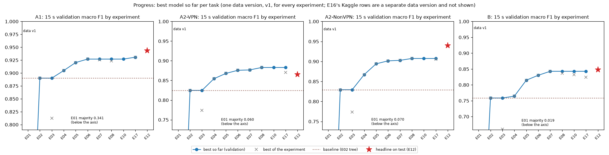
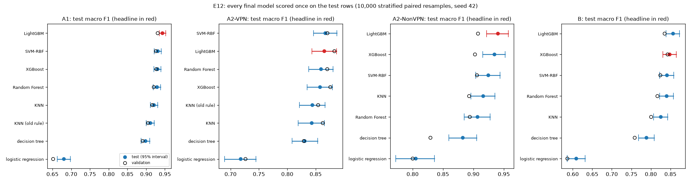
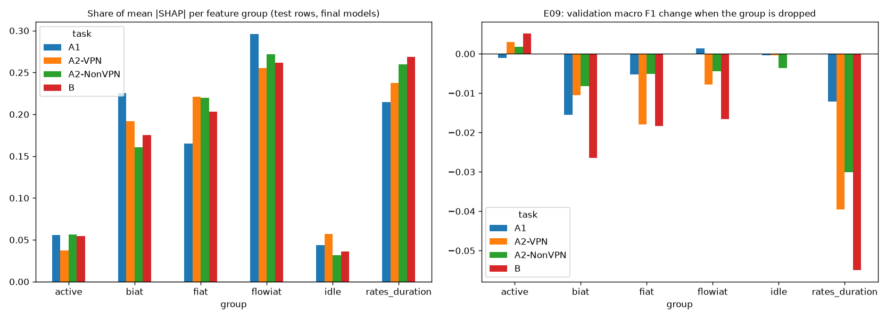

% Classifying Encrypted and VPN Traffic from Flow Timing Features: A Leakage-Safe Re-evaluation on ISCXVPN2016
% BlindSpy team
% Third-year AIML project. Code, data versions and run history: https://github.com/Varun-U-Pratap/BlindSpy

## Abstract

Encryption hides packet contents, but the timing of a connection still reveals what kind of
traffic it carries. We revisit the ISCXVPN2016 dataset and its three tasks: VPN against non-VPN
traffic (A1), the traffic type within VPN and within non-VPN traffic (A2, two separate 7-class
models), and all 14 classes at once (B), using only the 23 published flow timing features and
never the payload. A check of the published files shows that 9 of the 12 A1 and B files carry
column names shifted by one pair and that the A2 files hold a different pair of features; we
map every column from value identities that hold on 100% of rows before any model is built. We
then apply a leakage-safe protocol: exact duplicates removed before a stratified 70/15/15 split,
every choice made on training and validation rows, and the test set scored once, with 10,000
stratified paired bootstrap resamples and 26 Holm-corrected tests fixed in advance. Under the
original paper's protocol our C4.5 approximation and 1-NN reproduce its A1 results. Gradient-boosted
trees, with the same tuning budget given to every one of seven method types, reach a test macro
F1 of 0.9434 (A1), 0.8652 (A2, VPN), 0.9403 (A2, non-VPN) and 0.8480 (B). Isotonic calibration
(for two of the four tasks a change made after the test set was opened) brings the test expected
calibration error to 0.0090-0.0169 without changing any prediction. We
also reproduce a recent 88.01% result on a stacked copy of the dataset (0.8796) and show, with a
training-size control, that its gap to a single-timeout score comes from training-set size, not
from mixing flow timeouts. All results come from one tracked run history of 2,015 runs.

**Index Terms**—encrypted traffic classification, VPN detection, flow timing features,
ISCXVPN2016, gradient boosting, reproducibility, calibration, SHAP.

# Introduction

Most network traffic is now encrypted, so deep packet inspection, which classifies traffic by
reading packet contents, no longer works. Network operators still need to know what kind of
traffic a connection carries, for quality of service, access control and security monitoring,
and whether it passes through a VPN. Applications leave a timing pattern even when their
contents are hidden: a voice call sends small packets at a steady rhythm, video streaming
arrives in bursts, and a file transfer runs at full speed with almost no idle time.

Draper-Gil et al. [1] published the ISCXVPN2016 dataset [2] to study this question. Each flow is
described by 23 time-related statistics and a label, and the flows are published at four flow
timeouts (15, 30, 60 and 120 s). The timeout is a setting of the flow builder that closes an
inactive flow; it is not the duration of a flow. The paper defines three tasks, which we follow
and score separately: A1, a binary VPN / non-VPN classifier; A2, two separate 7-class
classifiers, one for VPN and one for non-VPN traffic (never merged into one score); and B, one
14-class classifier over both. The seven traffic types are browsing, chat, email, file transfer
(FT), P2P, streaming and VoIP. The paper used C4.5 [11] and KNN with 10-fold cross-validation.

Published scores on this dataset range from about 80% to 99%, but they are rarely comparable:
studies differ in the split, the class setup, whether duplicate rows are removed and whether
flows from different timeouts are mixed. This paper makes the following contributions:

1. A check of the published files that finds shifted column names in 9 of the 12 A1 and B files
   and a different feature pair in the A2 files, decided from value identities that hold on
   100% of rows (Section III).
2. A reproduction of the original C4.5 and KNN results under the paper's own protocol
   (Section V-A).
3. A leakage-safe protocol with a test set scored once, a fair comparison of seven method types
   with equal tuning budgets, and 26 paired tests fixed before the test set was opened
   (Sections IV and V).
4. A reproduction of a recent 88.01% result [13] and a control experiment that separates the
   effect of training-set size from the effect of mixing timeouts (Section V-G).
5. Analyses of calibration, stability, the amount of training data and feature use (SHAP and a
   feature-group ablation), and a predictor and demo that report a calibrated confidence and the
   features behind each prediction.

# Related Work

Draper-Gil et al. [1] introduced the time-related features and reported, at a 15 s timeout, A1
precision of 0.89 (VPN) and 0.906 (non-VPN) with C4.5, and an average precision of 0.783 (C4.5)
and 0.711 (KNN) for task B at the best timeout. Bagui et al. [12] compared several learners,
including Random Forest and gradient boosting, on the same features and reported about 90%; we
cite this result from the public abstract only. Jorgensen et al. [14] documented quality
problems in the dataset's captures, including readable HTML in a capture that should be
encrypted, VPN captures holding several connections, and ambiguous labels. Isnan et al. [13]
trained a 300-tree Random Forest on a public copy of the dataset with 59,706 rows, removed 18,719
duplicates, kept 40,987 rows and reported 88.01% accuracy for 14 classes on a single 80/20 split.

We found that this copy is the eight A2 files of all four timeouts stacked together: as a
multiset its 59,706 rows equal the rows of those files, and 7,093 distinct flows appear in two to
four timeout files while only 3,676 rows are duplicates within one file. Most of the removed
"duplicates" are therefore the same flows repeated across timeouts, and a random split of the
stacked file mixes the four flow-building settings in training and test data. Section V-G
measures what this does to the score.

# Dataset

## Source and format

ISCXVPN2016 was captured in 2016 in a lab, with and without a VPN, and turned into flows with
ISCXFlowMeter [1, 2]. It is published as 20 ARFF files: tasks A1 (4 files), A2 (4 VPN and 4
non-VPN files), B (4 files) and four 7-class "AllinOne" files that are not a task. Each row is
one flow with 23 numeric features (times in microseconds, rates per second) and a label; the
files hold no payload, addresses, ports, timestamps or capture identifiers. A1, A2 and B hold
the same flows at each timeout: every A1 row matches an A2 row on seven integer features (100%),
and B is identical to A1 cell for cell except for one corrupt column.

## Column names

The first row of the A1 15 s file has a duration of 9,368,711 µs but a "total forward gap" of
16 µs, which is impossible. The paper's feature table and the authors' poster [15] list the
forward and backward inter-arrival times (fiat, biat) as min, mean, max and standard deviation,
yet 17 of the 20 headers list total_fiat and total_biat and no standard deviation. We read every
file under both name lists and tested identities that hold for any traffic: min <= mean <= max,
0 <= std <= max - min, and mean flow gap x (packets - 1) = duration (within 1%), allowing 0.5%
for values that the files store to three significant figures.

Under the header names, min <= mean <= max holds on at most 0.02% of A1 and B rows; under names
shifted by one pair (the paper's order min, max, mean, std) every identity holds on 100% of rows.
The A2 files are named correctly but hold total_fiat and total_biat (the sum of the gaps) in
place of std_fiat and std_biat: their totals reproduce the packet count on 100% of rows, while
their std check holds on 0%. The reading of total_fiat as a packet count holds on at most 2% of
rows in any file and is ruled out. Each task therefore uses its own files, with a column map that
renames the 9 shifted files. One corrupt A1 120 s column (flowPktsPerSecond), which disagrees
with A2 on 99.97% of matched rows, is restored from the B file that is identical in every other
column; this changes 10,288 of 10,782 rows.

## Cleaning

Every rule is applied by one script and logged per file and per class, including rules that
change nothing. Exact duplicates (23 features and label) are removed within each file before
splitting, so no flow can be both trained on and scored. Of 179,120 raw lines in the 16 task
files, 2 comma-only lines are skipped and 11,209 duplicates removed, leaving 167,909 rows. Conflicting duplicates (same features, different label; 1,102 rows) are
kept, because removing them would make the test set easier than reality. The code -1 ("not
measurable": fewer than two packets in a direction, or no active or idle period), single-packet
flows and negative minimum gaps (out-of-order timestamps) are kept as they are. No
normalization, feature selection, outlier removal or class balancing is applied to the data
itself. Table I summarizes the 15 s files used by the final models.

[[wide]]
Table: Data at the 15 s timeout after cleaning (data version v1)

| Task | Raw rows | Duplicates removed | Final rows | Classes | Train / val / test |
|---|---|---|---|---|---|
| A1 | 18,758 | 720 | 18,038 | 2 | 12,626 / 2,706 / 2,706 |
| A2-VPN | 9,793 | 413 | 9,380 | 7 | 6,566 / 1,407 / 1,407 |
| A2-NonVPN | 8,965 | 271 | 8,694 | 7 | 6,085 / 1,304 / 1,305 |
| B | 18,758 | 684 | 18,074 | 14 | 12,651 / 2,711 / 2,712 |

# Method

## Protocol

For each task and timeout the cleaned data is split once into 70% training, 15% validation and
15% test rows, stratified by class, with seed 42. Hyperparameters are chosen by 5-fold stratified
cross-validation inside the training rows; models are compared on validation; scaling,
transforms and resampling are pipeline steps fitted on training folds only. The main metric is
macro F1, which weights every class equally. The final configuration of each task is retrained
on training and validation rows and scored once on its test rows. Every experiment states its
hypotheses and numeric pass/fail thresholds before it runs, and changes one thing against the
current best model.

## Models

We start from a majority-class floor, a decision tree with the entropy criterion (a C4.5
approximation, since scikit-learn [3] has no C4.5 pruning), KNN, logistic regression and an
RBF-kernel SVM, all at the four timeouts. Improvement experiments then add, at 15 s: a signed
log, sign(x) log(1 + |x|), before scaling for the distance-based models, which keeps -1 apart
from 0 and is defined for negative gaps; a 300-tree Random Forest; XGBoost [4] and LightGBM [5]
with default settings; Optuna [7] tuning with the TPE sampler, 50 trials per search and the same
budget for every method type; class balancing with class weights, random oversampling or SMOTE
[9, 10]; and a two-step model for task B (VPN / non-VPN first, then one 7-class model per
group). A model that beat the current best at 15 s by at least 0.03, above the largest
cross-validation standard deviation of the baselines (0.025), was rerun at the other timeouts.

## Final choice and comparison set

The final model of each task is the configuration with the highest validation macro F1. A rule
set earlier would have broken gaps below 0.03 in favor of a simpler model, but the measured
cross-validation standard deviation of the chosen models (0.0028-0.0058) is far below 0.03; the
change was made before the test set was opened, and the old rule's picks were scored as well.
Before the test set was opened we also fixed a comparison set: per task the best validation
variant of each of seven method types (decision tree, KNN, logistic regression, SVM, Random
Forest, XGBoost, LightGBM).

## Statistics and calibration

Intervals are 95% percentile intervals from 10,000 stratified paired bootstrap resamples of the
test rows [18] (rows drawn within each true class, seed 42), so they are conditional on the test
set's class counts. Exactly 26 differences in macro F1 were fixed in advance: per task the final
model against the six other method types, plus the old rule's pick in A1 and A2-VPN. Each is a
two-sided paired bootstrap test, Holm-corrected [17] over all 26 at 0.05. With 1,000 resamples
the smallest possible p-value (0.0020) would exceed Holm's first threshold (0.05 / 26 = 0.0019),
so 10,000 are needed. Calibration is measured by the expected calibration error (ECE) with 15
equal-width bins [20, 21]. Isotonic calibration [19] is learned from shuffled 5-fold out-of-fold
predictions on the rows the model is fitted on; the predicted class always stays the uncalibrated model's, so calibration
changes only the reported confidence.

## Reproducibility

Every run is logged to MLflow [8] with its commit, dependency lock hash, data version and hash,
settings, metrics, timing and trained model, and official runs are refused unless the code is
committed and pushed. A fresh clone of the repository reproduced the final scores, predictions
and calibration errors exactly. Feature use is explained with SHAP [6]. A command-line predictor
and a Streamlit [23] demo apply the four final models to a new flow file, report the label, its
calibrated confidence and the features behind it, and reject a malformed file.

# Results

[[wide]]

## Reproducing the original paper

Under the paper's protocol (10-fold cross-validation on the full files, Weka defaults [16]) our
C4.5 approximation matches all 16 A1 precision and recall values of the paper within 0.05, and
1-NN matches 15 of 16. Contrary to our hypothesis, removing duplicates did not lower these
scores: the removed rows are near-empty flows (median 0-2 packets), and 39-92% of them have a
twin with the same features and another label, so keeping them adds errors no model can avoid.

[[wide]]

## Model development on validation

Table II follows the best 15 s validation macro F1 through the experiments. A 300-tree Random
Forest added +0.0302 to +0.0647 over the tree; default gradient boosting added a little more. The
signed log lifted KNN by 0.080-0.104 in every task, and was chosen by every logistic regression
and SVM search that could use it. Equal tuning added at most +0.0151 to an ensemble but lifted
the SVM by +0.3243 to +0.5277, to within 0.0017-0.0186 of each task's best. Class balancing
moved macro F1 by at most 0.0064, and the two-step model for task B scored 0.8318 against 0.8428
for the direct model, with more errors across the VPN line (191 against 180). Fig. 1 shows the
progress per task.

Table: Best 15 s validation macro F1 after each step (majority-class floor: 0.341, 0.060, 0.070, 0.019)

| Step | A1 | A2-VPN | A2-NonVPN | B |
|---|---|---|---|---|
| Decision tree | 0.8901 | 0.8247 | 0.8294 | 0.7585 |
| KNN with signed log | 0.9048 | 0.8544 | 0.8670 | 0.7644 |
| Random Forest | 0.9203 | 0.8679 | 0.8941 | 0.8147 |
| XGBoost, default | 0.9271 | 0.8758 | 0.9015 | 0.8303 |
| Final choice | 0.9308 | 0.8830 | 0.9075 | 0.8428 |

## Final test scores

Table III gives the final models on the test rows (their validation scores are the last row of
Table II). Three tasks score above validation and one below. One pre-stated check failed: the A2-NonVPN test score is 0.0328 above validation, more
than the 0.03 we allowed. A split-seed experiment run before the test set was opened had already
shown that its official validation rows are harder than any of 10 resplits (0.9075 against
0.9257-0.9468). The two other checks held: the final model scored above the old rule's pick in
all four tasks, and the order of the seven method types by test score followed their order by
validation score (Spearman [22] 0.9643, 0.8214, 0.9286 and 0.9643).

Table: Final models on the test rows (macro F1 with 95% interval; Acc. = accuracy; ECE after calibration)

| Task | Model | Test F1 | 95% interval | Acc. | ECE |
|---|---|---|---|---|---|
| A1 | LightGBM, tuned | 0.9434 | 0.9348-0.9519 | 0.9435 | 0.0090 |
| A2-VPN | LightGBM, class weights | 0.8652 | 0.8431-0.8866 | 0.8955 | 0.0169 |
| A2-NonVPN | LightGBM, oversampling | 0.9403 | 0.9216-0.9573 | 0.9609 | 0.0132 |
| B | XGBoost, tuned | 0.8480 | 0.8305-0.8651 | 0.8798 | 0.0158 |

The voice classes are the easiest (VPN-VOIP F1 0.9941, VOIP 0.9964 and 0.9917), and the weakest
are VPN-MAIL (0.7132 in A2-VPN, 0.7259 in B) and STREAMING in A2-NonVPN (0.8955). In task B the
largest confusion is BROWSING predicted as VPN-BROWSING (28 flows) and the reverse (17), and
55.05% of the direct model's validation errors cross the VPN line: separating VPN from non-VPN is
the hard part of B.

## Comparison of method types

Table IV and Fig. 2 give every member of the comparison set on the same test rows. Of the 26
pre-stated tests, 14 are clear after Holm correction. The final model is clearly better than
logistic regression in every task and than the decision tree in A1, A2-NonVPN and B, but it is
not clearly different from the tuned SVM in any task, nor from XGBoost or LightGBM except A1
against XGBoost. Two comparison models scored slightly higher on test, neither clearly: the
A2-VPN SVM (0.8670) and the B LightGBM (0.8567); nothing was swapped after the test set was
seen. Two tests sit on the Holm line (Holm p 0.0504, Monte Carlo band about 0.03-0.07) and count
as not clear. The old rule's picks scored 0.0322 (A1, clear), 0.0211, 0.0242 (clear) and 0.0069
below the final models.

Table: Test macro F1 of the seven method types (bold: final model)

| Task | Tree | KNN | LogReg | SVM | RF | XGB | LGBM |
|---|---|---|---|---|---|---|---|
| A1 | 0.8982 | 0.9208 | 0.6804 | 0.9311 | 0.9289 | 0.9304 | **0.9434** |
| A2-VPN | 0.8308 | 0.8431 | 0.7179 | 0.8670 | 0.8594 | 0.8577 | **0.8652** |
| A2-NonVPN | 0.8825 | 0.9160 | 0.8053 | 0.9244 | 0.9067 | 0.9346 | **0.9403** |
| B | 0.7886 | 0.8253 | 0.6089 | 0.8411 | 0.8403 | **0.8480** | 0.8567 |

## Calibration, stability and training size

All four final models were overconfident on validation. A rule fixed before the test set adopted
isotonic calibration where the uncalibrated validation ECE exceeded 0.05 (A1 and A2-VPN). After
the test set had been opened, the team calibrated A2-NonVPN and B in the same way as well; this
is a post-hoc change, it changed no label or score, and the raw values stay reported (Table V).
Across 10 resplits of training and validation rows the validation macro F1 of the final
configurations varies with a standard deviation of 0.0042-0.0114. The learning curve still rises
between 80% and 100% of the training rows in every task, most in B (0.8297 to 0.8428), so more
data would probably help.

Table: Expected calibration error, uncalibrated and isotonic

| Task | Val ECE raw | Val ECE isotonic | Test ECE raw | Test ECE used | Decided |
|---|---|---|---|---|---|
| A1 | 0.0552 | 0.0140 | 0.0442 | 0.0090 | before test |
| A2-VPN | 0.0714 | 0.0168 | 0.0709 | 0.0169 | before test |
| A2-NonVPN | 0.0444 | 0.0152 | 0.0339 | 0.0132 | after test |
| B | 0.0350 | 0.0099 | 0.0420 | 0.0158 | after test |

## What the models use

SHAP values of the final models on the test rows and a feature-group ablation on validation
answer two different questions: which features a model uses, and which it cannot do without
(Fig. 3). The byte rate is the most used feature in A2-VPN, A2-NonVPN and B, and the smallest
gaps between packets are in the top five of every task. Rates and duration hold 21.4-26.9% of
mean |SHAP|, and dropping them costs the most in A2-VPN, A2-NonVPN and B (0.0395, 0.0301 and
0.0549); in A1 dropping the backward gaps costs more (0.0155 against 0.0122). Active and idle
times matter least (3.1-5.7% of mean |SHAP|; dropping either group changes macro F1 by -0.0036 to
+0.0051). A timing-only model without the byte rate loses 0.015-0.044, so the models read no
payload but do use the amount of data per second.

[[wide]]

## Reproducing and correcting a published result

On the stacked copy used by Isnan et al. [13], with their deduplication, 80/20 split and grid
search, a Random Forest reaches 0.8796 accuracy against their 0.8801 (Table VI). Keeping the
timeouts apart lowers the same method to 0.8206-0.8658 (mean 0.8430). Stacking the four files
gives 2.3-4.3 times as many training rows, so we trained the mixed-timeout forest on training
sets cut to each per-timeout size: it then scores 0.8395 on average, no higher than the
per-timeout models. The gap therefore comes from training-set size, not from the mixing itself;
the result is still not comparable with a single-timeout score. Our tuned task-B XGBoost beats
the forest at every timeout (mean 0.8647).

Table: Reproduction of Isnan et al. on the stacked copy (test accuracy, 14 classes)

| Setup | Training rows | Accuracy |
|---|---|---|
| Isnan et al., published | 32,789 | 0.8801 |
| Their setup, our run | 32,789 | 0.8796 |
| Same forest, per timeout (mean) | 7,671-14,459 | 0.8430 |
| Mixed, cut to per-timeout size (mean) | 7,671-14,459 | 0.8395 |
| Our XGBoost, per timeout (mean) | 7,671-14,459 | 0.8647 |

# Discussion

Most of the gain over the paper's algorithms comes from ensembles and boosting, while tuning
mattered mainly for the SVM, which went from one of the weakest models to one of the strongest.
Choosing by the highest validation score instead of a fixed tie margin did not cost anything on
the test rows and gained a clear margin in two tasks. Class balancing and a two-step task-B model
did not help: the weak classes appear weak not because they are small but because their flows
look like those of other classes, and the two-step model inherits the hardest decision, VPN or
not, as its first step. The most confident errors come from a byte rate typical of another class
(for example a VPN-P2P flow predicted as VPN-FT with confidence 0.9916), so a calibrated
confidence is useful on average but does not prove an individual prediction right.

# Limitations

The data were captured in a lab in 2016 with specific applications and one VPN setup, and the
captures have documented quality problems [14]; label errors in the source are errors in our
training and test rows alike. The files carry no session or capture identifiers, so a
session-aware split was impossible. Holding out contiguous blocks of the file-ordered training
rows instead of shuffled rows lowers out-of-fold accuracy by 0.07-0.26, which suggests that
neighboring flows, probably from the same capture, resemble each other; random-split scores may
therefore be optimistic for traffic from new captures. The 60 s files hold different VoIP and
file-transfer flows from the other timeouts, and the class mix changes with the timeout, so
score differences between timeouts are not read as a timeout effect. The tree is only an
approximation of C4.5. Two deviations from rules set in advance are reported as such: the final
choice by the highest validation score, made before the test set was opened, and the post-hoc
calibration of A2-NonVPN and B, which used their test rows a second time for confidence only.
Every interval is conditional on the test set's class counts, two of the 26 tests are
borderline, and one test set is one sample.

# Conclusion

Using only 23 timing statistics per flow, gradient-boosted trees classify ISCXVPN2016 traffic
with test macro F1 of 0.9434 (VPN or not), 0.8652 and 0.9403 (traffic type within VPN and
non-VPN traffic) and 0.8480 (14 classes), each with a 95% interval, on a protocol that removes
duplicates before splitting and scores the test set once. Getting there required fixing the
column names of most published files, and comparing with earlier work required reproducing it
under its own protocol. These results hold for this dataset only: a session-aware split on data
with capture identifiers, and a test on traffic captured independently of ISCXVPN2016, are the
next steps before any of these models is used on a real network. The code, the data versions,
every run and every decision are kept in the project repository.
