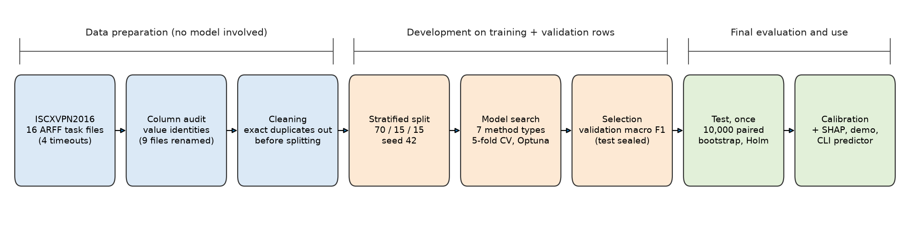
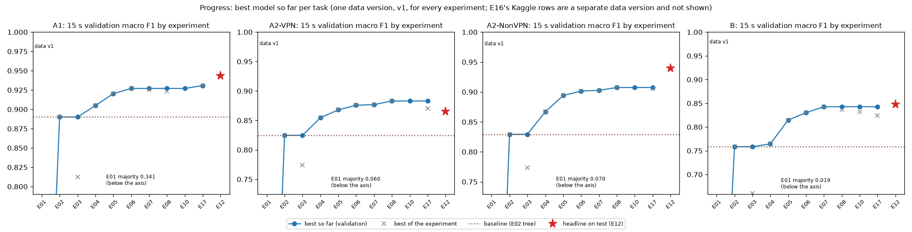
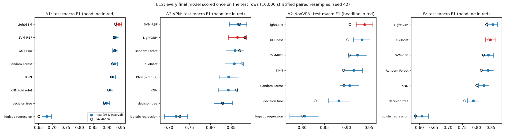
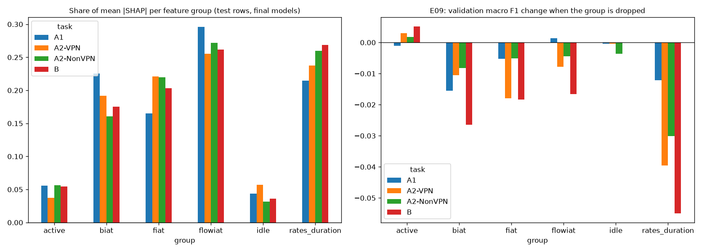

% VPN Detection and Encrypted Traffic Classification Using Flow Timing Features
% [Author 1], [Author 2], [Author 3], [Author 4]
% [Department], [Institution], [City], [Country]. Corresponding author: [e-mail].

## Abstract

Payload inspection fails once traffic is encrypted, yet the rhythm of a connection, its gaps,
bursts and rates, still carries information about the application behind it. ISCXVPN2016 is one of
the most widely used public benchmarks for this idea, but reported accuracies on it span roughly
80-99% and are seldom comparable. We audit the benchmark and re-evaluate it under a protocol
designed to prevent leakage. The audit shows that 9 of the 12 published A1 and B attribute files
label their inter-arrival columns one position off, and that the A2 files store total gaps where
standard deviations are declared; both findings follow from arithmetic identities that hold on
every row. After removing exact duplicates ahead of a class-stratified 70/15/15 partition, we compare seven
model families with an equal tuning budget, freeze all choices on validation data, and open the
test partition once. Gradient-boosted trees using only the 23 timing statistics obtain test
macro F1 scores of 0.9434 (VPN vs. non-VPN), 0.8652 and 0.9403 (seven application types inside
VPN and non-VPN traffic), and 0.8480 when all 14 classes are predicted jointly, each with a 95% stratified bootstrap
interval. Of 26 pairwise comparisons declared in advance, 14 remain significant after Holm
correction; no task shows a significant
difference between the best model and a tuned RBF-kernel SVM. After isotonic calibration, the expected calibration error on the test data falls to
between 0.0090 and 0.0169, and no label changes. Finally, we show that a recently reported 88.01% accuracy is
obtained on a file that stacks four flow-timeout versions of the same traffic, and that its
advantage comes from the larger training set rather than from the mixing. We release the code, every
data version, the 2,015 tracked runs and a working demonstrator.

**Keywords**—VPN detection, encrypted traffic, ISCXVPN2016, flow statistics, data leakage,
boosted trees, calibration, reproducible machine learning.

# Introduction

Network operators classify traffic to enforce quality-of-service policies, to apply access
rules and to spot misuse. For two decades the dependable way to do so was deep packet
inspection, which matches signatures in packet contents. Transport encryption and VPN tunnelling
have removed most of that visibility: the payload is opaque, and inside a tunnel even the
original ports and addresses disappear. Only the timing of a flow stays visible.
An interactive voice call produces small packets at a near-constant cadence; a video player
fetches content in bursts separated by pauses; a bulk download saturates the link with almost no
idle periods. We ask whether these patterns identify the traffic type, and whether they still
reveal that a VPN is in use.

Draper-Gil et al. [1] made the question measurable by releasing ISCXVPN2016 [2]. Every flow in
it is summarized by 23 time-related statistics, and the same traffic was exported four times,
using a flow timeout of 15 s, 30 s, 60 s or 120 s (a timeout ends an idle flow; it does not set a flow's
length). Three tasks are defined on the release, and we keep them separate throughout: A1 decides whether a
flow is tunnelled; A2 assigns one of seven application types (browsing, chat, e-mail, file
transfer, P2P, streaming and VoIP), with one model for VPN flows and another for non-VPN flows;
and B predicts all 14 combinations in a single step. The original study used C4.5 and k-nearest
neighbours under 10-fold cross-validation.

Since then the dataset has become a default benchmark, but results are hard to compare. Studies
differ in which files they load, in whether duplicate rows survive into both training and test
partitions, in the class grouping they score and in whether flows produced with different
timeouts are pooled. Each of these choices can raise a headline number without any real gain in
generalization. Arp et al. [29] list such choices among the common pitfalls of machine learning
in security, and Kapoor and Narayanan [30] report the same problem across empirical science.

We make five contributions:

1. An audit of the released attribute files showing column names displaced by one attribute pair
   in nine of the twelve A1/B files and a substituted feature pair in all A2 files, with every correction
   backed by arithmetic relations that every row satisfies (Section III-A).
2. A re-run of the original C4.5 and nearest-neighbour experiments under the published
   set-up, which anchors our later numbers to the published ones (Section IV-A).
3. A leakage-controlled benchmark: deduplication before splitting, an equal hyperparameter
   budget for seven model families, a single opening of the test partition, bootstrap
   intervals, and 26 Holm-corrected comparisons declared before testing (Sections III and IV).
4. A reproduction and correction of a recent 88.01% result, with a control experiment that
   separates training-set size from timeout mixing (Section IV-G).
5. Analyses of calibration, stability, data volume and feature reliance, plus a released terminal
   tool and an interactive demonstrator that state, for every flow, a calibrated confidence and
   the attributes that drove the decision (Section IV-H).

The rest of the paper reviews related work (Section II), details the methodology (Section III),
reports and discusses the results (Section IV) and concludes (Section V).

# Related Work

## Statistical flow features on ISCXVPN2016

The benchmark was introduced together with ISCXFlowMeter and a feature set built only from
timing: forward, backward and bidirectional inter-arrival statistics, active and idle periods,
duration, and byte and packet rates [1]. At the 15 s timeout the authors reported C4.5
precision of 0.89 for VPN and 0.906 for non-VPN flows, found that shorter timeouts tended to help,
and obtained an average precision near 0.783 with C4.5 and 0.711 with KNN on the 14-class task. The
same group later applied time-based features to anonymity traffic in ISCXTor2016 [28]. Bagui et
al. [12] compared a broader set of supervised learners, including ensembles, on the VPN timing
features. Isnan et al. [13] recently fitted a Random Forest of 300 trees to a public CSV derived from
the benchmark (59,706 rows, of which 18,719 were dropped as duplicates) and reported 88.01%
accuracy over 14 classes on a single random 80:20 partition, then linked the classifier to firewall rules for
access control. Section IV-G re-examines that CSV.

## Packet-level and deep models

A second line of work abandons summary statistics and learns from packet bytes or packet
sequences. Wang et al. [25] applied one-dimensional convolutional networks to raw traffic of
the ISCX VPN-nonVPN captures, Deep Packet [24] combined stacked autoencoders and convolutional
networks on packet contents, and ET-BERT [26] pre-trained a transformer on large unlabelled
traffic corpora before fine-tuning on benchmarks that include this one. Rezaei and Liu [27]
survey these architectures. Such models often report very high accuracy, but they see
information, including bytes inside the first packets, that a timing-only model never touches,
so their scores are not a fair yardstick for flow-statistics classifiers, and we do not
compare against them numerically.

## Dataset quality and evaluation practice

Jorgensen et al. [14] inspected the ISCXVPN2016 captures themselves and found readable HTML in a
capture labelled as VPN traffic, VPN captures that hold several connections to ordinary service
addresses, and labels that are hard to reconcile with the recorded activity. Engelen et al. [31]
documented comparable flow-construction and labelling defects in CICIDS2017, another dataset
produced with the same family of flow meters. More generally, Arp et al. [29] list data snooping,
sampling bias and inappropriate baselines among the most frequent flaws in security machine
learning, and Kapoor and Narayanan [30] show that leakage between training and evaluation data is
a leading cause of irreproducible results. Our protocol is built around these warnings: the file
audit addresses label and column integrity, deduplication before the split removes the most
direct form of leakage, and the frozen test partition with pre-declared tests limits data
snooping.

# Methodology

[[wide]]

Fig. 1 summarizes the pipeline. All steps are implemented in Python with scikit-learn [3],
XGBoost [4], LightGBM [5], imbalanced-learn [9] and Optuna [7], and every run is tracked in MLflow
[8].

## Column audit

A plausibility check exposed the first problem. The opening record of the A1 15 s file lists a
duration of 9,368,711 µs together with a total forward gap of only 16 µs, which cannot both be
true. The original paper and the authors' poster [15] describe each gap family by its minimum,
mean, maximum and standard deviation, whereas 17 of the 20 file headers announce a total and no
standard deviation.

We parsed each file under both candidate name orders and tested relations that every
genuine flow must satisfy: minimum ≤ mean ≤ maximum; 0 ≤ standard deviation ≤ maximum − minimum;
and mean bidirectional gap × (packets − 1) ≈ duration within 1%, with a 0.5% allowance for values
stored to three significant figures. Read with the header names, the ordering relation is satisfied by
no more than 0.02% of A1 and B rows. Read one attribute pair later, in the order min, max, mean, std
used by the paper, every relation holds for 100% of rows. The A2 headers are in the right order,
but the two columns declared as standard deviations of the forward and backward gaps contain
sums: together with the mean gaps they reproduce the packet count on every row, while the
standard-deviation bound holds on none. Interpreting a total as a packet count instead fits no file on
more than 2% of its rows, so that reading was rejected. Each task is trained on its own files
through an explicit column map, and the nine shifted files are renamed. In the A1 120 s file the
packet-rate column disagrees with the matching A2 rows on 99.97% of pairs; we restore it from the
B file, which is otherwise identical, changing 10,288 of 10,782 values.

## Cleaning

A single script applies every rule and records, for each file and each class, how many rows it touched,
even when the answer is zero. Records that repeat all 23 attributes and the label are dropped within each
file before any split, so an identical flow cannot sit on both sides of the evaluation boundary.
Across the 16 task files this removes 11,209 of 179,120 raw lines (plus 2 lines containing only
commas), leaving 167,909 records. Records that share all attributes but carry different labels
(1,102 rows) are deliberately kept, since deleting them would make the test partition easier than
real traffic. The sentinel −1, which the flow meter writes when a statistic cannot be computed,
is preserved, as are single-packet flows and negative minimum gaps caused by out-of-order
timestamps. No scaling, feature selection, outlier filtering or resampling is applied to the
stored data.

## Evaluation protocol

Each task and timeout is split once, stratified by class with seed 42, into training, validation and
test records in proportions 0.70, 0.15 and 0.15. Hyperparameters are searched by stratified five-fold
cross-validation on the training records; candidate models are ranked on validation records; and
every scaler, transform and resampler sits inside the model pipeline so that it is fitted on
training folds only. Macro-averaged F1 is the primary metric because it weights the rare classes
(for example VPN-MAIL) as heavily as the frequent ones. The selected configuration is refitted on
training plus validation records and applied once to the test records. Before each experiment
the team recorded its hypothesis and a numeric acceptance threshold, and each experiment altered
a single factor relative to the current best model.

## Models and tuning

Baselines comprise a majority-class predictor, an entropy-criterion decision tree (scikit-learn
offers no C4.5 pruning, so this is an approximation of C4.5 [11]), KNN, logistic regression and
an SVM with an RBF kernel, each trained at every timeout. Subsequent experiments at 15 s added, in order: a
signed logarithm sign(x)·log(1+|x|) ahead of scaling for distance-based models, which keeps the
−1 sentinel distinct from zero and accepts negative gaps; a Random Forest with 300 trees; XGBoost and
LightGBM with library defaults; Tree-structured Parzen Estimator search with 50 trials per model
family, an identical budget for all seven families; class weighting, random oversampling and
SMOTE [10]; and a hierarchical variant of task B that first decides VPN versus non-VPN and then
applies one seven-class model per branch. A configuration was re-run at the other timeouts only
if it improved the 15 s validation score by at least 0.03, a margin above the largest
standard deviation any baseline showed in cross-validation (at most 0.025).

## Model selection and comparison set

For every task we keep, as the headline model, whichever configuration achieved the best
validation macro F1. An
earlier rule would have preferred a simpler model whenever the gap to the best was below 0.03;
it was replaced before testing because the cross-validation spread of the leading models was
only 0.0028-0.0058, and the models the old rule would have chosen were evaluated on the test set
as well. Also before testing, we fixed a comparison set containing, for every task, the best
validation variant from each of seven families (single tree, nearest neighbours, logistic
regression, SVM, Random Forest, XGBoost and LightGBM).

## Statistical testing and calibration

Confidence intervals are 2.5th-97.5th percentiles over 10,000 stratified bootstrap resamples of
the test records [18], drawn within each true class with seed 42, so the intervals treat the
test class counts as fixed. Exactly 26 macro-F1 differences were declared before
testing: in each task, the headline model against the six other families, plus, for A1 and A2-VPN only, the
model the abandoned tie rule would have picked. Each difference is assessed with a two-sided paired bootstrap test and
the 26 p-values are corrected with Holm's procedure [17] at α = 0.05. The resample count matters
here: with 1,000 draws the smallest attainable p-value (0.0020) already exceeds Holm's first
threshold, which is 0.05 divided by 26, about 0.0019.

Calibration is measured with the expected calibration error (ECE) over 15 equal-width bins
[20, 21]. Isotonic regression [19] is fitted on out-of-fold scores from a shuffled five-fold
split of the model's fitting records. The class label is always taken from the uncalibrated
model, so calibration can only change the reported confidence, never the prediction.

## Implementation, reproducibility and demonstrator

Each run records the git commit, a hash of the locked dependency file, the data version with
its digest, all parameters and metrics, timings and the fitted model; the tracking script will
not start an official run from code that has not been pushed to the shared repository. The final store holds 2,015 runs. A fresh clone on the
original platform (macOS, Apple silicon) gave back identical test scores, identical per-flow predictions
and identical calibration errors. Feature reliance is analysed with SHAP [6] and with group ablation. For
deployment we supply a terminal tool and a browser application built with Streamlit [23]; both load the
four final models after checking their SHA-256 digests, validate the 23 input columns, and return
for every flow the label, a calibrated confidence and the three attributes that pushed the model
hardest towards that label. A converter turns a user's own packet capture into the same 23
attributes; on the dataset's own captures it reproduces all 23 values for 94.9% of the flows with
at least three packets whose duration also appears in the A2 15 s file.

# Results and Discussion

## Agreement with the original study

Using the published set-up (10-fold cross-validation over the released rows, with Weka [16]
defaults approximated), our tree matches each of the 16 A1 precision and recall figures reported by
Draper-Gil et al. [1] within ±0.05, with the largest gap 0.021, and 1-NN reproduces 15 of 16. For
the 14-class task our tree reaches a mean precision of 0.770 at the best timeout against the
published 0.783, and 1-NN reaches 0.710 against 0.711. We expected deduplication to lower these
cross-validated scores; it did not. Most removed rows describe flows whose median size is zero to
two packets, and between 39% and 92% of them, depending on the file, share every attribute with a
row of another class. Retaining such rows injects mistakes that timing alone can never resolve,
which roughly offsets what leakage would have added.

[[wide]]

## Model development on validation data

Table I and Fig. 2 trace the best 15 s validation score through the experiments. A forest of 300 trees
beat the single tree by +0.0302 to +0.0647 depending on the task, and
default gradient boosting added a further small gain. The signed logarithm raised KNN by 0.080
to 0.104 in every task and was the preferred transform in all logistic-regression and SVM searches
that were allowed to use it. Under the equal tuning budget, ensembles improved by at most 0.0151, whereas the SVM
gained 0.3243 to 0.5277 and finished within 0.0017-0.0186 of the best model of each task. Class
rebalancing never moved macro F1 by more than 0.0064. The hierarchical task-B model reached 0.8318,
below the 0.8428 of the direct model, and made more errors across the VPN boundary (191 against
180 validation flows).

Table: Validation macro F1 at the 15 s timeout as development progressed (a majority-class predictor scores 0.341, 0.060, 0.070 and 0.019)

| Step | A1 | A2-VPN | A2-NonVPN | B |
|---|---|---|---|---|
| Decision tree | 0.8901 | 0.8247 | 0.8294 | 0.7585 |
| KNN, signed log | 0.9048 | 0.8544 | 0.8670 | 0.7644 |
| Random Forest | 0.9203 | 0.8679 | 0.8941 | 0.8147 |
| XGBoost, default | 0.9271 | 0.8758 | 0.9015 | 0.8303 |
| Final choice | 0.9308 | 0.8830 | 0.9075 | 0.8428 |

## Test performance of the final models

Table II reports the four headline models on their test partitions. Three tasks score above
their validation estimate and one below. One of the three pre-declared checks failed, for
A2-NonVPN, whose test score exceeds validation by 0.0328, slightly beyond the 0.03 tolerance. A
re-splitting experiment run before testing had already shown that this task's official
validation partition is unusually hard (0.9075 against 0.9257-0.9468 over ten re-splits), which
explains the gap. The other two checks passed: each headline model beat the old rule's choice in
all four tasks, and the ranking of the seven families on test agreed with their validation
ranking (Spearman's ρ [22] of 0.9643, 0.8214, 0.9286 and 0.9643).

Table: Final models on the test partition (macro F1 with 95% bootstrap interval, accuracy, and ECE of the reported confidence)

| Task | Model | Test macro F1 | 95% interval | Accuracy | ECE |
|---|---|---|---|---|---|
| A1 | LightGBM, tuned | 0.9434 | 0.9348-0.9519 | 0.9435 | 0.0090 |
| A2-VPN | LightGBM, class weights | 0.8652 | 0.8431-0.8866 | 0.8955 | 0.0169 |
| A2-NonVPN | LightGBM, oversampling | 0.9403 | 0.9216-0.9573 | 0.9609 | 0.0132 |
| B | XGBoost, tuned | 0.8480 | 0.8305-0.8651 | 0.8798 | 0.0158 |

Voice traffic is the easiest category (F1 of 0.9941 for VPN-VOIP in A2-VPN; 0.9964 and 0.9917
for VOIP in A2-NonVPN and B). The weakest classes are e-mail over VPN, with F1 of 0.7132 (A2-VPN)
and 0.7259 (B), and non-VPN streaming at 0.8955 (A2-NonVPN). Within the joint task the commonest
mistake turns plain browsing into VPN browsing (28 test flows), with 17 flows mislabelled the
opposite way, and on validation 55.05% of the direct model's errors put a flow on the wrong side
of the VPN/non-VPN divide. In the joint task, telling whether a browsing flow was
tunnelled is harder than recognising it as browsing.

[[wide]]

## Comparison of model families

Table III and Fig. 3 evaluate all comparison-set models on identical test records. After Holm
correction, 14 of the 26 pre-declared differences are significant. Logistic regression is beaten
significantly in all four tasks, and the decision tree in three of them (every task except
A2-VPN). Against the tuned SVM no task shows a significant gap, and among the remaining ensembles
only XGBoost in A1 trails the headline model significantly. Two comparison models scored
marginally higher on test, namely the SVM for A2-VPN (0.8670) and LightGBM for task B (0.8567), neither
significantly; the headline choice was not revised after testing. Two tests lie on the Holm
threshold (adjusted p = 0.0504, Monte Carlo band roughly 0.03-0.07) and are counted as not
significant. Relative to the choices of the abandoned tie rule, the headline models scored higher
by 0.0322 (A1, significant), 0.0211 (A2-VPN), 0.0242 (A2-NonVPN, significant) and 0.0069 (B).

Table: Test macro F1 of the best variant of each model family (bold: headline model)

| Task | Tree | KNN | LogReg | SVM | RF | XGB | LGBM |
|---|---|---|---|---|---|---|---|
| A1 | 0.8982 | 0.9208 | 0.6804 | 0.9311 | 0.9289 | 0.9304 | **0.9434** |
| A2-VPN | 0.8308 | 0.8431 | 0.7179 | 0.8670 | 0.8594 | 0.8577 | **0.8652** |
| A2-NonVPN | 0.8825 | 0.9160 | 0.8053 | 0.9244 | 0.9067 | 0.9346 | **0.9403** |
| B | 0.7886 | 0.8253 | 0.6089 | 0.8411 | 0.8403 | **0.8480** | 0.8567 |

With equal tuning, several nonlinear families end up within about two macro-F1 points of each
other, and most of the remaining differences fall inside the bootstrap noise. Most of the improvement over the original C4.5 and KNN comes from ensembling and
boosting, while tuning mattered chiefly for the SVM, which rose from near the bottom of the
ranking to near the top. Neither rebalancing nor the hierarchical task-B design paid off: the weak
classes are weak not because they are rare but because their flows resemble those of other
classes, and the hierarchical model places the hardest decision, VPN or not, at its first
stage, where an error cannot be recovered.

## Calibration, stability and training-set size

On validation data every headline model reported higher confidence than its accuracy justified. A rule fixed before testing
applied isotonic calibration only where the raw validation ECE exceeded 0.05, so only A1
and A2-VPN qualified. Once the test partition had been opened, the team extended the same calibration to
A2-NonVPN and B, whose mean test confidence (0.9942 and 0.9213) clearly exceeded their accuracy.
This is a post-hoc decision; it left every label and F1 score unchanged, and both the raw and the
calibrated values are reported in Table IV.

Table: Expected calibration error before and after isotonic calibration

| Task | Validation, raw | Validation, isotonic | Test, raw | Test, reported | Decision |
|---|---|---|---|---|---|
| A1 | 0.0552 | 0.0140 | 0.0442 | 0.0090 | before test |
| A2-VPN | 0.0714 | 0.0168 | 0.0709 | 0.0169 | before test |
| A2-NonVPN | 0.0444 | 0.0152 | 0.0339 | 0.0132 | after test |
| B | 0.0350 | 0.0099 | 0.0420 | 0.0158 | after test |

Re-splitting the training and validation records ten times changes the validation macro F1 of
the chosen setups with a standard deviation of 0.0042-0.0114, so the ranking in Table III
is not an artefact of one split. The learning curves still climb from 80% to the full set of
training records in every task, most steeply in B (0.8297 to 0.8428), which suggests that more
labelled traffic would still pay off.

## Which timing evidence the models use

SHAP attributions on the test records and group ablation on validation answer different
questions, namely what a model relies on and what it cannot do without (Fig. 4). The byte rate
dominates the attributions for both A2 tasks and for B, while minimum inter-arrival gaps appear
among the five strongest attributes in each task. The rate and duration group carry 21.4-26.9% of the mean
absolute SHAP value, and deleting that group produces the largest ablation losses: 0.0395 for
A2-VPN, 0.0301 for A2-NonVPN and 0.0549 for B. A1 behaves differently, losing 0.0155 without the
backward gaps but only 0.0122 without rates and duration. The active- and idle-period groups
contribute least, with 3.1-5.7% of mean |SHAP|, and deleting either one changes macro F1 by no more
than −0.0036 to +0.0051. A model restricted to gap statistics, without the byte rate, loses 0.015 to
0.044. The classifiers thus never read payload, but they do exploit how much data a flow moves per
second, and that volume signal is what produces the most confident mistakes: the most confident
task-B error is a VPN-P2P flow labelled VPN-FT with a calibrated confidence of 0.9916, driven by a
byte rate typical of file transfer. A well-calibrated confidence is informative on average, but
it does not certify any single decision.

[[wide]]

## Re-examining a recent 88.01% result

The public CSV used by Isnan et al. [13] is all eight A2 files, covering every timeout,
concatenated: as a multiset, its 59,706 rows are exactly the rows of those files. Of these,
7,093 distinct flows recur across two, three or four timeout exports, against just 3,676 rows that
repeat inside one file. So most of the 18,719 removed "duplicates" are one flow exported at
different timeouts, and splitting the combined file at random places versions of one flow, built
with different flow-meter settings, on both sides of the split.

Repeating their duplicate removal, their 80:20 partition and their grid search, our Random Forest reaches 0.8796
accuracy against the published 0.8801 (Table V). Training and testing the same method within a
single timeout gives 0.8206-0.8658 (mean 0.8430). Because stacking gives 2.3 to 4.3 times more
training records, we repeated the mixed-timeout experiment with training sets subsampled to each
single-timeout size: the mean accuracy falls to 0.8395, no better than the per-timeout models.
The combined file's advantage is explained by training-set size rather than by mixing
timeouts as such, but its score is still not comparable with single-timeout results. Our tuned
task-B XGBoost beats that forest at all four timeouts, averaging 0.8647.

Table: Isnan et al. reproduced on the stacked file (test accuracy, 14 classes)

| Setting | Training rows | Accuracy |
|---|---|---|
| Isnan et al., published | 32,789 | 0.8801 |
| Same setting, our run | 32,789 | 0.8796 |
| Same forest, per timeout (mean) | 7,671-14,459 | 0.8430 |
| Mixed timeouts, size-matched (mean) | 7,671-14,459 | 0.8395 |
| Our XGBoost, per timeout (mean) | 7,671-14,459 | 0.8647 |

## Deployment check and demonstration

The released models are small and fast enough for an operator workstation: model files of
4.6-28.1 MiB, refits of 4.3-14.8 s on training plus validation data, and 58.8-1,372.9 ms to
score 1,000 flows on a laptop CPU (measured for the final fits before calibration). To confirm that the artefacts are usable outside the
development machine, we installed the locked environment on a Windows 11 laptop and ran the test
suite, the predictor and the demonstrator. This surfaced two portability defects, which we
fixed: a Unix-only memory-measurement import that prevented the training module from loading,
and an XGBoost model snapshot whose embedded training configuration the Windows build refused;
the fix rebuilds the booster from its tree section alone, after the file's SHA-256 digest has been
verified, and leaves predictions unchanged. With these fixes the predictor labels 17, 19, 19 and
18 of the 20 held-out sample flows correctly for A1, A2-VPN, A2-NonVPN and B, and rejects a file
with a renamed column with exit code 2. Bit-exact score reproduction on Windows was not attempted
because it requires the full dataset rebuild.

## Threats to validity

The traffic was recorded in a laboratory in 2016, using a fixed list of applications and one
VPN configuration, and the captures carry documented quality problems [14]; any label noise in
the source affects our training and test records alike. Because the files contain no session or
capture identifier, a session-aware split was not possible. When we hold out consecutive runs of
training records in file order rather than shuffled records, out-of-fold accuracy drops by
0.07-0.26, which suggests that neighbouring flows, likely recorded in the same session, look
alike; random-split scores may overstate performance on traffic from
unseen captures. The 60 s export holds VoIP and file-transfer flows unlike those of the other
exports, and class proportions vary between timeouts, so we do not interpret score differences
across timeouts as a timeout effect. Our tree only approximates C4.5. Two departures from
pre-declared rules are reported as such: selection by the highest validation score (decided
before testing) and calibrating A2-NonVPN and B after testing (which reused their test records
for confidence estimates only). Finally, the bootstrap intervals hold the test class counts fixed,
two of the 26 comparisons sit at the significance threshold, and one test partition remains one
sample of the data.

# Conclusion

With only the 23 per-flow timing attributes as input, boosted tree ensembles achieve test macro F1
scores of 0.9434 for VPN detection, 0.8652 and 0.9403 for application type inside VPN and
non-VPN traffic, and 0.8480 for the joint 14-class problem on ISCXVPN2016. Each figure carries a
95% interval and comes from a protocol in which duplicates are dropped before partitioning and the
test data are opened a single time. Trustworthy numbers first required correcting mislabelled
columns in most of the released files, and comparing with prior work required reproducing that work under its own conditions.
Three points apply beyond this dataset: equal tuning budgets erase much of the apparent gap
between model families; deduplication must be considered together with the flow-building
settings, since the same flow can reappear under a different timeout; and calibrated confidence
is worth reporting but does not replace per-decision scrutiny. The models are not yet ready for
production networks. Two steps come next: evaluating on data that records which session each
flow came from, so that whole sessions can be held out, and testing on traffic captured outside
ISCXVPN2016, where the released capture converter gives a starting point.

# Declarations

**Data availability.** ISCXVPN2016 is available from the Canadian Institute for Cybersecurity
[2]. The SHA-256 digests of the files used, the cleaning log and all derived data versions are in
the project repository.

**Code availability.** All code, configurations, the full run history (2,015 runs), final models,
the predictor and the demonstrator are available at https://github.com/Varun-U-Pratap/BlindSpy
(tag v1.1-final for the results reported here).

**Author contributions.** [To be completed by the authors, e.g. using the CRediT taxonomy.]

**Conflicts of interest.** The authors declare no conflict of interest.

**Funding.** [State funding, or "This work received no external funding."]

**Use of AI tools.** [The authors must state here, as required by the target venue, how AI
assistants were used, for example for code verification and language editing, and confirm that
they take full responsibility for the content.]
