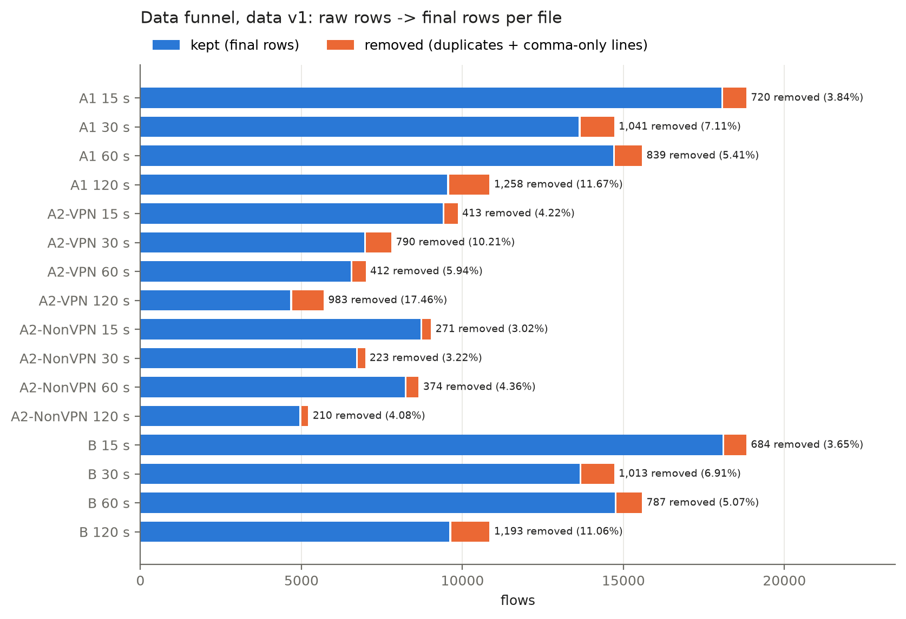
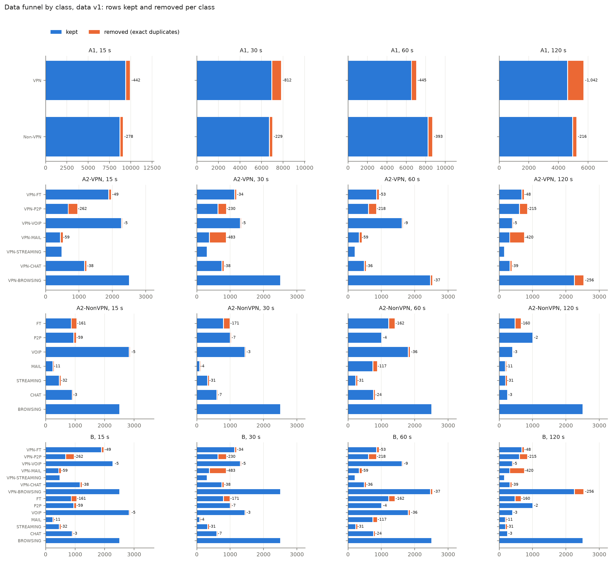
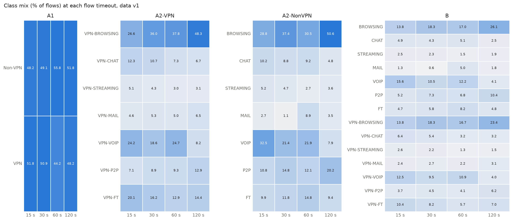

# 2 Dataset

*Working draft. The Google Docs report is the master copy; this text is pasted there and kept in
sync. Every number and table here comes from files written by code for data version v1
(`data/manifest.json`, `data/processed/v1/cleaning_log.csv`, `reports/DATA_CHANGELOG.md`); the
tables are printed by `scripts/data_tables.py v1`. Evidence: experiment E00.*

## 2.1 Source and format

We use ISCXVPN2016 [2], published with Draper-Gil et al. [1] by the Canadian Institute for
Cybersecurity, University of New Brunswick. The traffic was captured in 2016 in a lab, with and
without a VPN, for seven traffic types: browsing, chat, streaming, mail, VoIP, P2P and file
transfer. The authors turned the captures into flows with ISCXFlowMeter and published the flows as
20 ARFF files (Weka's text format). Each row is one flow: 23 numeric time-related features (times
in microseconds, rates per second) and a label. We use only these files. They hold no payload,
addresses, ports or timestamps. The SHA-256 hash of every file is recorded in
`data/arff_sha256.txt`.

Each scenario is published at four flow timeouts (15, 30, 60 and 120 s). The timeout is a setting
of the flow builder, not a flow duration. Flows longer than the timeout exist (up to 646 s) because
the timeout closes a flow only after it has been inactive for that long.

## 2.2 Tasks and files

| Task | Files | Labels |
|---|---|---|
| A1 | `Scenario A1-ARFF`, 4 files | VPN, Non-VPN |
| A2-VPN | `Scenario A2-ARFF`, 4 `-VPN` files | 7 VPN traffic types |
| A2-NonVPN | `Scenario A2-ARFF`, 4 `-NO-VPN` files | 7 traffic types |
| B | `Scenario B-ARFF`, 4 files | 14 classes (7 types x VPN / non-VPN) |
| (B-AllinOne) | `Scenario B-ARFF`, 4 `-AllinOne` files | 7 types, VPN and non-VPN merged; inventoried, not a task |

| file | task | timeout | header | rows | classes | core_task |
|---|---|---|---|---|---|---|
| Scenario A1-ARFF/TimeBasedFeatures-Dataset-15s-VPN.arff | A1 | 15 | T | 18,758 | 2 | 1 |
| Scenario A1-ARFF/TimeBasedFeatures-Dataset-30s-VPN.arff | A1 | 30 | T | 14,651 | 2 | 1 |
| Scenario A1-ARFF/TimeBasedFeatures-Dataset-60s-VPN.arff | A1 | 60 | S | 15,515 | 2 | 1 |
| Scenario A1-ARFF/TimeBasedFeatures-Dataset-120s-VPN.arff | A1 | 120 | T | 10,782 | 2 | 1 |
| Scenario A2-ARFF/TimeBasedFeatures-Dataset-15s-VPN.arff | A2-VPN | 15 | T | 9,793 | 7 | 1 |
| Scenario A2-ARFF/TimeBasedFeatures-Dataset-30s-VPN.arff | A2-VPN | 30 | T | 7,734 | 7 | 1 |
| Scenario A2-ARFF/TimeBasedFeatures-Dataset-60s-VPN.arff | A2-VPN | 60 | T | 6,935 | 7 | 1 |
| Scenario A2-ARFF/TimeBasedFeatures-Dataset-120s-VPN.arff | A2-VPN | 120 | T | 5,631 | 7 | 1 |
| Scenario A2-ARFF/TimeBasedFeatures-Dataset-15s-NO-VPN.arff | A2-NonVPN | 15 | T | 8,965 | 7 | 1 |
| Scenario A2-ARFF/TimeBasedFeatures-Dataset-30s-NO-VPN.arff | A2-NonVPN | 30 | T | 6,917 | 7 | 1 |
| Scenario A2-ARFF/TimeBasedFeatures-Dataset-60s-NO-VPN.arff | A2-NonVPN | 60 | T | 8,580 | 7 | 1 |
| Scenario A2-ARFF/TimeBasedFeatures-Dataset-120s-NO-VPN.arff | A2-NonVPN | 120 | T | 5,151 | 7 | 1 |
| Scenario B-ARFF/TimeBasedFeatures-Dataset-15s.arff | B | 15 | T | 18,758 | 14 | 1 |
| Scenario B-ARFF/TimeBasedFeatures-Dataset-30s.arff | B | 30 | T | 14,651 | 14 | 1 |
| Scenario B-ARFF/TimeBasedFeatures-Dataset-60s.arff | B | 60 | S | 15,515 | 14 | 1 |
| Scenario B-ARFF/TimeBasedFeatures-Dataset-120s.arff | B | 120 | T | 10,782 | 14 | 1 |
| Scenario B-ARFF/TimeBasedFeatures-Dataset-15s-AllinOne.arff | B-AllinOne | 15 | T | 18,758 | 7 | 0 |
| Scenario B-ARFF/TimeBasedFeatures-Dataset-30s-AllinOne.arff | B-AllinOne | 30 | T | 14,651 | 7 | 0 |
| Scenario B-ARFF/TimeBasedFeatures-Dataset-60s-AllinOne.arff | B-AllinOne | 60 | S | 15,515 | 7 | 0 |
| Scenario B-ARFF/TimeBasedFeatures-Dataset-120s-AllinOne.arff | B-AllinOne | 120 | T | 10,782 | 7 | 0 |

Two features of the raw files matter for everything below. A1, A2 and B hold **the same flows**
at each timeout: every A1 row matches an A2 row on seven integer features at all four timeouts
(100%), and the labels agree key by key (0 disagreements). B and A1 are identical cell for cell
except for one corrupt column (Section 2.4). BROWSING and VPN-BROWSING hold exactly 2,500 flows in
every raw A2 file, which suggests the dataset authors capped those classes.

## 2.3 Column-name check

**Problem.** The first row of A1 15 s has `duration` = 9,368,711 us (9.4 s) but `total_fiat` = 16
and `total_biat` = 4. A total forward gap of 16 us in a 9-second flow is impossible. The paper's
Table 2 [1] and the authors' 2016 poster [15] describe the forward and backward inter-arrival
features as min, mean, max and std, with no totals. Yet 17 of the 20 headers list `total_fiat` and
`total_biat` and no std. The three 60 s files of A1 and B have a second header that matches the
paper.

**Method.** We read every file under both name lists. On every row we tested identities that hold
whatever the traffic: min <= mean <= max for each gap statistic, 0 <= std <= max - min, mean flow
gap x (packets - 1) = duration, and, for totals, total / mean + 1 per direction = packet count.
Means of 10^7 or more are stored to 3 significant figures in the files, so a tolerance of 0.5% is
allowed. We also tested the reading that `total_fiat` is a forward packet count.

| check | A1 15 s (T) | A1 15 s (S) | A2-VPN 15 s (T) | A2-VPN 15 s (S) | A2-NonVPN 15 s (T) | A2-NonVPN 15 s (S) | B 15 s (T) | B 15 s (S) |
|---|---|---|---|---|---|---|---|---|
| fiat: min <= mean <= max | 0.0 | 100.0 | 100.0 | 18.8 | 100.0 | 5.24 | 0.0 | 100.0 |
| biat: min <= mean <= max | 0.01 | 100.0 | 100.0 | 14.07 | 100.0 | 4.06 | 0.01 | 100.0 |
| flowiat: min <= mean <= max | 100.0 | 100.0 | 100.0 | 100.0 | 100.0 | 100.0 | 100.0 | 100.0 |
| active: min <= mean <= max | 100.0 | 100.0 | 100.0 | 100.0 | 100.0 | 100.0 | 100.0 | 100.0 |
| idle: min <= mean <= max | 100.0 | 100.0 | 100.0 | 100.0 | 100.0 | 100.0 | 100.0 | 100.0 |
| mean_flowiat x (packets - 1) = duration (+-1%) | 100.0 | 100.0 | 100.0 | 100.0 | 100.0 | 100.0 | 100.0 | 100.0 |
| bytes per packet in 40-1500 | 97.72 | 97.72 | 99.26 | 99.26 | 96.06 | 96.06 | 97.72 | 97.72 |
| min_flowiat <= min(min_fiat, min_biat) | 100.0 | 100.0 | 100.0 | 80.98 | 100.0 | 83.1 | 100.0 | 100.0 |
| total_fiat <= duration | 100.0 | - | 100.0 | - | 100.0 | - | 100.0 | - |
| total/mean + 1, fwd + bwd = packets (+-2%) | 0.0 | - | 100.0 | - | 100.0 | - | 0.0 | - |
| total_fiat as packet count (+-10%) | 1.98 | - | 0.0 | - | 0.04 | - | 1.98 | - |
| 0 <= std_fiat <= max - min | - | 100.0 | - | 0.0 | - | 0.0 | - | 100.0 |
| 0 <= std_biat <= max - min | - | 100.0 | - | 0.0 | - | 0.0 | - | 100.0 |

The same pattern holds at every timeout (`column_name_check` in the manifest has all 16 files).

**Result.** The headers are wrong for 9 of the 12 A1/B files, and the fault is a shift, not a
shuffle. These files hold the paper's features in the order min, max, mean, std for fiat and
biat, but their header names them total, min, max, mean. Under the corrected names every identity
passes on 100% of rows; under the header names, min <= mean <= max passes on at most 0.02%. A2
files are named correctly and hold a different pair of features: `total_fiat` and `total_biat`
(the sum of the forward and backward gaps) instead of `std_fiat` and `std_biat`. The packet-count
reading passes on at most 2% of rows in any file, so it is ruled out. `COLUMN_MAP` in
`src/blindspy/data.py` renames the 9 shifted files. It maps `total_fiat`->`min_fiat`,
`total_biat`->`min_biat`, `min_fiat`->`max_fiat`, `min_biat`->`max_biat`, `max_fiat`->`mean_fiat`,
`max_biat`->`mean_biat`, `mean_fiat`->`std_fiat`, `mean_biat`->`std_biat`; the other 15 names are
unchanged. All feature names in this report (importances, SHAP, ablation) are the corrected ones.

**Units and value ranges.** Table 2 gives no units. The data does: with packets = flow packets per
second x duration / 10^6, the mean flow gap x (packets - 1) equals the duration within 1% on 100% of
rows in all 16 files, which holds only if times are in microseconds and rates per second. Every
measured gap, active or idle value is at most the flow's duration (100% of values), as Table 2's
definitions require. Under the corrected names the A1/B feature list is exactly Table 2's 23
features; the A2 list differs only in `total_fiat` and `total_biat`
(`reports/data_checks_v1.json`).

| feature | min | median | p99 | max | exactly_-1 | other_negative | % <= duration |
|---|---|---|---|---|---|---|---|
| duration | 0 | 14,422,310 | 119,998,194 | 646,565,983 | 0 | 0 | - |
| min_fiat | -1 | 112 | 45,211,908 | 119,999,708 | 6,308 | 0 | 100.0 |
| min_biat | -1 | 45 | 45,213,098 | 119,999,620 | 10,522 | 0 | 100.0 |
| max_fiat | -1 | 1,650,890 | 104,244,407 | 646,287,731 | 6,308 | 0 | 100.0 |
| max_biat | -1 | 2,294,484 | 63,987,999 | 600,109,667 | 10,522 | 0 | 100.0 |
| mean_fiat | 0 | 158,066 | 45,200,000 | 152,000,000 | 0 | 0 | 100.0 |
| mean_biat | 0 | 83,359 | 45,200,000 | 120,000,000 | 0 | 0 | 100.0 |
| std_fiat | 0 | 27,808 | 34,000,000 | 264,000,000 | 0 | 0 | - |
| std_biat | 0 | 24,804 | 25,700,000 | 98,000,000 | 0 | 0 | - |
| flowPktsPerSecond | 0 | 8.96615 | 57,143 | 2,000,000 | 0 | 0 | - |
| flowBytesPerSecond | 0 | 1,695 | 6,140,974 | 617,000,000 | 0 | 0 | - |
| min_flowiat | -1,247 | 21 | 1,076,195 | 59,947,704 | 224 | 405 | 100.0 |
| max_flowiat | -1 | 962,728 | 109,547,639 | 646,287,731 | 45 | 0 | 100.0 |
| mean_flowiat | 0 | 144,230 | 19,900,000 | 64,700,000 | 0 | 0 | 100.0 |
| std_flowiat | 0 | 192,278 | 33,700,000 | 204,000,000 | 0 | 0 | - |
| min_active | -1 | 5,949,131 | 120,988,572 | 646,565,983 | 28,663 | 0 | 100.0 |
| mean_active | 0 | 0 | 110,000,000 | 647,000,000 | 0 | 0 | 100.0 |
| max_active | -1 | 10,316,202 | 122,147,146 | 646,565,983 | 28,663 | 0 | 100.0 |
| std_active | 0 | 0 | 23,200,000 | 184,000,000 | 0 | 0 | - |
| min_idle | -1 | 4,993,314 | 120,661,941 | 646,287,731 | 28,663 | 0 | 100.0 |
| mean_idle | 0 | 0 | 109,000,000 | 646,000,000 | 0 | 0 | 100.0 |
| max_idle | -1 | 10,000,610 | 121,615,880 | 646,287,731 | 28,663 | 0 | 100.0 |
| std_idle | 0 | 0 | 23,100,000 | 185,000,000 | 0 | 0 | - |

This also explains the earlier puzzle that A1 and A2 rows never match. As published (names
ignored), 0 A1 rows equal an A2 row in all 23 values at any timeout, and only 2,364 of 18,758 at
15 s (1,501, 2,190 and 494 at 30, 60 and 120 s) contain the same set of values in another order.
Two of the 23 values mean different things in the two families, and 9 of the 12 A1/B headers shift
the names.

## 2.4 File-family decision

Because A1/B and A2 hold the same flows with two different feature pairs, we had three options:
use each task's own files, rebuild A1 and B from the A2 files, or merge both into 25 features. We
use **each task's own files**: A1 and B with the paper's 23 features, A2 with its 23. These are
the files the paper trained on for each scenario, so our comparison with it stays matched. A
rebuild would have replaced two of the paper's features, and a merge is ambiguous wherever a key
repeats. For the two-step classifier in E10, both steps use the A1/B layout: the 7-class step is
trained on B rows split by VPN (the same flows as A2).

One column needed repair. In A1 120 s, `flowPktsPerSecond` disagrees with A2 on 99.97% of
matched rows, while B 120 s, identical to A1 120 s in the other 22 columns of every row, agrees
with A2 on 100%. We restore the column from B 120 s, which changes 10,288 of 10,782 rows.

## 2.5 Cleaning rules

Every rule is in `configs/base.yaml` and is applied by `scripts/prepare_data.py` in this order.
Each file gets one line per rule in the cleaning log, including rules that change nothing.

| # | Step | Rule | Reason |
|---|---|---|---|
| 1 | parse | Strip trailing commas from header lines; skip comma-only data lines | Export glitch; a comma-only line (one in each 60 s file of A1 and B) is not a flow |
| 2 | column map | Rename with `COLUMN_MAP` | Section 2.3 |
| 3 | restore | A1 120 s `flowPktsPerSecond` from B 120 s | Section 2.4 |
| 4-5 | missing, infinite | Count; none found | No imputation needed |
| 6-9 | -1 codes | Keep | -1 means "not measurable": fewer than 2 packets in a direction, a single-packet flow, or no active/idle period. The matching mean or total is 0 on the same rows |
| 10 | single-packet flows | Keep `duration` = 0 flows | Real flows; dropping them would bias the data toward long flows |
| 11 | negative `min_flowiat` | Keep (down to -1,247 us) | Out-of-order capture timestamps |
| 12 | rounding | Keep means, stds and rates >= 10^7 as stored | Already rounded to 3 significant figures in the source; can't be undone |
| 13 | packet size | Keep flows outside 40-1,500 B per packet | Header-only packets (down to 30 B) and segments merged at capture (up to about 7 kB) are real |
| 14 | exact duplicates | Drop within each file before splitting, keep the first copy | A copy in both train and test would score the model on rows it trained on |
| 15 | conflicting duplicates | Keep (one row per label) | Real ambiguity; removing it would make the test set easier than reality |
| 16-19 | not done | No normalization, no feature selection, no outlier removal, no class balancing | Scaling and resampling run inside the model pipeline on training folds only; all 23 features are kept |

Rows each kept-as-is rule applies to:

| rule | A1 | A2-VPN | A2-NonVPN | B |
|---|---|---|---|---|
| fiat_not_measurable | 8,846 | 5,120 | 3,726 | 8,846 |
| biat_not_measurable | 13,857 | 8,056 | 5,801 | 13,857 |
| flowiat_not_measurable | 2,108 | 1,205 | 903 | 2,108 |
| active_idle_not_measurable | 32,228 | 15,753 | 16,475 | 32,228 |
| single_packet | 2,110 | 1,207 | 903 | 2,110 |
| negative_flowiat | 586 | 300 | 286 | 586 |
| rounding | 15,217 | 7,979 | 7,234 | 15,217 |
| packet_size | 1,380 | 397 | 983 | 1,380 |

## 2.6 Dataset summary

| file | initial_rows | comma_only_lines_skipped | exact_duplicates_removed | conflicting_rows_kept | conflicting_groups | final_rows | missing_values | features | classes | largest_to_smallest_class | train | val | test |
|---|---|---|---|---|---|---|---|---|---|---|---|---|---|
| A1 15 s | 18,758 | 0 | 720 | 46 | 23 | 18,038 | 0 | 23 | 2 | 1.08:1 | 12,626 | 2,706 | 2,706 |
| A1 30 s | 14,651 | 0 | 1,041 | 44 | 22 | 13,610 | 0 | 23 | 2 | 1.03:1 | 9,526 | 2,042 | 2,042 |
| A1 60 s | 15,516 | 1 | 838 | 94 | 47 | 14,677 | 0 | 23 | 2 | 1.26:1 | 10,273 | 2,202 | 2,202 |
| A1 120 s | 10,782 | 0 | 1,258 | 62 | 31 | 9,524 | 0 | 23 | 2 | 1.08:1 | 6,666 | 1,429 | 1,429 |
| A2-VPN 15 s | 9,793 | 0 | 413 | 53 | 24 | 9,380 | 0 | 23 | 7 | 5.79:1 | 6,566 | 1,407 | 1,407 |
| A2-VPN 30 s | 7,734 | 0 | 790 | 39 | 17 | 6,944 | 0 | 23 | 7 | 8.39:1 | 4,860 | 1,042 | 1,042 |
| A2-VPN 60 s | 6,935 | 0 | 412 | 61 | 28 | 6,523 | 0 | 23 | 7 | 12.50:1 | 4,565 | 979 | 979 |
| A2-VPN 120 s | 5,631 | 0 | 983 | 111 | 52 | 4,648 | 0 | 23 | 7 | 15.48:1 | 3,252 | 698 | 698 |
| A2-NonVPN 15 s | 8,965 | 0 | 271 | 10 | 3 | 8,694 | 0 | 23 | 7 | 11.85:1 | 6,085 | 1,304 | 1,305 |
| A2-NonVPN 30 s | 6,917 | 0 | 223 | 9 | 3 | 6,694 | 0 | 23 | 7 | 32.47:1 | 4,685 | 1,004 | 1,005 |
| A2-NonVPN 60 s | 8,580 | 0 | 374 | 34 | 15 | 8,206 | 0 | 23 | 7 | 11.31:1 | 5,744 | 1,231 | 1,231 |
| A2-NonVPN 120 s | 5,151 | 0 | 210 | 9 | 3 | 4,941 | 0 | 23 | 7 | 14.37:1 | 3,458 | 741 | 742 |
| B 15 s | 18,758 | 0 | 684 | 100 | 41 | 18,074 | 0 | 23 | 14 | 11.85:1 | 12,651 | 2,711 | 2,712 |
| B 30 s | 14,651 | 0 | 1,013 | 83 | 33 | 13,638 | 0 | 23 | 14 | 32.47:1 | 9,546 | 2,046 | 2,046 |
| B 60 s | 15,516 | 1 | 786 | 174 | 75 | 14,729 | 0 | 23 | 14 | 12.69:1 | 10,309 | 2,210 | 2,210 |
| B 120 s | 10,782 | 0 | 1,193 | 173 | 77 | 9,589 | 0 | 23 | 14 | 17.24:1 | 6,711 | 1,439 | 1,439 |

## 2.7 Data funnel (data v1)

Only two steps remove rows: the parser (two comma-only lines in total) and exact
de-duplication (11,209 rows). Over the 16 core files, 179,120 raw data lines become 167,909
cleaned flows; no value is changed except the restored A1 120 s column.

| file | raw data lines | parsed | after duplicates | final | train | val | test |
|---|---|---|---|---|---|---|---|
| A1 15 s | 18,758 | 18,758 | 18,038 | 18,038 | 12,626 | 2,706 | 2,706 |
| A1 30 s | 14,651 | 14,651 | 13,610 | 13,610 | 9,526 | 2,042 | 2,042 |
| A1 60 s | 15,516 | 15,515 | 14,677 | 14,677 | 10,273 | 2,202 | 2,202 |
| A1 120 s | 10,782 | 10,782 | 9,524 | 9,524 | 6,666 | 1,429 | 1,429 |
| A2-VPN 15 s | 9,793 | 9,793 | 9,380 | 9,380 | 6,566 | 1,407 | 1,407 |
| A2-VPN 30 s | 7,734 | 7,734 | 6,944 | 6,944 | 4,860 | 1,042 | 1,042 |
| A2-VPN 60 s | 6,935 | 6,935 | 6,523 | 6,523 | 4,565 | 979 | 979 |
| A2-VPN 120 s | 5,631 | 5,631 | 4,648 | 4,648 | 3,252 | 698 | 698 |
| A2-NonVPN 15 s | 8,965 | 8,965 | 8,694 | 8,694 | 6,085 | 1,304 | 1,305 |
| A2-NonVPN 30 s | 6,917 | 6,917 | 6,694 | 6,694 | 4,685 | 1,004 | 1,005 |
| A2-NonVPN 60 s | 8,580 | 8,580 | 8,206 | 8,206 | 5,744 | 1,231 | 1,231 |
| A2-NonVPN 120 s | 5,151 | 5,151 | 4,941 | 4,941 | 3,458 | 741 | 742 |
| B 15 s | 18,758 | 18,758 | 18,074 | 18,074 | 12,651 | 2,711 | 2,712 |
| B 30 s | 14,651 | 14,651 | 13,638 | 13,638 | 9,546 | 2,046 | 2,046 |
| B 60 s | 15,516 | 15,515 | 14,729 | 14,729 | 10,309 | 2,210 | 2,210 |
| B 120 s | 10,782 | 10,782 | 9,589 | 9,589 | 6,711 | 1,439 | 1,439 |
| **All 16 files** | 179,120 | 179,118 | 167,909 | 167,909 | 117,523 | 25,191 | 25,195 |

Removals are uneven by class, so they change the class balance.

A1

| class | 15 s | 30 s | 60 s | 120 s |
|---|---|---|---|---|
| Non-VPN | 278 of 8,965 | 229 of 6,917 | 393 of 8,580 | 216 of 5,151 |
| VPN | 442 of 9,793 | 812 of 7,734 | 445 of 6,935 | 1,042 of 5,631 |

A2-VPN

| class | 15 s | 30 s | 60 s | 120 s |
|---|---|---|---|---|
| VPN-BROWSING | 0 of 2,500 | 0 of 2,500 | 37 of 2,500 | 256 of 2,500 |
| VPN-CHAT | 38 of 1,196 | 38 of 780 | 36 of 514 | 39 of 349 |
| VPN-STREAMING | 0 of 475 | 0 of 298 | 0 of 197 | 0 of 145 |
| VPN-MAIL | 59 of 491 | 483 of 848 | 59 of 383 | 420 of 722 |
| VPN-VOIP | 5 of 2,271 | 5 of 1,299 | 9 of 1,620 | 5 of 386 |
| VPN-P2P | 262 of 928 | 230 of 851 | 218 of 823 | 215 of 813 |
| VPN-FT | 49 of 1,932 | 34 of 1,158 | 53 of 898 | 48 of 716 |

A2-NonVPN

| class | 15 s | 30 s | 60 s | 120 s |
|---|---|---|---|---|
| BROWSING | 0 of 2,500 | 0 of 2,500 | 0 of 2,500 | 0 of 2,500 |
| CHAT | 3 of 890 | 7 of 595 | 24 of 778 | 3 of 242 |
| STREAMING | 32 of 482 | 31 of 342 | 31 of 252 | 31 of 208 |
| MAIL | 11 of 249 | 4 of 81 | 117 of 849 | 11 of 185 |
| VOIP | 5 of 2,826 | 3 of 1,438 | 36 of 1,829 | 3 of 392 |
| P2P | 59 of 1,000 | 7 of 1,000 | 4 of 1,000 | 2 of 1,000 |
| FT | 161 of 1,018 | 171 of 961 | 162 of 1,372 | 160 of 624 |

B

| class | 15 s | 30 s | 60 s | 120 s |
|---|---|---|---|---|
| BROWSING | 0 of 2,500 | 0 of 2,500 | 0 of 2,500 | 0 of 2,500 |
| CHAT | 3 of 890 | 7 of 595 | 24 of 778 | 3 of 242 |
| STREAMING | 32 of 482 | 31 of 342 | 31 of 252 | 31 of 208 |
| MAIL | 11 of 249 | 4 of 81 | 117 of 849 | 11 of 185 |
| VOIP | 5 of 2,826 | 3 of 1,438 | 36 of 1,829 | 3 of 392 |
| P2P | 59 of 1,000 | 7 of 1,000 | 4 of 1,000 | 2 of 1,000 |
| FT | 161 of 1,018 | 171 of 961 | 162 of 1,372 | 160 of 624 |
| VPN-BROWSING | 0 of 2,500 | 0 of 2,500 | 37 of 2,500 | 256 of 2,500 |
| VPN-CHAT | 38 of 1,196 | 38 of 780 | 36 of 514 | 39 of 349 |
| VPN-STREAMING | 0 of 475 | 0 of 298 | 0 of 197 | 0 of 145 |
| VPN-MAIL | 59 of 491 | 483 of 848 | 59 of 383 | 420 of 722 |
| VPN-VOIP | 5 of 2,271 | 5 of 1,299 | 9 of 1,620 | 5 of 386 |
| VPN-P2P | 262 of 928 | 230 of 851 | 218 of 823 | 215 of 813 |
| VPN-FT | 49 of 1,932 | 34 of 1,158 | 53 of 898 | 48 of 716 |

| file | groups | rows | test rows with a conflicting twin in train |
|---|---|---|---|
| A1 15 s | 23 | 46 | 4 |
| A1 30 s | 22 | 44 | 8 |
| A1 60 s | 47 | 94 | 9 |
| A1 120 s | 31 | 62 | 7 |
| A2-VPN 15 s | 24 | 53 | 9 |
| A2-VPN 30 s | 17 | 39 | 4 |
| A2-VPN 60 s | 28 | 61 | 6 |
| A2-VPN 120 s | 52 | 111 | 11 |
| A2-NonVPN 15 s | 3 | 10 | 3 |
| A2-NonVPN 30 s | 3 | 9 | 2 |
| A2-NonVPN 60 s | 15 | 34 | 6 |
| A2-NonVPN 120 s | 3 | 9 | 1 |
| B 15 s | 41 | 100 | 15 |
| B 30 s | 33 | 83 | 15 |
| B 60 s | 75 | 174 | 25 |
| B 120 s | 77 | 173 | 21 |

Per class, from raw rows to the final train / validation / test sets:

A1

| class | timeout | raw | final | train | val | test |
|---|---|---|---|---|---|---|
| Non-VPN | 15 s | 8,965 | 8,687 | 6,081 | 1,303 | 1,303 |
| VPN | 15 s | 9,793 | 9,351 | 6,545 | 1,403 | 1,403 |
| Non-VPN | 30 s | 6,917 | 6,688 | 4,681 | 1,004 | 1,003 |
| VPN | 30 s | 7,734 | 6,922 | 4,845 | 1,038 | 1,039 |
| Non-VPN | 60 s | 8,580 | 8,187 | 5,731 | 1,228 | 1,228 |
| VPN | 60 s | 6,935 | 6,490 | 4,542 | 974 | 974 |
| Non-VPN | 120 s | 5,151 | 4,935 | 3,454 | 741 | 740 |
| VPN | 120 s | 5,631 | 4,589 | 3,212 | 688 | 689 |

A2-VPN

| class | timeout | raw | final | train | val | test |
|---|---|---|---|---|---|---|
| VPN-BROWSING | 15 s | 2,500 | 2,500 | 1,750 | 375 | 375 |
| VPN-CHAT | 15 s | 1,196 | 1,158 | 810 | 174 | 174 |
| VPN-STREAMING | 15 s | 475 | 475 | 333 | 71 | 71 |
| VPN-MAIL | 15 s | 491 | 432 | 302 | 65 | 65 |
| VPN-VOIP | 15 s | 2,271 | 2,266 | 1,586 | 340 | 340 |
| VPN-P2P | 15 s | 928 | 666 | 466 | 100 | 100 |
| VPN-FT | 15 s | 1,932 | 1,883 | 1,319 | 282 | 282 |
| VPN-BROWSING | 30 s | 2,500 | 2,500 | 1,750 | 375 | 375 |
| VPN-CHAT | 30 s | 780 | 742 | 520 | 111 | 111 |
| VPN-STREAMING | 30 s | 298 | 298 | 208 | 45 | 45 |
| VPN-MAIL | 30 s | 848 | 365 | 255 | 55 | 55 |
| VPN-VOIP | 30 s | 1,299 | 1,294 | 906 | 194 | 194 |
| VPN-P2P | 30 s | 851 | 621 | 435 | 93 | 93 |
| VPN-FT | 30 s | 1,158 | 1,124 | 786 | 169 | 169 |
| VPN-BROWSING | 60 s | 2,500 | 2,463 | 1,724 | 369 | 370 |
| VPN-CHAT | 60 s | 514 | 478 | 334 | 72 | 72 |
| VPN-STREAMING | 60 s | 197 | 197 | 139 | 29 | 29 |
| VPN-MAIL | 60 s | 383 | 324 | 227 | 49 | 48 |
| VPN-VOIP | 60 s | 1,620 | 1,611 | 1,127 | 242 | 242 |
| VPN-P2P | 60 s | 823 | 605 | 423 | 91 | 91 |
| VPN-FT | 60 s | 898 | 845 | 591 | 127 | 127 |
| VPN-BROWSING | 120 s | 2,500 | 2,244 | 1,570 | 337 | 337 |
| VPN-CHAT | 120 s | 349 | 310 | 216 | 47 | 47 |
| VPN-STREAMING | 120 s | 145 | 145 | 101 | 22 | 22 |
| VPN-MAIL | 120 s | 722 | 302 | 212 | 45 | 45 |
| VPN-VOIP | 120 s | 386 | 381 | 267 | 57 | 57 |
| VPN-P2P | 120 s | 813 | 598 | 418 | 90 | 90 |
| VPN-FT | 120 s | 716 | 668 | 468 | 100 | 100 |

A2-NonVPN

| class | timeout | raw | final | train | val | test |
|---|---|---|---|---|---|---|
| BROWSING | 15 s | 2,500 | 2,500 | 1,750 | 375 | 375 |
| CHAT | 15 s | 890 | 887 | 621 | 133 | 133 |
| STREAMING | 15 s | 482 | 450 | 315 | 67 | 68 |
| MAIL | 15 s | 249 | 238 | 166 | 36 | 36 |
| VOIP | 15 s | 2,826 | 2,821 | 1,975 | 423 | 423 |
| P2P | 15 s | 1,000 | 941 | 659 | 141 | 141 |
| FT | 15 s | 1,018 | 857 | 599 | 129 | 129 |
| BROWSING | 30 s | 2,500 | 2,500 | 1,750 | 375 | 375 |
| CHAT | 30 s | 595 | 588 | 412 | 88 | 88 |
| STREAMING | 30 s | 342 | 311 | 217 | 47 | 47 |
| MAIL | 30 s | 81 | 77 | 53 | 12 | 12 |
| VOIP | 30 s | 1,438 | 1,435 | 1,005 | 215 | 215 |
| P2P | 30 s | 1,000 | 993 | 695 | 149 | 149 |
| FT | 30 s | 961 | 790 | 553 | 118 | 119 |
| BROWSING | 60 s | 2,500 | 2,500 | 1,750 | 375 | 375 |
| CHAT | 60 s | 778 | 754 | 528 | 113 | 113 |
| STREAMING | 60 s | 252 | 221 | 155 | 33 | 33 |
| MAIL | 60 s | 849 | 732 | 512 | 110 | 110 |
| VOIP | 60 s | 1,829 | 1,793 | 1,255 | 269 | 269 |
| P2P | 60 s | 1,000 | 996 | 697 | 150 | 149 |
| FT | 60 s | 1,372 | 1,210 | 847 | 181 | 182 |
| BROWSING | 120 s | 2,500 | 2,500 | 1,750 | 375 | 375 |
| CHAT | 120 s | 242 | 239 | 167 | 36 | 36 |
| STREAMING | 120 s | 208 | 177 | 124 | 26 | 27 |
| MAIL | 120 s | 185 | 174 | 122 | 26 | 26 |
| VOIP | 120 s | 392 | 389 | 273 | 58 | 58 |
| P2P | 120 s | 1,000 | 998 | 698 | 150 | 150 |
| FT | 120 s | 624 | 464 | 324 | 70 | 70 |

B

| class | timeout | raw | final | train | val | test |
|---|---|---|---|---|---|---|
| BROWSING | 15 s | 2,500 | 2,500 | 1,750 | 375 | 375 |
| CHAT | 15 s | 890 | 887 | 621 | 133 | 133 |
| STREAMING | 15 s | 482 | 450 | 315 | 68 | 67 |
| MAIL | 15 s | 249 | 238 | 166 | 36 | 36 |
| VOIP | 15 s | 2,826 | 2,821 | 1,975 | 423 | 423 |
| P2P | 15 s | 1,000 | 941 | 659 | 141 | 141 |
| FT | 15 s | 1,018 | 857 | 600 | 128 | 129 |
| VPN-BROWSING | 15 s | 2,500 | 2,500 | 1,750 | 375 | 375 |
| VPN-CHAT | 15 s | 1,196 | 1,158 | 810 | 174 | 174 |
| VPN-STREAMING | 15 s | 475 | 475 | 333 | 71 | 71 |
| VPN-MAIL | 15 s | 491 | 432 | 302 | 65 | 65 |
| VPN-VOIP | 15 s | 2,271 | 2,266 | 1,586 | 340 | 340 |
| VPN-P2P | 15 s | 928 | 666 | 466 | 100 | 100 |
| VPN-FT | 15 s | 1,932 | 1,883 | 1,318 | 282 | 283 |
| BROWSING | 30 s | 2,500 | 2,500 | 1,750 | 375 | 375 |
| CHAT | 30 s | 595 | 588 | 412 | 88 | 88 |
| STREAMING | 30 s | 342 | 311 | 217 | 47 | 47 |
| MAIL | 30 s | 81 | 77 | 54 | 11 | 12 |
| VOIP | 30 s | 1,438 | 1,435 | 1,005 | 215 | 215 |
| P2P | 30 s | 1,000 | 993 | 695 | 149 | 149 |
| FT | 30 s | 961 | 790 | 553 | 119 | 118 |
| VPN-BROWSING | 30 s | 2,500 | 2,500 | 1,750 | 375 | 375 |
| VPN-CHAT | 30 s | 780 | 742 | 520 | 111 | 111 |
| VPN-STREAMING | 30 s | 298 | 298 | 208 | 45 | 45 |
| VPN-MAIL | 30 s | 848 | 365 | 255 | 55 | 55 |
| VPN-VOIP | 30 s | 1,299 | 1,294 | 906 | 194 | 194 |
| VPN-P2P | 30 s | 851 | 621 | 435 | 93 | 93 |
| VPN-FT | 30 s | 1,158 | 1,124 | 786 | 169 | 169 |
| BROWSING | 60 s | 2,500 | 2,500 | 1,750 | 375 | 375 |
| CHAT | 60 s | 778 | 754 | 528 | 113 | 113 |
| STREAMING | 60 s | 252 | 221 | 155 | 33 | 33 |
| MAIL | 60 s | 849 | 732 | 512 | 110 | 110 |
| VOIP | 60 s | 1,829 | 1,793 | 1,255 | 269 | 269 |
| P2P | 60 s | 1,000 | 996 | 698 | 149 | 149 |
| FT | 60 s | 1,372 | 1,210 | 847 | 182 | 181 |
| VPN-BROWSING | 60 s | 2,500 | 2,463 | 1,724 | 369 | 370 |
| VPN-CHAT | 60 s | 514 | 478 | 334 | 72 | 72 |
| VPN-STREAMING | 60 s | 197 | 197 | 138 | 30 | 29 |
| VPN-MAIL | 60 s | 383 | 324 | 227 | 48 | 49 |
| VPN-VOIP | 60 s | 1,620 | 1,611 | 1,127 | 242 | 242 |
| VPN-P2P | 60 s | 823 | 605 | 423 | 91 | 91 |
| VPN-FT | 60 s | 898 | 845 | 591 | 127 | 127 |
| BROWSING | 120 s | 2,500 | 2,500 | 1,750 | 375 | 375 |
| CHAT | 120 s | 242 | 239 | 167 | 36 | 36 |
| STREAMING | 120 s | 208 | 177 | 124 | 26 | 27 |
| MAIL | 120 s | 185 | 174 | 122 | 26 | 26 |
| VOIP | 120 s | 392 | 389 | 273 | 58 | 58 |
| P2P | 120 s | 1,000 | 998 | 698 | 150 | 150 |
| FT | 120 s | 624 | 464 | 324 | 70 | 70 |
| VPN-BROWSING | 120 s | 2,500 | 2,244 | 1,570 | 337 | 337 |
| VPN-CHAT | 120 s | 349 | 310 | 217 | 47 | 46 |
| VPN-STREAMING | 120 s | 145 | 145 | 101 | 22 | 22 |
| VPN-MAIL | 120 s | 722 | 302 | 212 | 45 | 45 |
| VPN-VOIP | 120 s | 386 | 381 | 267 | 57 | 57 |
| VPN-P2P | 120 s | 813 | 598 | 418 | 90 | 90 |
| VPN-FT | 120 s | 716 | 668 | 468 | 100 | 100 |

**In sentences.** For task A1 at 15 s, 18,758 flows were parsed. After removing 720 exact
duplicates (442 VPN, 278 non-VPN), 18,038 unique flows remained. All 23 features were kept without
feature selection or normalization, and the flows were split 12,626 / 2,706 / 2,706 into training,
validation and test sets. Duplicates are most common at the 120 s timeout: 1,258 of 10,782 A1
flows (11.67%) and 983 of 5,631 A2-VPN flows (17.46%). They hit some classes much harder than
others: VPN-MAIL lost 483 of 848 flows at 30 s and 420 of 722 at 120 s, FT lost 160-171 flows at
every timeout, and BROWSING lost none. A1 loses slightly more rows than B at the same timeout
(720 vs 684 at 15 s) because flows that share features but differ in traffic type become exact
duplicates once both are labelled with the same VPN / non-VPN label. After cleaning, no exact
duplicate crosses train and test in any file; 1-25 test flows per file have a twin in training
with the same features but a different label.

**Deliberately not done, and why.** No values were imputed (none are missing). No -1 code was
replaced and nothing was set to zero, because -1 has a meaning. No flag columns were added, since
the matching zero mean already marks the same rows and flags would change the paper's 23-feature
set. No rows were dropped as outliers, because long, bursty or single-packet flows are real
traffic. No features were scaled or selected and no classes were rebalanced at data level; all of
that happens inside model pipelines, fitted on training data only (Section 3).

## 2.8 Timeouts

Within each task the feature names, their order and their units are the same at all four
timeouts. The number of flows falls as the timeout grows (A1: 18,038 at 15 s to 9,524 at 120 s),
and the class mix moves a lot. One class's share changes by up to 24.6 percentage points in
A2-NonVPN (VOIP 32.5% at 15 s vs 7.9% at 120 s; BROWSING 28.8% vs 50.6%), 21.6 in A2-VPN, 12.2 in B
and 7.6 in A1. A difference in scores between timeouts is therefore confounded by class mix, and
we do not attribute it to the timeout alone.

**The 60 s files differ in what some classes look like.** At 15, 30 and 120 s, non-VPN VOIP flows
send about 100 packets per second with a 20 ms median forward gap, and VPN-VOIP flows about 2 with
a gap of about 960 ms. At 60 s the two are almost reversed (2.1 packets/s and 962 ms for VOIP, 16.5
packets/s and 18 ms for VPN-VOIP), and non-VPN FT drops from 1,237-3,739 to 56.5 packets/s. It is not
a label swap. Of 7,041 flows found identically in more than one timeout file, 210 change label
between timeouts; they are mostly 2-packet flows, and no VoIP pair is among them. The 60 s files are
also the only ones exported with the paper-style header, so they may come from a different export
run. The ARFF files can't settle the cause. Results at 60 s are therefore read with care and the
issue is listed under Limitations (Section 7).

| class, timeout | flows | median packets per second | median mean_fiat (us) | % mean_fiat 15-25 ms | % no active/idle period |
|---|---|---|---|---|---|
| VOIP 15s | 2,821 | 100.1 | 19994.9 | 78.1 | 99.4 |
| VOIP 30s | 1,435 | 100.0 | 19998.1 | 77.1 | 98.9 |
| VOIP 60s | 1,793 | 2.1 | 961624.6 | 31.2 | 51.5 |
| VOIP 120s | 389 | 100.0 | 19999.8 | 73.5 | 95.4 |
| FT 15s | 857 | 1236.7 | 1042.8 | 1.2 | 69.4 |
| FT 30s | 790 | 2155.9 | 768.0 | 1.5 | 72.0 |
| FT 60s | 1,210 | 56.5 | 34444.3 | 7.8 | 80.1 |
| FT 120s | 464 | 3738.5 | 507.5 | 0.4 | 78.9 |
| VPN-VOIP 15s | 2,266 | 2.2 | 960175.4 | 42.9 | 64.4 |
| VPN-VOIP 30s | 1,294 | 2.1 | 960284.3 | 37.7 | 56.6 |
| VPN-VOIP 60s | 1,611 | 16.5 | 18295.3 | 15.7 | 71.6 |
| VPN-VOIP 120s | 381 | 2.1 | 960800.7 | 32.3 | 49.3 |
| VPN-FT 15s | 1,883 | 7.1 | 192693.4 | 0.7 | 55.1 |
| VPN-FT 30s | 1,124 | 4.0 | 416771.2 | 0.8 | 35.0 |
| VPN-FT 60s | 845 | 6.1 | 286898.0 | 1.4 | 45.1 |
| VPN-FT 120s | 668 | 7.5 | 187957.4 | 2.1 | 48.8 |

## 2.9 The Kaggle copy used by Isnan et al.

The Kaggle file used by Isnan et al. [13] has 59,706 rows and the A2 header. Compared as a
multiset of rows, it equals the eight A2 files (VPN and non-VPN at all four timeouts) stacked:
no row is left over at 12 significant digits, and the labels are the same. It has 40,987 unique
rows, their count after removing 18,719 duplicates. Only 3,676 of those duplicates lie within one
file; 7,093 distinct flows appear in two (2,475), three (1,286) or four (3,332) timeout files. Most
of their "duplicates" are therefore the same flow built with different timeouts, and a random
80/20 split of the stacked file puts versions of one flow in both training and test sets. The file
also carries the A2 feature pair (`total_*`), not the paper's (`std_*`). E16 reproduces their
setup and measures the effect of keeping timeouts apart.

## 2.10 Data versions

| Version | Date | Author | What changed | Files | Rows (raw lines -> final) | Commit |
|---|---|---|---|---|---|---|
| v1 | 2026-10-27 | utsav-s-r | First cleaned version | 16 core files (A1, A2-VPN, A2-NonVPN, B x 15/30/60/120 s) | 179,120 -> 167,909 | 0a36896 |

Figures from the exploration notebook (`notebooks/01_eda.ipynb`): class counts per task and timeout
(`class_counts_v1.png`), feature distributions by class at every timeout (`feature_boxes_<task>_<timeout>s.png`, 16 figures) and
feature correlations (`correlation_<task>_15s.png`, all four tasks), the data funnel by class (`data_funnel_by_class_v1.png`). The notebook records
two findings that matter later. Classes differ by orders of magnitude on rate and gap features
(VPN-STREAMING: median 202 packets/s; VPN-VOIP: 2.2). Many features are near-duplicates: 19 of
253 pairs in A1 and B (27 in A2-VPN, 20 in A2-NonVPN) have Spearman |rho| >= 0.9, mostly within the active/idle group. Feature
importances will therefore be shared out among correlated features.
