# 4 Experiments

*Working draft. These markdown drafts are the master copy of the report; the full report (DOCX and
PDF) is assembled from them at each milestone. Every table here is copied unchanged from a
generated file: Sections 4.1-4.4 from `reports/baseline_tables.md` (`scripts/results_tables.py`),
Sections 4.5-4.19 from `reports/phase3_tables.md` (`scripts/results_tables.py --phase 3`) and
Sections 4.20-4.21 from `reports/phase4_tables.md` (`--phase 4`), all
built from `reports/history.csv` (all MLflow runs, exported by `scripts/export_history.py`); a
test (`tests/test_report_drafts.py`) checks that each table still matches its source. Every
number cites its experiment (entries in `reports/EXPERIMENT_LOG.md`). Data version: v1 (E16:
kaggle-k1). Phase 2 code: tag `v0.1.1-baseline` (commit c450c3e), from which all 144 runs
(80 baselines, 64 paper benchmark) were rerun with identical scores; the first runs came from
commit 1817c5a (tag `v0.1-baseline`) and 36c56a1. Timings are from the rerun. Phase 3 run
commits are listed in each experiment entry and in the `v0.2-tuned` tag message.*

Each experiment states a hypothesis and a numeric pass/fail threshold before it runs, changes one
thing, and ends with a verdict (supported / not supported). Unless stated otherwise, scores are on
the **validation** set of the fixed 70/15/15 split (seed 42); models are chosen with 5-fold
cross-validation on the training set; the test set is not used until the final experiment (E12).

## 4.0 E00: data findings and data version v1

E00 checked the dataset before any model was trained: the corrected column names, the file-family
decision, the odd-value and duplicate rules, the session question and the Kaggle finding. It
produced data version v1 (167,909 flows in 16 task files). Section 2 reports it in full.

## 4.1 E01: majority-class baseline

**What.** A model that always predicts the largest training class (`DummyClassifier`), for every
task and timeout (16 runs).
**Why.** It is the floor every model must beat, and its scores are known in advance, so it also
tests the metrics code: accuracy must equal the largest class's share p of the validation set, and
macro F1 must equal 2p / ((1 + p) k) for k classes.
**Result.** Supported: all 16 runs match both values to 4 decimals (threshold 0.001). The floor in
macro F1 is 0.34-0.36 for A1, 0.06-0.10 for A2 and 0.02-0.03 for B. Accuracy alone would look
much better (up to 0.56 for A1 and 0.51 for A2-NonVPN 120 s), which is why macro F1 is the main
score.

| task | timeout | classes | largest_class | p | val_accuracy | expected_macro_f1 | val_macro_f1 | ok |
|---|---|---|---|---|---|---|---|---|
| A1 | 15 s | 2 | VPN | 0.5185 | 0.5185 | 0.3414 | 0.3414 | yes |
| A1 | 30 s | 2 | VPN | 0.5083 | 0.5083 | 0.337 | 0.337 | yes |
| A1 | 60 s | 2 | Non-VPN | 0.5577 | 0.5577 | 0.358 | 0.358 | yes |
| A1 | 120 s | 2 | Non-VPN | 0.5185 | 0.5185 | 0.3415 | 0.3415 | yes |
| A2-VPN | 15 s | 7 | VPN-BROWSING | 0.2665 | 0.2665 | 0.0601 | 0.0601 | yes |
| A2-VPN | 30 s | 7 | VPN-BROWSING | 0.3599 | 0.3599 | 0.0756 | 0.0756 | yes |
| A2-VPN | 60 s | 7 | VPN-BROWSING | 0.3769 | 0.3769 | 0.0782 | 0.0782 | yes |
| A2-VPN | 120 s | 7 | VPN-BROWSING | 0.4828 | 0.4828 | 0.093 | 0.093 | yes |
| A2-NonVPN | 15 s | 7 | VOIP | 0.3244 | 0.3244 | 0.07 | 0.07 | yes |
| A2-NonVPN | 30 s | 7 | BROWSING | 0.3735 | 0.3735 | 0.0777 | 0.0777 | yes |
| A2-NonVPN | 60 s | 7 | BROWSING | 0.3046 | 0.3046 | 0.0667 | 0.0667 | yes |
| A2-NonVPN | 120 s | 7 | BROWSING | 0.5061 | 0.5061 | 0.096 | 0.096 | yes |
| B | 15 s | 14 | VOIP | 0.156 | 0.156 | 0.0193 | 0.0193 | yes |
| B | 30 s | 14 | BROWSING | 0.1833 | 0.1833 | 0.0221 | 0.0221 | yes |
| B | 60 s | 14 | BROWSING | 0.1697 | 0.1697 | 0.0207 | 0.0207 | yes |
| B | 120 s | 14 | BROWSING | 0.2606 | 0.2606 | 0.0295 | 0.0295 | yes |

## 4.2 E02 and E03: decision tree, KNN, Logistic Regression and SVM-RBF

**What.** Four baselines, each a scikit-learn pipeline, run on all 16 task/timeout files (64 runs):
an unpruned entropy decision tree (E02; the closest scikit-learn model to C4.5, so a "C4.5
approximation"), KNN with k = 5 and standard scaling, Logistic Regression and an RBF-kernel SVM,
both with standard scaling (E03). Scaling is a pipeline step, fitted on training rows only.
**Why.** The tree and KNN are the paper's two algorithms. Logistic Regression and SVM-RBF match
the baselines of Isnan et al. [13]. Together they set the bar for the improvements in Phase 3.
**Hypotheses and thresholds (written before running).** E02: the tree beats the floor by at least
0.30 in every config and reaches at least 0.80 on A1 at every timeout. E03: all three beat the floor
by at least 0.10; KNN is within 0.10 of the tree in at least 12 of 16 configs; Logistic Regression
and SVM-RBF score below the tree in at least 12 of 16 configs, because the features are heavy-tailed
(microsecond times up to about 10^8 next to -1 and 0 codes).
**Result.** All supported. The tree is the best baseline in all 16 configs (macro F1 0.706-0.890),
0.499-0.765 above the floor. KNN is second everywhere, 0.039-0.101 below the tree (within 0.10 in
15 of 16). Logistic Regression (0.270-0.598) and SVM-RBF (0.274-0.621) are below the tree in all 16.

Validation macro F1 (E01-E03):

| task | timeout | majority | tree | knn | logreg | svm_rbf |
|---|---|---|---|---|---|---|
| A1 | 15 s | 0.341 | 0.890 | 0.813 | 0.585 | 0.602 |
| A1 | 30 s | 0.337 | 0.864 | 0.825 | 0.598 | 0.610 |
| A1 | 60 s | 0.358 | 0.857 | 0.813 | 0.541 | 0.545 |
| A1 | 120 s | 0.341 | 0.857 | 0.807 | 0.576 | 0.621 |
| A2-VPN | 15 s | 0.060 | 0.825 | 0.774 | 0.432 | 0.468 |
| A2-VPN | 30 s | 0.076 | 0.828 | 0.788 | 0.536 | 0.542 |
| A2-VPN | 60 s | 0.078 | 0.775 | 0.730 | 0.339 | 0.330 |
| A2-VPN | 120 s | 0.093 | 0.780 | 0.727 | 0.332 | 0.332 |
| A2-NonVPN | 15 s | 0.070 | 0.829 | 0.773 | 0.449 | 0.487 |
| A2-NonVPN | 30 s | 0.078 | 0.828 | 0.783 | 0.486 | 0.468 |
| A2-NonVPN | 60 s | 0.067 | 0.825 | 0.750 | 0.447 | 0.441 |
| A2-NonVPN | 120 s | 0.096 | 0.839 | 0.769 | 0.482 | 0.471 |
| B | 15 s | 0.019 | 0.759 | 0.660 | 0.307 | 0.296 |
| B | 30 s | 0.022 | 0.748 | 0.647 | 0.320 | 0.311 |
| B | 60 s | 0.021 | 0.706 | 0.617 | 0.271 | 0.278 |
| B | 120 s | 0.030 | 0.716 | 0.637 | 0.270 | 0.274 |

5-fold cross-validation on the training set, mean +- standard deviation:

| task | timeout | majority | tree | knn | logreg | svm_rbf |
|---|---|---|---|---|---|---|
| A1 | 15 s | 0.341 +- 0.000 | 0.888 +- 0.005 | 0.821 +- 0.002 | 0.600 +- 0.011 | 0.608 +- 0.005 |
| A1 | 30 s | 0.337 +- 0.000 | 0.873 +- 0.006 | 0.814 +- 0.010 | 0.600 +- 0.012 | 0.619 +- 0.023 |
| A1 | 60 s | 0.358 +- 0.000 | 0.852 +- 0.010 | 0.808 +- 0.009 | 0.551 +- 0.008 | 0.552 +- 0.006 |
| A1 | 120 s | 0.341 +- 0.000 | 0.857 +- 0.009 | 0.803 +- 0.002 | 0.569 +- 0.008 | 0.608 +- 0.011 |
| A2-VPN | 15 s | 0.060 +- 0.000 | 0.810 +- 0.007 | 0.767 +- 0.008 | 0.410 +- 0.014 | 0.448 +- 0.024 |
| A2-VPN | 30 s | 0.076 +- 0.000 | 0.796 +- 0.009 | 0.769 +- 0.025 | 0.495 +- 0.016 | 0.507 +- 0.021 |
| A2-VPN | 60 s | 0.078 +- 0.000 | 0.760 +- 0.016 | 0.708 +- 0.019 | 0.334 +- 0.022 | 0.331 +- 0.021 |
| A2-VPN | 120 s | 0.093 +- 0.000 | 0.725 +- 0.023 | 0.692 +- 0.016 | 0.343 +- 0.019 | 0.317 +- 0.021 |
| A2-NonVPN | 15 s | 0.070 +- 0.000 | 0.862 +- 0.009 | 0.792 +- 0.010 | 0.459 +- 0.013 | 0.479 +- 0.018 |
| A2-NonVPN | 30 s | 0.078 +- 0.000 | 0.817 +- 0.015 | 0.783 +- 0.017 | 0.459 +- 0.007 | 0.426 +- 0.008 |
| A2-NonVPN | 60 s | 0.067 +- 0.000 | 0.829 +- 0.016 | 0.740 +- 0.013 | 0.454 +- 0.015 | 0.432 +- 0.022 |
| A2-NonVPN | 120 s | 0.096 +- 0.000 | 0.807 +- 0.015 | 0.731 +- 0.013 | 0.472 +- 0.016 | 0.441 +- 0.023 |
| B | 15 s | 0.019 +- 0.000 | 0.757 +- 0.013 | 0.663 +- 0.008 | 0.299 +- 0.010 | 0.278 +- 0.008 |
| B | 30 s | 0.022 +- 0.000 | 0.733 +- 0.008 | 0.654 +- 0.016 | 0.323 +- 0.009 | 0.292 +- 0.008 |
| B | 60 s | 0.021 +- 0.000 | 0.703 +- 0.013 | 0.607 +- 0.010 | 0.275 +- 0.002 | 0.261 +- 0.009 |
| B | 120 s | 0.030 +- 0.000 | 0.684 +- 0.020 | 0.607 +- 0.015 | 0.250 +- 0.005 | 0.251 +- 0.017 |

What the tables show:

- **Cross-validation predicts validation.** For every run, |CV mean - validation| is at most 0.054,
  and CV standard deviations are at most 0.025. A gap of several points between two models is
  therefore larger than fold-to-fold noise.
- **Small classes.** Logistic Regression and SVM-RBF score F1 = 0.00 on MAIL / VPN-MAIL in most A2
  and B configs. So their macro F1 is far below their weighted F1 (gap up to 0.225); the tree's gap
  is 0.000-0.069. The SVM keeps 55-88% of the training rows as support vectors, a sign that the RBF
  kernel separates the standard-scaled features poorly. A log transform or a robust scaler is
  tested in E04.
- **Easiest and hardest classes.** VoIP is the easiest type (tree F1 0.92-0.99 for VOIP and
  VPN-VOIP). The weakest are CHAT, VPN-CHAT, STREAMING, MAIL and VPN-MAIL (tree F1 0.42-0.71).
- **Most frequent confusion.** In task B the largest confusion for the tree and KNN, at every
  timeout, is BROWSING vs VPN-BROWSING in both directions (tree: 29-45 validation flows each way).
  The model recognises browsing, but not whether it went through the VPN.
- **Timeouts.** B and A2-VPN score lower at 60 s and 120 s. The class mix differs between timeouts
  (Section 2.8), and the 60 s files hold differently shaped VOIP and FT flows (E00 addendum), so this
  is not read as an effect of the timeout.
- **Cost.** All baselines train in under 3 s. To predict 1,000 flows, the tree needs 0.30 ms
  (median), KNN 8.0 ms and the SVM 210 ms. Model files range from 1.4 KB (majority) and
  4-5 KB (Logistic Regression) to 4.2 MB (SVM).

Per-class extremes for the tree (E02): macro vs weighted F1, their gap, the generalisation gap, and
the best and worst class by F1 and by recall:

| task | timeout | macro F1 | weighted F1 | gap | CV - val | best F1 | worst F1 | best recall | worst recall |
|---|---|---|---|---|---|---|---|---|---|
| A1 | 15 s | 0.89 | 0.89 | 0.0 | -0.002 | VPN 0.89 | Non-VPN 0.89 | Non-VPN 0.89 | VPN 0.89 |
| A1 | 30 s | 0.864 | 0.864 | 0.0 | 0.009 | VPN 0.87 | Non-VPN 0.86 | VPN 0.87 | Non-VPN 0.86 |
| A1 | 60 s | 0.857 | 0.859 | 0.002 | -0.005 | Non-VPN 0.87 | VPN 0.84 | Non-VPN 0.87 | VPN 0.85 |
| A1 | 120 s | 0.857 | 0.857 | 0.0 | 0.0 | Non-VPN 0.86 | VPN 0.85 | Non-VPN 0.86 | VPN 0.85 |
| A2-VPN | 15 s | 0.825 | 0.849 | 0.024 | -0.014 | VPN-VOIP 0.99 | VPN-CHAT 0.65 | VPN-VOIP 0.98 | VPN-CHAT 0.66 |
| A2-VPN | 30 s | 0.828 | 0.847 | 0.02 | -0.031 | VPN-VOIP 0.98 | VPN-CHAT 0.67 | VPN-STREAMING 0.98 | VPN-CHAT 0.70 |
| A2-VPN | 60 s | 0.775 | 0.831 | 0.056 | -0.014 | VPN-VOIP 0.92 | VPN-CHAT 0.63 | VPN-VOIP 0.92 | VPN-FT 0.65 |
| A2-VPN | 120 s | 0.78 | 0.825 | 0.045 | -0.054 | VPN-VOIP 0.98 | VPN-CHAT 0.61 | VPN-VOIP 0.98 | VPN-CHAT 0.57 |
| A2-NonVPN | 15 s | 0.829 | 0.891 | 0.061 | 0.033 | VOIP 0.99 | STREAMING 0.71 | VOIP 0.99 | STREAMING 0.70 |
| A2-NonVPN | 30 s | 0.828 | 0.889 | 0.061 | -0.011 | VOIP 0.98 | STREAMING 0.68 | VOIP 0.98 | STREAMING 0.57 |
| A2-NonVPN | 60 s | 0.825 | 0.878 | 0.053 | 0.004 | VOIP 0.97 | STREAMING 0.58 | VOIP 0.97 | STREAMING 0.55 |
| A2-NonVPN | 120 s | 0.839 | 0.893 | 0.054 | -0.033 | VOIP 0.95 | CHAT 0.56 | BROWSING 0.95 | CHAT 0.56 |
| B | 15 s | 0.759 | 0.81 | 0.051 | -0.001 | VOIP 0.98 | VPN-MAIL 0.55 | VOIP 0.99 | VPN-MAIL 0.52 |
| B | 30 s | 0.748 | 0.8 | 0.053 | -0.014 | VPN-VOIP 0.98 | MAIL 0.55 | VPN-VOIP 0.99 | MAIL 0.55 |
| B | 60 s | 0.706 | 0.775 | 0.069 | -0.002 | VOIP 0.92 | VPN-CHAT 0.42 | VOIP 0.92 | VPN-CHAT 0.42 |
| B | 120 s | 0.716 | 0.767 | 0.051 | -0.031 | VOIP 0.97 | STREAMING 0.47 | VOIP 1.00 | CHAT 0.42 |

Top 5 confusion pairs of the tree on the validation set (E02):

| task | timeout | top 5 confusion pairs (true -> predicted: flows) |
|---|---|---|
| A1 | 15 s | VPN -> Non-VPN: 158; Non-VPN -> VPN: 139 |
| A1 | 30 s | Non-VPN -> VPN: 142; VPN -> Non-VPN: 135 |
| A1 | 60 s | Non-VPN -> VPN: 161; VPN -> Non-VPN: 150 |
| A1 | 120 s | Non-VPN -> VPN: 104; VPN -> Non-VPN: 100 |
| A2-VPN | 15 s | VPN-FT -> VPN-CHAT: 28; VPN-CHAT -> VPN-BROWSING: 26; VPN-BROWSING -> VPN-CHAT: 25; VPN-CHAT -> VPN-FT: 20; VPN-FT -> VPN-BROWSING: 19 |
| A2-VPN | 30 s | VPN-BROWSING -> VPN-CHAT: 26; VPN-FT -> VPN-BROWSING: 22; VPN-BROWSING -> VPN-FT: 15; VPN-CHAT -> VPN-BROWSING: 12; VPN-CHAT -> VPN-FT: 12 |
| A2-VPN | 60 s | VPN-FT -> VPN-BROWSING: 17; VPN-BROWSING -> VPN-FT: 16; VPN-FT -> VPN-CHAT: 14; VPN-BROWSING -> VPN-VOIP: 13; VPN-CHAT -> VPN-FT: 12 |
| A2-VPN | 120 s | VPN-FT -> VPN-BROWSING: 18; VPN-BROWSING -> VPN-FT: 16; VPN-CHAT -> VPN-BROWSING: 11; VPN-FT -> VPN-P2P: 9; VPN-P2P -> VPN-BROWSING: 9 |
| A2-NonVPN | 15 s | BROWSING -> CHAT: 18; CHAT -> BROWSING: 15; BROWSING -> STREAMING: 12; FT -> BROWSING: 12; FT -> CHAT: 11 |
| A2-NonVPN | 30 s | CHAT -> BROWSING: 12; STREAMING -> BROWSING: 11; BROWSING -> CHAT: 10; BROWSING -> FT: 10; FT -> CHAT: 9 |
| A2-NonVPN | 60 s | CHAT -> BROWSING: 20; BROWSING -> CHAT: 19; MAIL -> FT: 8; FT -> BROWSING: 7; BROWSING -> MAIL: 6 |
| A2-NonVPN | 120 s | CHAT -> BROWSING: 12; P2P -> BROWSING: 8; FT -> BROWSING: 7; BROWSING -> P2P: 6; BROWSING -> CHAT: 5 |
| B | 15 s | VPN-BROWSING -> BROWSING: 41; BROWSING -> VPN-BROWSING: 39; VPN-CHAT -> VPN-FT: 25; VPN-FT -> VPN-CHAT: 24; VPN-BROWSING -> VPN-CHAT: 18 |
| B | 30 s | VPN-BROWSING -> BROWSING: 44; BROWSING -> VPN-BROWSING: 36; VPN-BROWSING -> VPN-CHAT: 13; VPN-FT -> VPN-CHAT: 12; VPN-CHAT -> VPN-BROWSING: 11 |
| B | 60 s | BROWSING -> VPN-BROWSING: 37; VPN-BROWSING -> BROWSING: 29; VPN-MAIL -> MAIL: 15; VPN-P2P -> P2P: 14; VPN-VOIP -> VOIP: 14 |
| B | 120 s | BROWSING -> VPN-BROWSING: 45; VPN-BROWSING -> BROWSING: 32; VPN-BROWSING -> VPN-FT: 17; VPN-FT -> VPN-BROWSING: 12; VPN-BROWSING -> VPN-P2P: 10 |

Model complexity (E02 tree, E03 SVM):

| task | timeout | n_train | tree depth | tree nodes | tree leaves | SVM support vectors |
|---|---|---|---|---|---|---|
| A1 | 15 s | 12,626 | 27 | 1,789 | 895 | 10,292 |
| A1 | 30 s | 9,526 | 35 | 1,601 | 801 | 7,976 |
| A1 | 60 s | 10,273 | 27 | 1,917 | 959 | 7,882 |
| A1 | 120 s | 6,666 | 25 | 1,243 | 622 | 5,501 |
| A2-VPN | 15 s | 6,566 | 23 | 1,407 | 704 | 4,497 |
| A2-VPN | 30 s | 4,860 | 20 | 1,067 | 534 | 3,108 |
| A2-VPN | 60 s | 4,565 | 24 | 1,249 | 625 | 3,265 |
| A2-VPN | 120 s | 3,252 | 21 | 985 | 493 | 2,368 |
| A2-NonVPN | 15 s | 6,085 | 16 | 743 | 372 | 3,329 |
| A2-NonVPN | 30 s | 4,685 | 19 | 751 | 376 | 2,751 |
| A2-NonVPN | 60 s | 5,744 | 24 | 1,001 | 501 | 3,803 |
| A2-NonVPN | 120 s | 3,458 | 18 | 591 | 296 | 1,907 |
| B | 15 s | 12,651 | 30 | 3,409 | 1,705 | 11,076 |
| B | 30 s | 9,546 | 23 | 2,901 | 1,451 | 8,368 |
| B | 60 s | 10,309 | 26 | 3,437 | 1,719 | 8,796 |
| B | 120 s | 6,711 | 22 | 2,481 | 1,241 | 5,813 |

Cost per model over the 16 configs:

| model | train time (s) median | train time (s) max | 5-fold CV time (s) median | 5-fold CV time (s) max | predict ms / 1,000 flows median | predict ms / 1,000 flows max | model file (KB) median | model file (KB) max | peak fit memory (MB) median | peak fit memory (MB) max |
|---|---|---|---|---|---|---|---|---|---|---|
| majority | 0.004 | 0.008 | 0.157 | 2.854 | 0.091 | 0.18 | 1.414 | 1.523 | 0.623 | 1.182 |
| tree | 0.112 | 0.304 | 0.293 | 0.652 | 0.298 | 0.531 | 134.49 | 592.916 | 1.257 | 2.392 |
| knn | 0.01 | 0.021 | 0.182 | 0.281 | 8.031 | 13.338 | 1242.967 | 2374.631 | 2.999 | 5.722 |
| logreg | 0.084 | 0.428 | 0.212 | 0.603 | 0.378 | 0.69 | 3.829 | 5.196 | 3.433 | 8.144 |
| svm_rbf | 0.626 | 2.913 | 1.61 | 3.784 | 209.808 | 596.678 | 1175.091 | 4288.896 | 3.552 | 7.781 |

Peak fit memory is measured with Python's tracemalloc, which counts NumPy arrays
but not memory allocated inside compiled libraries (for example libsvm), so SVM
memory is a lower bound. Training time comes from a fit without tracemalloc and
peak memory from a separate fit of a clone. The first Phase 2 runs (commits
1817c5a and 36c56a1) timed the fit with tracemalloc on, which slowed it (x1.05
tree, x1.00 SVM, x1.19 Logistic Regression, x2.3 KNN in a recheck); all 144 configs
were rerun from the fixed code (commit c450c3e) with identical scores, and these
tables use the rerun. The first runs also logged process_max_rss_mb, a high-water
mark of the whole batch process rather than a per-run figure; it is not used.

The same tables for KNN, Logistic Regression and SVM-RBF, plus accuracy, balanced accuracy,
weighted F1 and A1 ROC-AUC for every run, are in `reports/baseline_tables.md` (Appendix).

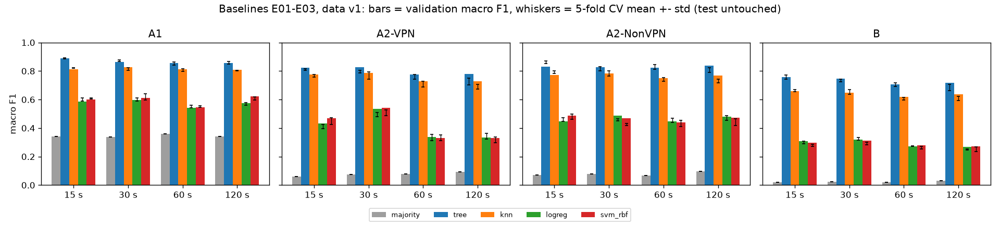

## 4.3 Paper benchmark (part of E02 and E03)

**What.** The paper's own protocol [1]: 10-fold stratified cross-validation on the whole file, with
predictions pooled over the folds as Weka reports them, for its two algorithms with Weka's default
settings. J48 (C4.5) defaults are a pruning confidence of 0.25 and at least 2 instances per leaf;
scikit-learn has no C4.5 pruning, so our stand-in is an unpruned entropy tree with at least 2 rows
per leaf. IBk (KNN) defaults are k = 1 with a Euclidean distance that normalises each attribute
to its range; our stand-in is min-max scaling followed by 1-NN. The defaults were checked in the
Weka documentation [16] (also cited in `notebooks/02_baselines.ipynb`). Each algorithm ran on two row
sources per file (64 runs): every row as published (duplicates kept, values untouched), which is
closest to the paper's input, and data v1 (deduplicated).
**Why.** It tests whether we reproduce the paper's results before we try to improve on them. We
compare precision with precision and recall with recall, never the paper's precision with our F1.
These scores are never used to choose a model.
**Hypotheses and thresholds.** On the published rows, at least 12 of the 16 A1 values of the
paper's Figure 2 are matched within +-0.05, for each algorithm. Because duplicates can put a copy
of a flow in the training folds, removing them lowers 10-fold macro F1 in at least 12 of 16 files.
**Result.** Reproduction supported: our C4.5 approximation matches all 16 A1 values (largest
difference 0.021, close to the +-0.01 reading error of the chart), and 1-NN matches 15 of 16 (the
miss is VPN recall at 120 s: 0.803 vs 0.860). The duplicate hypothesis is not supported (6 of 16
files lower for the tree, 2 of 16 for 1-NN).

A1, paper (Figure 2, read to +-0.01) vs ours (`diff` = ours - paper):

| algorithm | class | timeout | metric | paper | paper_source | ours_published | ours_v1 | diff_published | diff_v1 |
|---|---|---|---|---|---|---|---|---|---|
| C4.5 | Non-VPN | 15 | precision | 0.906 | chart +-0.01 and text | 0.886 | 0.882 | -0.02 | -0.024 |
| C4.5 | Non-VPN | 30 | precision | 0.885 | chart +-0.01 | 0.866 | 0.866 | -0.019 | -0.019 |
| C4.5 | Non-VPN | 60 | precision | 0.864 | chart +-0.01 | 0.86 | 0.876 | -0.004 | 0.012 |
| C4.5 | Non-VPN | 120 | precision | 0.887 | chart +-0.01 and text | 0.87 | 0.863 | -0.017 | -0.024 |
| C4.5 | Non-VPN | 15 | recall | 0.877 | chart +-0.01 | 0.882 | 0.903 | 0.005 | 0.026 |
| C4.5 | Non-VPN | 30 | recall | 0.846 | chart +-0.01 | 0.857 | 0.886 | 0.011 | 0.04 |
| C4.5 | Non-VPN | 60 | recall | 0.888 | chart +-0.01 | 0.889 | 0.898 | 0.001 | 0.01 |
| C4.5 | Non-VPN | 120 | recall | 0.843 | chart +-0.01 | 0.853 | 0.89 | 0.01 | 0.047 |
| C4.5 | VPN | 15 | precision | 0.89 | chart +-0.01 and text | 0.892 | 0.908 | 0.002 | 0.018 |
| C4.5 | VPN | 30 | precision | 0.868 | chart +-0.01 | 0.874 | 0.888 | 0.006 | 0.02 |
| C4.5 | VPN | 60 | precision | 0.856 | chart +-0.01 | 0.857 | 0.867 | 0.001 | 0.011 |
| C4.5 | VPN | 120 | precision | 0.863 | chart +-0.01 and text | 0.868 | 0.877 | 0.005 | 0.014 |
| C4.5 | VPN | 15 | recall | 0.917 | chart +-0.01 | 0.896 | 0.888 | -0.021 | -0.029 |
| C4.5 | VPN | 30 | recall | 0.901 | chart +-0.01 | 0.881 | 0.867 | -0.02 | -0.034 |
| C4.5 | VPN | 60 | recall | 0.827 | chart +-0.01 | 0.821 | 0.84 | -0.006 | 0.013 |
| C4.5 | VPN | 120 | recall | 0.902 | chart +-0.01 | 0.884 | 0.849 | -0.018 | -0.053 |
| KNN | Non-VPN | 15 | precision | 0.846 | chart +-0.01 and text | 0.821 | 0.846 | -0.025 | 0.0 |
| KNN | Non-VPN | 30 | precision | 0.84 | chart +-0.01 | 0.805 | 0.83 | -0.035 | -0.01 |
| KNN | Non-VPN | 60 | precision | 0.838 | chart +-0.01 | 0.831 | 0.854 | -0.007 | 0.016 |
| KNN | Non-VPN | 120 | precision | 0.837 | chart +-0.01 and text | 0.794 | 0.83 | -0.043 | -0.007 |
| KNN | Non-VPN | 15 | recall | 0.832 | chart +-0.01 | 0.857 | 0.848 | 0.025 | 0.016 |
| KNN | Non-VPN | 30 | recall | 0.808 | chart +-0.01 | 0.839 | 0.831 | 0.031 | 0.023 |
| KNN | Non-VPN | 60 | recall | 0.851 | chart +-0.01 | 0.857 | 0.849 | 0.006 | -0.002 |
| KNN | Non-VPN | 120 | recall | 0.787 | chart +-0.01 | 0.827 | 0.825 | 0.04 | 0.038 |
| KNN | VPN | 15 | precision | 0.848 | chart +-0.01 and text | 0.863 | 0.859 | 0.015 | 0.011 |
| KNN | VPN | 30 | precision | 0.835 | chart +-0.01 | 0.85 | 0.836 | 0.015 | 0.001 |
| KNN | VPN | 60 | precision | 0.812 | chart +-0.01 | 0.816 | 0.811 | 0.004 | -0.001 |
| KNN | VPN | 120 | precision | 0.815 | chart +-0.01 and text | 0.836 | 0.813 | 0.021 | -0.002 |
| KNN | VPN | 15 | recall | 0.861 | chart +-0.01 | 0.83 | 0.857 | -0.031 | -0.004 |
| KNN | VPN | 30 | recall | 0.862 | chart +-0.01 | 0.818 | 0.835 | -0.044 | -0.027 |
| KNN | VPN | 60 | recall | 0.795 | chart +-0.01 | 0.784 | 0.817 | -0.011 | 0.022 |
| KNN | VPN | 120 | recall | 0.86 | chart +-0.01 | 0.803 | 0.818 | -0.057 | -0.042 |

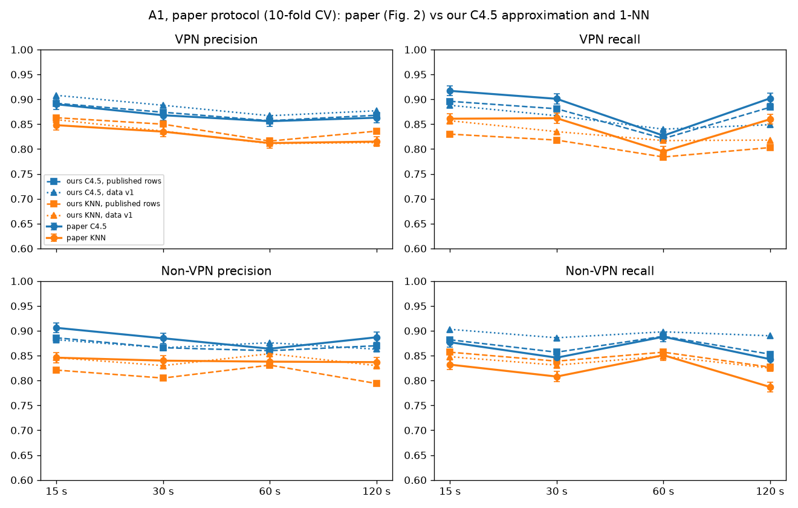

The plan asks for the comparison as one table per task. The tables below give our 10-fold
precision and recall for every class, both algorithms and all timeouts, on the published rows
(closest to the paper's input), with the paper's value in brackets wherever the paper gives one
(C = read from its chart, +-0.01; T = stated in its text). The same tables on data v1 are in
`reports/baseline_tables.md`.

A2-VPN:

| class | metric | C4.5 15 s | C4.5 30 s | C4.5 60 s | C4.5 120 s | KNN 15 s | KNN 30 s | KNN 60 s | KNN 120 s |
|---|---|---|---|---|---|---|---|---|---|
| VPN-BROWSING | precision | 0.872 | 0.878 | 0.873 | 0.878 | 0.830 | 0.874 | 0.881 | 0.795 |
| VPN-BROWSING | recall | 0.884 | 0.916 | 0.918 | 0.906 | 0.846 | 0.893 | 0.902 | 0.888 |
| VPN-CHAT | precision | 0.661 | 0.647 | 0.568 | 0.532 | 0.511 | 0.490 | 0.427 | 0.576 |
| VPN-CHAT | recall | 0.687 | 0.628 | 0.562 | 0.473 | 0.651 | 0.667 | 0.658 | 0.562 |
| VPN-FT | precision | 0.792 | 0.744 | 0.676 | 0.649 | 0.773 | 0.764 | 0.714 | 0.674 |
| VPN-FT | recall | 0.770 | 0.690 | 0.610 | 0.605 | 0.735 | 0.689 | 0.648 | 0.595 |
| VPN-MAIL | precision | 0.808 | 0.891 | 0.778 | 0.864 | 0.766 | 0.912 | 0.753 | 0.859 |
| VPN-MAIL | recall | 0.762 | 0.887 | 0.715 | 0.852 | 0.766 | 0.947 | 0.734 | 0.904 |
| VPN-P2P | precision | 0.827 | 0.831 | 0.793 | 0.810 | 0.736 | 0.806 | 0.727 | 0.771 |
| VPN-P2P | recall | 0.863 | 0.870 | 0.848 | 0.862 | 0.517 | 0.585 | 0.527 | 0.567 |
| VPN-STREAMING | precision | 0.922 | 0.926 | 0.875 | 0.838 | 0.906 | 0.876 | 0.838 | 0.815 |
| VPN-STREAMING | recall | 0.891 | 0.876 | 0.782 | 0.752 | 0.914 | 0.856 | 0.787 | 0.759 |
| VPN-VOIP | precision | 0.990 | 0.992 | 0.939 | 0.973 | 0.990 | 0.993 | 0.911 | 0.984 |
| VPN-VOIP | recall | 0.979 | 0.975 | 0.914 | 0.925 | 0.987 | 0.981 | 0.907 | 0.951 |
| AVERAGE (macro) | precision | 0.839 (paper 0.840 T) | 0.844 | 0.786 | 0.792 | 0.788 | 0.816 | 0.750 | 0.782 |
| AVERAGE (macro) | recall | 0.834 | 0.835 | 0.764 | 0.768 | 0.774 | 0.803 | 0.738 | 0.747 |

A2-NonVPN:

| class | metric | C4.5 15 s | C4.5 30 s | C4.5 60 s | C4.5 120 s | KNN 15 s | KNN 30 s | KNN 60 s | KNN 120 s |
|---|---|---|---|---|---|---|---|---|---|
| BROWSING | precision | 0.904 | 0.915 | 0.897 | 0.928 | 0.866 | 0.883 | 0.865 | 0.922 |
| BROWSING | recall | 0.930 | 0.934 | 0.922 | 0.948 | 0.880 | 0.912 | 0.872 | 0.932 |
| CHAT | precision | 0.813 | 0.769 | 0.738 | 0.656 | 0.558 | 0.508 | 0.483 | 0.331 |
| CHAT | recall | 0.798 | 0.793 | 0.753 | 0.694 | 0.692 | 0.662 | 0.661 | 0.599 |
| FT | precision | 0.810 | 0.794 | 0.793 | 0.796 | 0.812 | 0.769 | 0.847 | 0.791 |
| FT | recall | 0.853 | 0.824 | 0.873 | 0.851 | 0.670 | 0.629 | 0.734 | 0.571 |
| MAIL | precision | 0.849 | 0.754 | 0.866 | 0.859 | 0.709 | 0.734 | 0.762 | 0.709 |
| MAIL | recall | 0.835 | 0.605 | 0.786 | 0.789 | 0.735 | 0.716 | 0.723 | 0.697 |
| P2P | precision | 0.971 | 0.943 | 0.948 | 0.946 | 0.907 | 0.897 | 0.893 | 0.914 |
| P2P | recall | 0.955 | 0.916 | 0.919 | 0.929 | 0.890 | 0.883 | 0.897 | 0.911 |
| STREAMING | precision | 0.837 | 0.769 | 0.757 | 0.768 | 0.782 | 0.759 | 0.655 | 0.657 |
| STREAMING | recall | 0.701 | 0.664 | 0.567 | 0.558 | 0.685 | 0.617 | 0.504 | 0.524 |
| VOIP | precision | 0.992 | 0.990 | 0.973 | 0.989 | 0.990 | 0.980 | 0.968 | 0.931 |
| VOIP | recall | 0.988 | 0.979 | 0.946 | 0.941 | 0.987 | 0.977 | 0.954 | 0.929 |
| AVERAGE (macro) | precision | 0.882 (paper 0.890 T) | 0.848 | 0.853 | 0.849 | 0.803 | 0.790 | 0.782 | 0.751 |
| AVERAGE (macro) | recall | 0.866 | 0.817 | 0.824 | 0.816 | 0.791 | 0.771 | 0.764 | 0.738 |

B:

| class | metric | C4.5 15 s | C4.5 30 s | C4.5 60 s | C4.5 120 s | KNN 15 s | KNN 30 s | KNN 60 s | KNN 120 s |
|---|---|---|---|---|---|---|---|---|---|
| BROWSING | precision | 0.771 | 0.790 | 0.779 | 0.800 | 0.690 | 0.748 | 0.746 | 0.807 |
| BROWSING | recall | 0.820 | 0.831 | 0.827 | 0.847 | 0.700 | 0.758 | 0.741 | 0.794 |
| CHAT | precision | 0.677 | 0.620 | 0.631 | 0.510 | 0.349 | 0.292 | 0.336 | 0.164 |
| CHAT | recall | 0.727 | 0.667 | 0.667 | 0.554 | 0.567 | 0.536 | 0.586 | 0.488 |
| FT | precision | 0.717 | 0.666 | 0.807 | 0.687 | 0.744 | 0.685 | 0.809 | 0.683 |
| FT | recall | 0.653 | 0.614 | 0.743 | 0.535 | 0.622 | 0.552 | 0.717 | 0.487 |
| MAIL | precision | 0.633 (paper 0.671 T) | 0.617 | 0.741 | 0.680 (paper 0.790 T) | 0.618 | 0.712 | 0.674 | 0.548 |
| MAIL | recall | 0.651 | 0.617 | 0.727 | 0.665 | 0.643 | 0.642 | 0.645 | 0.616 |
| P2P | precision | 0.880 | 0.851 | 0.842 | 0.874 | 0.749 | 0.743 | 0.760 | 0.818 |
| P2P | recall | 0.893 | 0.845 | 0.863 | 0.891 | 0.732 | 0.724 | 0.752 | 0.804 |
| STREAMING | precision | 0.713 | 0.657 | 0.496 | 0.510 | 0.679 | 0.630 | 0.536 | 0.477 |
| STREAMING | recall | 0.670 | 0.623 | 0.472 | 0.495 | 0.629 | 0.532 | 0.440 | 0.394 |
| VOIP | precision | 0.983 | 0.976 | 0.912 | 0.934 | 0.980 | 0.974 | 0.923 | 0.895 |
| VOIP | recall | 0.981 | 0.971 | 0.905 | 0.903 | 0.983 | 0.972 | 0.903 | 0.895 |
| VPN-BROWSING | precision | 0.773 (paper 0.771 T) | 0.800 | 0.797 | 0.807 (paper 0.809 T) | 0.689 (paper 0.691 T) | 0.738 | 0.760 | 0.742 (paper 0.743 T) |
| VPN-BROWSING | recall | 0.768 | 0.778 | 0.802 | 0.799 | 0.711 | 0.759 | 0.780 | 0.703 |
| VPN-CHAT | precision | 0.616 | 0.607 | 0.557 | 0.534 | 0.510 (paper 0.501 T) | 0.503 | 0.460 | 0.466 (paper 0.501 T) |
| VPN-CHAT | recall | 0.571 | 0.560 | 0.477 | 0.444 | 0.507 | 0.471 | 0.442 | 0.476 |
| VPN-FT | precision | 0.759 | 0.717 | 0.639 | 0.661 | 0.693 | 0.664 | 0.584 | 0.549 |
| VPN-FT | recall | 0.712 | 0.661 | 0.532 | 0.539 | 0.637 | 0.593 | 0.528 | 0.580 |
| VPN-MAIL | precision | 0.770 (paper 0.739 T) | 0.828 | 0.702 | 0.804 (paper 0.786 T) | 0.687 (paper 0.688 T) | 0.843 | 0.599 | 0.820 (paper 0.688 T) |
| VPN-MAIL | recall | 0.670 | 0.808 | 0.608 | 0.802 | 0.644 | 0.902 | 0.554 | 0.878 |
| VPN-P2P | precision | 0.615 | 0.620 | 0.547 | 0.629 | 0.591 | 0.666 | 0.593 | 0.669 |
| VPN-P2P | recall | 0.767 | 0.771 | 0.745 | 0.806 | 0.428 | 0.498 | 0.441 | 0.514 |
| VPN-STREAMING | precision | 0.885 | 0.871 | 0.863 | 0.875 | 0.836 | 0.774 | 0.774 | 0.713 |
| VPN-STREAMING | recall | 0.823 | 0.812 | 0.766 | 0.772 | 0.848 | 0.772 | 0.782 | 0.703 |
| VPN-VOIP | precision | 0.986 | 0.980 | 0.893 | 0.942 | 0.978 | 0.963 | 0.807 | 0.921 |
| VPN-VOIP | recall | 0.973 | 0.968 | 0.845 | 0.889 | 0.972 | 0.965 | 0.809 | 0.912 |
| AVERAGE (macro) | precision | 0.770 | 0.757 | 0.729 | 0.732 | 0.700 | 0.710 | 0.669 | 0.662 |
| AVERAGE (macro) | recall | 0.763 | 0.752 | 0.713 | 0.710 | 0.687 | 0.691 | 0.651 | 0.660 |

For A2 and B the paper's Figure 3 draws two unlabelled lines per timeout, which can't be assigned
to C4.5 or KNN. So only the values the paper states in its text are compared. The paper doesn't
say whether its "average" is a plain or a class-weighted mean, so both are shown. On the published
rows the plain (macro) mean matches it within 0.013 in every case, which suggests the paper used
the plain mean.

For averages the paper does not say whether it is a plain or a class-weighted mean
(Weka prints the weighted one), so both are shown.

| task | algorithm | class | timeout | metric | paper | rows | ours | ours_kind | diff |
|---|---|---|---|---|---|---|---|---|---|
| A2-VPN | C4.5 | AVERAGE | 15 | precision | 0.84 | published | 0.839 | macro | -0.001 |
| A2-VPN | C4.5 | AVERAGE | 15 | precision | 0.84 | published | 0.853 | weighted | 0.013 |
| A2-VPN | C4.5 | AVERAGE | 15 | precision | 0.84 | v1 | 0.827 | macro | -0.013 |
| A2-VPN | C4.5 | AVERAGE | 15 | precision | 0.84 | v1 | 0.846 | weighted | 0.006 |
| A2-NonVPN | C4.5 | AVERAGE | 15 | precision | 0.89 | published | 0.882 | macro | -0.008 |
| A2-NonVPN | C4.5 | AVERAGE | 15 | precision | 0.89 | published | 0.914 | weighted | 0.024 |
| A2-NonVPN | C4.5 | AVERAGE | 15 | precision | 0.89 | v1 | 0.886 | macro | -0.004 |
| A2-NonVPN | C4.5 | AVERAGE | 15 | precision | 0.89 | v1 | 0.92 | weighted | 0.03 |
| B | C4.5 | VPN-BROWSING | 15 | precision | 0.771 | published | 0.773 | class | 0.002 |
| B | C4.5 | VPN-BROWSING | 15 | precision | 0.771 | v1 | 0.76 | class | -0.011 |
| B | C4.5 | VPN-BROWSING | 120 | precision | 0.809 | published | 0.807 | class | -0.002 |
| B | C4.5 | VPN-BROWSING | 120 | precision | 0.809 | v1 | 0.76 | class | -0.049 |
| B | C4.5 | VPN-MAIL | 15 | precision | 0.739 | published | 0.77 | class | 0.031 |
| B | C4.5 | VPN-MAIL | 15 | precision | 0.739 | v1 | 0.718 | class | -0.021 |
| B | C4.5 | VPN-MAIL | 120 | precision | 0.786 | published | 0.804 | class | 0.018 |
| B | C4.5 | VPN-MAIL | 120 | precision | 0.786 | v1 | 0.682 | class | -0.104 |
| B | C4.5 | MAIL | 15 | precision | 0.671 | published | 0.633 | class | -0.038 |
| B | C4.5 | MAIL | 15 | precision | 0.671 | v1 | 0.625 | class | -0.046 |
| B | C4.5 | MAIL | 120 | precision | 0.79 | published | 0.68 | class | -0.11 |
| B | C4.5 | MAIL | 120 | precision | 0.79 | v1 | 0.613 | class | -0.177 |
| B | KNN | VPN-BROWSING | 15 | precision | 0.691 | published | 0.689 | class | -0.002 |
| B | KNN | VPN-BROWSING | 15 | precision | 0.691 | v1 | 0.695 | class | 0.004 |
| B | KNN | VPN-BROWSING | 120 | precision | 0.743 | published | 0.742 | class | -0.001 |
| B | KNN | VPN-BROWSING | 120 | precision | 0.743 | v1 | 0.7 | class | -0.043 |
| B | KNN | VPN-CHAT | 15 | precision | 0.501 | published | 0.51 | class | 0.009 |
| B | KNN | VPN-CHAT | 15 | precision | 0.501 | v1 | 0.509 | class | 0.008 |
| B | KNN | VPN-CHAT | 120 | precision | 0.501 | published | 0.466 | class | -0.035 |
| B | KNN | VPN-CHAT | 120 | precision | 0.501 | v1 | 0.494 | class | -0.007 |
| B | KNN | VPN-MAIL | 15 | precision | 0.688 | published | 0.687 | class | -0.001 |
| B | KNN | VPN-MAIL | 15 | precision | 0.688 | v1 | 0.633 | class | -0.055 |
| B | KNN | VPN-MAIL | 120 | precision | 0.688 | published | 0.82 | class | 0.132 |
| B | KNN | VPN-MAIL | 120 | precision | 0.688 | v1 | 0.521 | class | -0.167 |
| B | C4.5 | AVERAGE_BEST_TIMEOUT | best | precision | 0.783 | published | 0.77 | macro | -0.013 |
| B | C4.5 | AVERAGE_BEST_TIMEOUT | best | precision | 0.783 | published | 0.808 | weighted | 0.025 |
| B | C4.5 | AVERAGE_BEST_TIMEOUT | best | precision | 0.783 | v1 | 0.774 | macro | -0.009 |
| B | C4.5 | AVERAGE_BEST_TIMEOUT | best | precision | 0.783 | v1 | 0.815 | weighted | 0.032 |
| B | KNN | AVERAGE_BEST_TIMEOUT | best | precision | 0.711 | published | 0.71 | macro | -0.001 |
| B | KNN | AVERAGE_BEST_TIMEOUT | best | precision | 0.711 | published | 0.745 | weighted | 0.034 |
| B | KNN | AVERAGE_BEST_TIMEOUT | best | precision | 0.711 | v1 | 0.707 | macro | -0.004 |
| B | KNN | AVERAGE_BEST_TIMEOUT | best | precision | 0.711 | v1 | 0.755 | weighted | 0.044 |

**Duplicates.** Removing the exact duplicates changed the 10-fold macro F1 by -0.018 to +0.014 for
the tree (mean +0.001) and by -0.017 to +0.040 for 1-NN (mean +0.012):

| algo | task | timeout | rows_published | rows_v1 | f1_published | f1_v1 | v1_minus_published |
|---|---|---|---|---|---|---|---|
| j48 | A1 | 15 | 18,758 | 18,038 | 0.8888 | 0.8954 | 0.0067 |
| j48 | A1 | 30 | 14,651 | 13,610 | 0.8696 | 0.8766 | 0.0069 |
| j48 | A1 | 60 | 15,515 | 14,677 | 0.8562 | 0.8702 | 0.014 |
| j48 | A1 | 120 | 10,782 | 9,524 | 0.8688 | 0.8694 | 0.0007 |
| j48 | A2-VPN | 15 | 9,793 | 9,380 | 0.836 | 0.8197 | -0.0162 |
| j48 | A2-VPN | 30 | 7,734 | 6,944 | 0.8389 | 0.821 | -0.0179 |
| j48 | A2-VPN | 60 | 6,935 | 6,523 | 0.7741 | 0.7702 | -0.0039 |
| j48 | A2-VPN | 120 | 5,631 | 4,648 | 0.779 | 0.7719 | -0.0071 |
| j48 | A2-NonVPN | 15 | 8,965 | 8,694 | 0.8731 | 0.8768 | 0.0037 |
| j48 | A2-NonVPN | 30 | 6,917 | 6,694 | 0.8303 | 0.8359 | 0.0055 |
| j48 | A2-NonVPN | 60 | 8,580 | 8,206 | 0.8359 | 0.8483 | 0.0123 |
| j48 | A2-NonVPN | 120 | 5,151 | 4,941 | 0.8294 | 0.8346 | 0.0052 |
| j48 | B | 15 | 18,758 | 18,074 | 0.765 | 0.7707 | 0.0057 |
| j48 | B | 30 | 14,651 | 13,638 | 0.7535 | 0.7488 | -0.0047 |
| j48 | B | 60 | 15,515 | 14,729 | 0.7185 | 0.7293 | 0.0107 |
| j48 | B | 120 | 10,782 | 9,589 | 0.7183 | 0.718 | -0.0003 |
| ibk | A1 | 15 | 18,758 | 18,038 | 0.8424 | 0.8524 | 0.01 |
| ibk | A1 | 30 | 14,651 | 13,610 | 0.8276 | 0.8331 | 0.0055 |
| ibk | A1 | 60 | 15,515 | 14,677 | 0.8217 | 0.8326 | 0.0109 |
| ibk | A1 | 120 | 10,782 | 9,524 | 0.8146 | 0.8218 | 0.0072 |
| ibk | A2-VPN | 15 | 9,793 | 9,380 | 0.7766 | 0.793 | 0.0164 |
| ibk | A2-VPN | 30 | 7,734 | 6,944 | 0.8047 | 0.81 | 0.0054 |
| ibk | A2-VPN | 60 | 6,935 | 6,523 | 0.7377 | 0.7552 | 0.0175 |
| ibk | A2-VPN | 120 | 5,631 | 4,648 | 0.7611 | 0.7441 | -0.017 |
| ibk | A2-NonVPN | 15 | 8,965 | 8,694 | 0.7949 | 0.8118 | 0.0169 |
| ibk | A2-NonVPN | 30 | 6,917 | 6,694 | 0.7769 | 0.7989 | 0.022 |
| ibk | A2-NonVPN | 60 | 8,580 | 8,206 | 0.7687 | 0.7899 | 0.0213 |
| ibk | A2-NonVPN | 120 | 5,151 | 4,941 | 0.7349 | 0.7751 | 0.0402 |
| ibk | B | 15 | 18,758 | 18,074 | 0.69 | 0.7071 | 0.0171 |
| ibk | B | 30 | 14,651 | 13,638 | 0.6958 | 0.6931 | -0.0027 |
| ibk | B | 60 | 15,515 | 14,729 | 0.6561 | 0.6697 | 0.0137 |
| ibk | B | 120 | 10,782 | 9,589 | 0.6531 | 0.661 | 0.0079 |

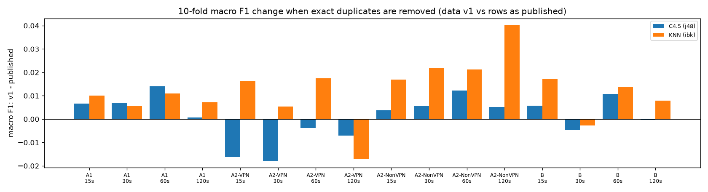

The reason the hypothesis failed is in the rows themselves. The removed duplicates are not copies
of ordinary flows. Between 39% and 92% of them have an identical twin with a different label, against
2-10% of all rows, and their median flow has 0-2 packets (all flows: 8-43). They are near-empty
flows that timing features can't tell apart. Keeping every copy multiplies errors that no model can
avoid, which outweighs the advantage of having a test flow's copy in the training data:

Share of removed rows whose features also occur with another label, and packets per
flow. A1 120 s packet counts use its published (corrupt) flowPktsPerSecond.

| task | timeout | duplicates removed | removed with other-label twin | all rows with other-label twin | median packets, removed | median packets, all |
|---|---|---|---|---|---|---|
| A1 | 15 | 720 | 0.761 | 0.032 | 0.0 | 32.0 |
| A1 | 30 | 1,041 | 0.51 | 0.039 | 2.0 | 22.0 |
| A1 | 60 | 838 | 0.766 | 0.047 | 0.0 | 16.0 |
| A1 | 120 | 1,257 | 0.434 | 0.056 | 0.0 | 0.0 |
| A2-VPN | 15 | 413 | 0.823 | 0.04 | 0.0 | 27.0 |
| A2-VPN | 30 | 790 | 0.395 | 0.045 | 2.0 | 17.0 |
| A2-VPN | 60 | 412 | 0.748 | 0.053 | 0.0 | 8.0 |
| A2-VPN | 120 | 983 | 0.45 | 0.098 | 2.0 | 8.0 |
| A2-NonVPN | 15 | 271 | 0.742 | 0.024 | 0.0 | 43.0 |
| A2-NonVPN | 30 | 223 | 0.897 | 0.03 | 0.0 | 26.0 |
| A2-NonVPN | 60 | 374 | 0.805 | 0.039 | 0.0 | 23.0 |
| A2-NonVPN | 120 | 210 | 0.919 | 0.039 | 0.0 | 17.0 |
| B | 15 | 684 | 0.804 | 0.035 | 0.0 | 32.0 |
| B | 30 | 1,013 | 0.529 | 0.042 | 2.0 | 22.0 |
| B | 60 | 786 | 0.818 | 0.053 | 0.0 | 16.0 |
| B | 120 | 1,193 | 0.562 | 0.078 | 2.0 | 12.0 |

The duplicate rule of data v1 stays: in our own split it guarantees that no flow is scored after
being trained on, and this benchmark shows it changes 10-fold scores by only about +-0.02.

## 4.4 Storage after the baselines

Every official run saves its trained model (the plan's rule). After the first 147 runs (80 baselines, 64 benchmark, 2 pilot, 1 setup check), the MLflow
store held 137.8 MB of artifacts and a 5.8 MB database (275.2 MB and 10.4 MB after the timing
rerun of all 144 configs); the largest single run is 4.3 MB (SVM).
Per model type:

| kind | runs | total_MB | per_run_max_MB | model_file_max_MB |
|---|---|---|---|---|
| knn (holdout) | 16 | 23.075 | 2.475 | 2.319 |
| knn_minmax (paper_10fold) | 32 | 66.742 | 3.596 | 3.438 |
| logreg (holdout) | 16 | 1.64 | 0.167 | 0.005 |
| majority (holdout) | 16 | 1.395 | 0.118 | 0.001 |
| svm_rbf (holdout) | 16 | 27.418 | 4.345 | 4.188 |
| tree (holdout) | 16 | 5.457 | 0.764 | 0.579 |
| tree (paper_10fold) | 32 | 11.674 | 0.817 | 0.629 |

Whole store now (after the rerun): artifacts 275.2 MB, mlflow.db 10.4 MB.

Tree ensembles in Phase 3 will be much larger: a 300-tree Random Forest, measured on the largest
training set (B, 15 s), is a 171.9 MB file (22.4 MB with joblib compression level 3) [E03].

## 4.5 Phase 3: how the improvement experiments were run

Phase 3 (E04-E17) starts from the Phase 2 baselines and changes **one thing at a time** against
the **current best** model of each task: the highest 15 s validation macro F1 so far, whatever
the margin. Every experiment runs first at 15 s for all four tasks. A model is a **winner**, and
is rerun at 30, 60 and 120 s with its 15 s settings, only if it beats the task's current best by
at least 0.03; 0.03 is above the largest Phase 2 cross-validation standard deviation (0.025), so a
smaller gain could be noise from the split. The rule was fixed on 28 Oct, before any Phase 3 run,
and written into every experiment entry before it ran. All Phase 3 runs use data v1, the same
dependency lock file and one thread per model; every model is saved with joblib compression
level 3. Every table below is copied unchanged from `reports/phase3_tables.md`, generated by
`scripts/results_tables.py --phase 3` from `reports/history.csv`; the figures come from
notebooks 03 and 04 (`scripts/make_notebooks.py`). Scores are validation scores of the fixed
70/15/15 split (seed 42); the test set is not used in Phase 3.

## 4.6 E04: KNN with a signed log transform

**What.** KNN (k = 5, as in E03) with a signed log, sign(x)·log1p(|x|), applied inside the
pipeline before scaling, once with StandardScaler and once with RobustScaler (Section 3.7).
**Why.** KNN compares flows by distance, and a few very large timing values (up to about 1.2e8
microseconds) dominate every distance on the raw features. **Threshold (pre-stated).** (a) the
better variant beats the E03 KNN by at least 0.02 in at least 3 of 4 tasks; (b) the two scalers
are within 0.02 of each other in at least 3 of 4 tasks.

| task | model | val macro F1 | CV macro F1 | best before | best before F1 | gain | winner (gain >= 0.03) |
|---|---|---|---|---|---|---|---|
| A1 | E04-knn_log_robust | 0.8929 | 0.8874 +- 0.0042 | E02-tree | 0.8901 | 0.0028 | no |
| A1 | E04-knn_log_standard | 0.9048 | 0.9033 +- 0.0046 | E02-tree | 0.8901 | 0.0146 | no |
| A2-VPN | E04-knn_log_robust | 0.8372 | 0.8185 +- 0.0080 | E02-tree | 0.8247 | 0.0125 | no |
| A2-VPN | E04-knn_log_standard | 0.8544 | 0.8336 +- 0.0103 | E02-tree | 0.8247 | 0.0296 | no |
| A2-NonVPN | E04-knn_log_robust | 0.854 | 0.8688 +- 0.0050 | E02-tree | 0.8294 | 0.0247 | no |
| A2-NonVPN | E04-knn_log_standard | 0.867 | 0.8861 +- 0.0068 | E02-tree | 0.8294 | 0.0376 | yes |
| B | E04-knn_log_robust | 0.742 | 0.7555 +- 0.0094 | E02-tree | 0.7585 | -0.0166 | no |
| B | E04-knn_log_standard | 0.7644 | 0.7798 +- 0.0078 | E02-tree | 0.7585 | 0.0059 | no |

**Result.** The signed log lifts KNN by 0.080-0.104 in every task, and StandardScaler beats
RobustScaler in every task (by 0.0118-0.0224). The signed-log KNN also passes the E02 tree in all
four tasks and becomes the current best; only A2-NonVPN (+0.0376) is a winner (A2-VPN misses the
margin by 0.0004). Rerun at the other timeouts, it stays the best A2-NonVPN run at each:

| task | timeout | model | val macro F1 | CV macro F1 | best other run | its F1 | difference |
|---|---|---|---|---|---|---|---|
| A2-NonVPN | 15 s | E04-knn_log_standard | 0.867 | 0.8861 +- 0.0068 | E04-knn_log_robust | 0.854 | 0.0129 |
| A2-NonVPN | 30 s | E04-knn_log_standard | 0.8523 | 0.8487 +- 0.0067 | E02-tree | 0.8283 | 0.024 |
| A2-NonVPN | 60 s | E04-knn_log_standard | 0.859 | 0.8638 +- 0.0108 | E02-tree | 0.8246 | 0.0344 |
| A2-NonVPN | 120 s | E04-knn_log_standard | 0.8491 | 0.8243 +- 0.0252 | E02-tree | 0.8393 | 0.0098 |

**Verdict.** (a) supported, (b) supported. [E04]

## 4.7 E05: Random Forest

**What.** A 300-tree Random Forest with default settings. **Why.** The E02 tree is unpruned
(depth 16-35) and fits noise; averaging 300 trees grown on bootstrap samples lowers that
variance. **Threshold.** (a) the forest beats the E02 tree by at least 0.03 in at least 3 of 4
tasks; (b) it beats the current best (the E04 KNN) in at least 2 of 4 tasks.

| task | model | val macro F1 | CV macro F1 | best before | best before F1 | gain | winner (gain >= 0.03) |
|---|---|---|---|---|---|---|---|
| A1 | E05-rf | 0.9203 | 0.9172 +- 0.0050 | E04-knn_log_standard | 0.9048 | 0.0156 | no |
| A2-VPN | E05-rf | 0.8679 | 0.8637 +- 0.0066 | E04-knn_log_standard | 0.8544 | 0.0135 | no |
| A2-NonVPN | E05-rf | 0.8941 | 0.9048 +- 0.0049 | E04-knn_log_standard | 0.867 | 0.0271 | no |
| B | E05-rf | 0.8147 | 0.8102 +- 0.0090 | E04-knn_log_standard | 0.7644 | 0.0503 | yes |

**Result.** The forest is the current best in all four tasks (+0.0135 to +0.0503 over the E04
KNN; +0.0302 to +0.0647 over the tree). Only B is a winner; its reruns:

| task | timeout | model | val macro F1 | CV macro F1 | best other run | its F1 | difference |
|---|---|---|---|---|---|---|---|
| B | 15 s | E05-rf | 0.8147 | 0.8102 +- 0.0090 | E04-knn_log_standard | 0.7644 | 0.0503 |
| B | 30 s | E05-rf | 0.8114 | 0.7979 +- 0.0119 | E02-tree | 0.7476 | 0.0638 |
| B | 60 s | E05-rf | 0.7771 | 0.7656 +- 0.0136 | E02-tree | 0.7058 | 0.0713 |
| B | 120 s | E05-rf | 0.7835 | 0.7562 +- 0.0083 | E02-tree | 0.7158 | 0.0677 |

**Verdict.** (a) and (b) supported. The forest is the largest model so far: 171.9 MiB uncompressed
for B at 15 s, 22.4 MiB as a compressed file. [E05]

## 4.8 E06: gradient boosting (XGBoost and LightGBM)

**What.** XGBoost and LightGBM with default settings. **Why.** Boosted trees correct the errors
of earlier trees, which should help the classes the forest still confuses. **Threshold.** (a) the
better booster beats the forest in at least 2 of 4 tasks; (b) the two are within 0.02 of each
other in at least 3 of 4 tasks.

| task | model | val macro F1 | CV macro F1 | best before | best before F1 | gain | winner (gain >= 0.03) |
|---|---|---|---|---|---|---|---|
| A1 | E06-lgbm | 0.9181 | 0.9175 +- 0.0042 | E05-rf | 0.9203 | -0.0022 | no |
| A1 | E06-xgb | 0.9271 | 0.9251 +- 0.0046 | E05-rf | 0.9203 | 0.0067 | no |
| A2-VPN | E06-lgbm | 0.8694 | 0.8827 +- 0.0080 | E05-rf | 0.8679 | 0.0015 | no |
| A2-VPN | E06-xgb | 0.8758 | 0.8799 +- 0.0025 | E05-rf | 0.8679 | 0.0079 | no |
| A2-NonVPN | E06-lgbm | 0.8983 | 0.9224 +- 0.0097 | E05-rf | 0.8941 | 0.0042 | no |
| A2-NonVPN | E06-xgb | 0.9015 | 0.9237 +- 0.0117 | E05-rf | 0.8941 | 0.0075 | no |
| B | E06-lgbm | 0.8201 | 0.8305 +- 0.0088 | E05-rf | 0.8147 | 0.0054 | no |
| B | E06-xgb | 0.8303 | 0.8334 +- 0.0053 | E05-rf | 0.8147 | 0.0156 | no |

**Result.** Default XGBoost is the current best in all four tasks (+0.0067 to +0.0156 over the
forest); LightGBM is 0.0032-0.0102 below it. No winner. **Verdict.** (a) and (b) supported.
Default XGBoost is also one of the cheapest models to run: 1.13-11.76 ms per 1,000 flows, against
21.91-27.28 ms for the forest. The figures show validation macro F1 with cross-validation mean +-
std for every E02-E06 model at 15 s, the F1 of every class, and macro F1 against training and
prediction time. [E06]

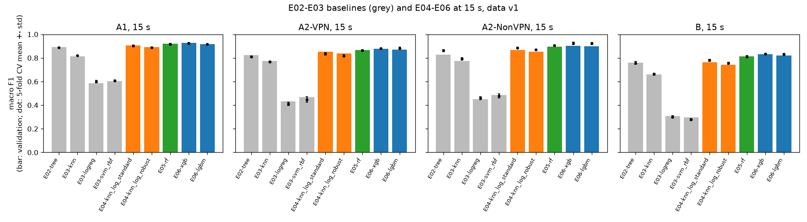

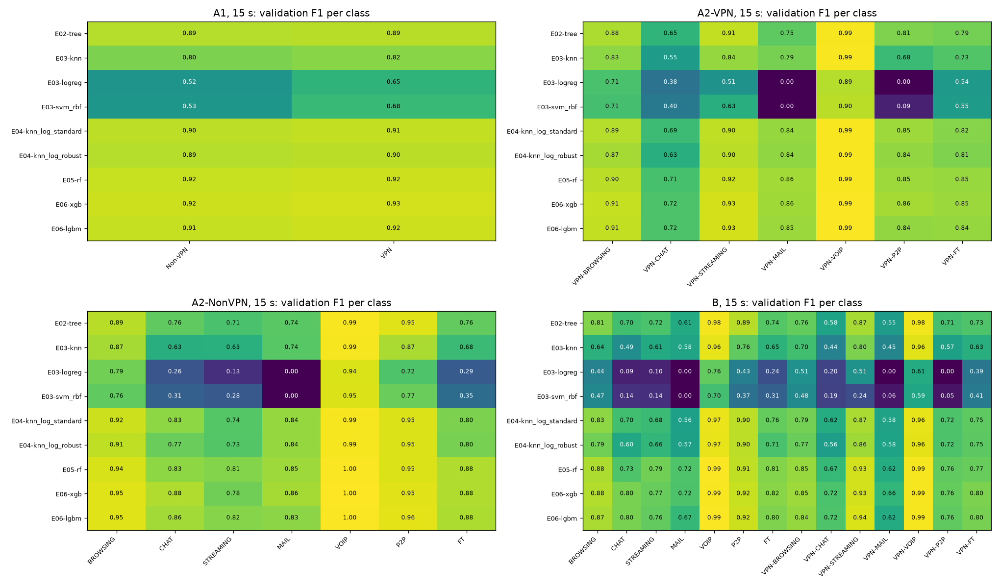

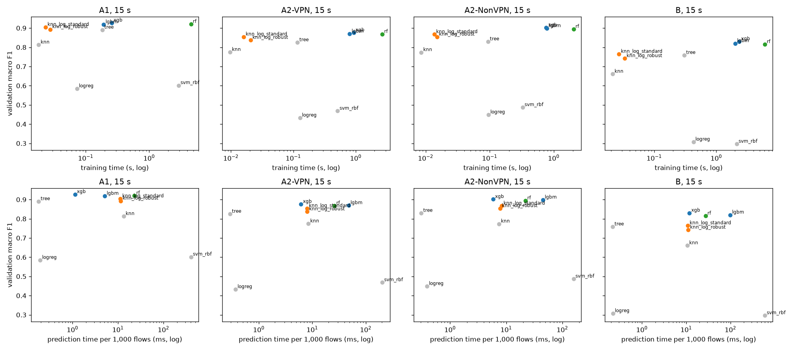

## 4.9 E07: hyperparameter tuning with Optuna

**What.** For each task the best 2 of Random Forest, XGBoost and LightGBM, plus the signed-log
KNN, each tuned with the same budget: 50 Optuna trials (TPE sampler, seed 42), each trial scored
by 5-fold cross-validation macro F1 on the training rows only. The search ranges were fixed in
the plan before running. The best trial is retrained and scored on validation like any other
run. **Why.** Defaults are general-purpose; giving every candidate the same budget means no
model wins only because it was tuned more. **Threshold.** (a) tuned above untuned in at least 8
of 12 searches; (b) the best E07 model beats the current best (default XGBoost) by at least 0.01
in at least 2 of 4 tasks; (c) the tuned KNN stays below the best tuned tree ensemble in all four
tasks.

| task | ranking (15 s val macro F1) | tuned in E07 | KNN preprocessing for E07 |
|---|---|---|---|
| A1 | xgb 0.9271, rf 0.9203, lgbm 0.9181 | xgb, rf | knn_log_standard 0.9048 |
| A2-VPN | xgb 0.8758, lgbm 0.8694, rf 0.8679 | xgb, lgbm | knn_log_standard 0.8544 |
| A2-NonVPN | xgb 0.9015, lgbm 0.8983, rf 0.8941 | xgb, lgbm | knn_log_standard 0.8670 |
| B | xgb 0.8303, lgbm 0.8201, rf 0.8147 | xgb, lgbm | knn_log_standard 0.7644 |

| task | model | val macro F1 | CV macro F1 | best before | best before F1 | gain | winner (gain >= 0.03) |
|---|---|---|---|---|---|---|---|
| A1 | E07-knn_log_standard | 0.9163 | 0.9122 +- 0.0047 | E06-xgb | 0.9271 | -0.0108 | no |
| A1 | E07-rf | 0.9181 | 0.9209 +- 0.0025 | E06-xgb | 0.9271 | -0.009 | no |
| A1 | E07-xgb | 0.9259 | 0.9293 +- 0.0065 | E06-xgb | 0.9271 | -0.0011 | no |
| A2-VPN | E07-knn_log_standard | 0.8625 | 0.8575 +- 0.0048 | E06-xgb | 0.8758 | -0.0133 | no |
| A2-VPN | E07-lgbm | 0.8768 | 0.8902 +- 0.0023 | E06-xgb | 0.8758 | 0.001 | no |
| A2-VPN | E07-xgb | 0.8661 | 0.8838 +- 0.0011 | E06-xgb | 0.8758 | -0.0097 | no |
| A2-NonVPN | E07-knn_log_standard | 0.8929 | 0.9060 +- 0.0071 | E06-xgb | 0.9015 | -0.0086 | no |
| A2-NonVPN | E07-lgbm | 0.9028 | 0.9329 +- 0.0072 | E06-xgb | 0.9015 | 0.0013 | no |
| A2-NonVPN | E07-xgb | 0.9025 | 0.9294 +- 0.0067 | E06-xgb | 0.9015 | 0.001 | no |
| B | E07-knn_log_standard | 0.8006 | 0.8044 +- 0.0111 | E06-xgb | 0.8303 | -0.0297 | no |
| B | E07-lgbm | 0.8352 | 0.8447 +- 0.0058 | E06-xgb | 0.8303 | 0.0049 | no |
| B | E07-xgb | 0.8428 | 0.8405 +- 0.0056 | E06-xgb | 0.8303 | 0.0125 | no |

**Result.** Tuning raised the cross-validation score in all 12 searches but the validation score
in only 9: the best of 50 cross-validation scores is optimistic. The largest gains are for KNN
(B +0.0361, A2-NonVPN +0.0260); the ensembles gain at most +0.0151. Only B improves by more than
0.01 (tuned XGBoost 0.8428, +0.0125). No winner. In every search the retrained model's
cross-validation score equals its best trial's exactly. **Verdict.** (a) supported (9 of 12),
(b) not supported (1 of 4 tasks), (c) supported. [E07]

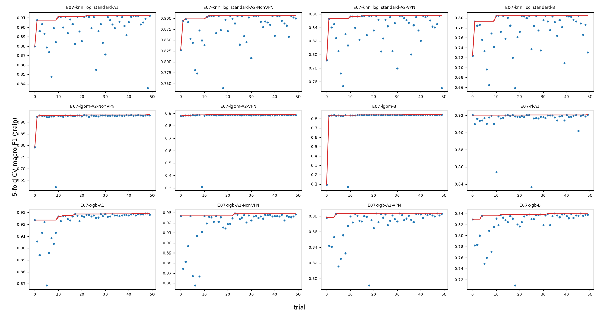

## 4.10 E08: class balancing

**What.** On the current best model per task, a ladder: none, then class weights, then random
oversampling, then SMOTE (inside the pipeline, so only training folds are resampled); a step runs
only if every earlier step helped. **Why.** Three tasks are imbalanced (largest to smallest class
5.79:1 in A2-VPN, 11.85:1 in A2-NonVPN and B), and macro F1 weights every class equally.
**Threshold.** (a) the best step beats "none" by at least 0.01 in at least 2 of the 3 imbalanced
tasks; (b) in A1 no step moves macro F1 by more than 0.01; (c) the best step raises the F1 of the
weakest class in at least 2 of the 3 imbalanced tasks.

| task | step | run | val macro F1 | change vs none | F1 of weakest class without balancing | helped | next |
|---|---|---|---|---|---|---|---|
| A1 | none | E06-xgb | 0.9271 | 0.0 | Non-VPN 0.9240 |  |  |
| A1 | class_weight | E08-xgb_class_weight | 0.9237 | -0.0034 | Non-VPN 0.9202 | no | stop: this step did not help |
| A2-VPN | none | E07-lgbm | 0.8768 | 0.0 | VPN-CHAT 0.7343 |  |  |
| A2-VPN | class_weight | E08-lgbm_class_weight | 0.883 | 0.0062 | VPN-CHAT 0.7463 | yes |  |
| A2-VPN | oversample | E08-lgbm_oversample | 0.883 | 0.0062 | VPN-CHAT 0.7477 | no | stop: this step did not help |
| A2-NonVPN | none | E07-lgbm | 0.9028 | 0.0 | STREAMING 0.8095 |  |  |
| A2-NonVPN | class_weight | E08-lgbm_class_weight | 0.9049 | 0.0022 | STREAMING 0.8189 | yes |  |
| A2-NonVPN | oversample | E08-lgbm_oversample | 0.9075 | 0.0047 | STREAMING 0.8372 | yes |  |
| A2-NonVPN | smote | E08-lgbm_smote | 0.9046 | 0.0019 | STREAMING 0.8217 | no | stop: this step did not help |
| B | none | E07-xgb | 0.8428 | 0.0 | VPN-MAIL 0.6496 |  |  |
| B | class_weight | E08-xgb_class_weight | 0.8364 | -0.0064 | VPN-MAIL 0.6290 | no | stop: this step did not help |

**Result.** Every change is within +-0.0064. Balancing helps a little in A2-VPN (class weights
+0.0062) and A2-NonVPN (random oversampling +0.0047) and hurts in A1 and B. **Verdict.** (a)
not supported, (b) supported, (c) supported.
The weak classes (VPN-CHAT, STREAMING, VPN-MAIL) seem to fail because their flows look like those
of other classes, not because there are too few of them; E08 does not test this directly. [E08]

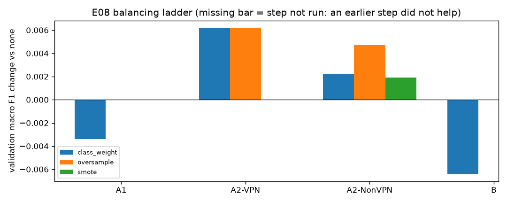

## 4.11 E10: task B as one 14-class model or two steps

**What.** A two-step model for task B: a VPN / non-VPN model routes each flow to one of two
7-class models. All three models use the current best B model type and settings (tuned XGBoost),
and all are trained on B's training rows only. They are never trained on the A1 split, because
A1 and B hold the same flows split differently. **Why.** Task B mixes two questions; separating
them could help. **Threshold.** (a) the two-step score is within 0.01 of the direct model; (b) its
first step makes fewer VPN / non-VPN errors than the direct model (180); (c) more than half of its
errors come from a wrong first step.

| structure | run | val macro F1 | CV macro F1 | val accuracy | rows | errors | group errors (VPN / non-VPN wrong) | type errors (right group, wrong type) | group accuracy | share of errors from the group |
|---|---|---|---|---|---|---|---|---|---|---|
| direct 14-class | E07-xgb | 0.8428 | 0.8405 +- 0.0056 | 0.8794 | 2,711 | 327 | 180 | 147 | 0.9336 | 0.5505 |
| two-step | E10-xgb_two_step | 0.8318 | 0.8274 +- 0.0083 | 0.8727 | 2,711 | 345 | 191 | 154 | 0.9295 | 0.5536 |

**Result.** The two-step model scores 0.0110 lower, makes more group errors (191 vs 180), and
55.36% of its errors come from the first step. The direct model also makes 55.05% of its errors
across the VPN / non-VPN line: telling VPN from non-VPN is the hard part either way. **Verdict.**
(a) not supported, (b) not supported, (c) supported. Task B stays a direct 14-class model. [E10]

## 4.12 E17: the same tuning budget for every method type

**What.** The same 50-trial search as E07 for every method type not yet tuned: decision tree,
logistic regression and SVM-RBF in all four tasks, Random Forest in A2-VPN, A2-NonVPN and B, and
LightGBM in A1 (16 searches). Logistic regression and SVM may choose the signed log inside the
search. **Why.** Without it, a comparison of method types would mix tuned and untuned models, the
weakness we point out in earlier studies. Added on 28 Oct after E10, with the ranges agreed before
running. **Threshold.** (a) tuned above untuned in at least 12 of 16 searches; (b) the best run
per task is still XGBoost or LightGBM in at least 3 of 4 tasks; (c) the signed log is chosen in at
least 6 of the 8 logistic-regression and SVM searches.

| task | model | val macro F1 | CV macro F1 | best before | best before F1 | gain | winner (gain >= 0.03) |
|---|---|---|---|---|---|---|---|
| A1 | E17-lgbm | 0.9308 | 0.9320 +- 0.0028 | E06-xgb | 0.9271 | 0.0037 | no |
| A1 | E17-logreg | 0.6517 | 0.6762 +- 0.0051 | E06-xgb | 0.9271 | -0.2754 | no |
| A1 | E17-svm_rbf | 0.9259 | 0.9187 +- 0.0044 | E06-xgb | 0.9271 | -0.0011 | no |
| A1 | E17-tree | 0.8905 | 0.8915 +- 0.0043 | E06-xgb | 0.9271 | -0.0366 | no |
| A2-VPN | E17-logreg | 0.7263 | 0.7344 +- 0.0074 | E08-lgbm_class_weight | 0.883 | -0.1566 | no |
| A2-VPN | E17-rf | 0.8704 | 0.8707 +- 0.0069 | E08-lgbm_class_weight | 0.883 | -0.0126 | no |
| A2-VPN | E17-svm_rbf | 0.8707 | 0.8668 +- 0.0074 | E08-lgbm_class_weight | 0.883 | -0.0123 | no |
| A2-VPN | E17-tree | 0.8292 | 0.8129 +- 0.0071 | E08-lgbm_class_weight | 0.883 | -0.0538 | no |
| A2-NonVPN | E17-logreg | 0.8002 | 0.8138 +- 0.0120 | E08-lgbm_oversample | 0.9075 | -0.1073 | no |
| A2-NonVPN | E17-rf | 0.8829 | 0.9063 +- 0.0050 | E08-lgbm_oversample | 0.9075 | -0.0246 | no |
| A2-NonVPN | E17-svm_rbf | 0.9058 | 0.9256 +- 0.0042 | E08-lgbm_oversample | 0.9075 | -0.0017 | no |
| A2-NonVPN | E17-tree | 0.8294 | 0.8619 +- 0.0086 | E08-lgbm_oversample | 0.9075 | -0.0781 | no |
| B | E17-logreg | 0.5862 | 0.5909 +- 0.0067 | E07-xgb | 0.8428 | -0.2566 | no |
| B | E17-rf | 0.8167 | 0.8270 +- 0.0092 | E07-xgb | 0.8428 | -0.0261 | no |
| B | E17-svm_rbf | 0.8242 | 0.8228 +- 0.0059 | E07-xgb | 0.8428 | -0.0186 | no |
| B | E17-tree | 0.7585 | 0.7575 +- 0.0132 | E07-xgb | 0.8428 | -0.0843 | no |

**Result.** SVM-RBF gains the most (+0.3243 to +0.5277), and every logistic-regression and SVM
search chose the signed log. The tuned SVM ends 0.0017-0.0186 below each task's best. Logistic
regression gains +0.0670 to +0.3515 but stays at 0.5862-0.8002. The tree (0.0000 to +0.0044) and
the forest (-0.0111 to +0.0025) barely change. Tuned LightGBM is the new A1 best (0.9308). No
winner. **Verdict.** (a) supported (13 of 16), (b) supported (4 of 4), (c) supported (8 of
8). The A2-NonVPN logistic regression stops at its fixed
1,000 iterations before converging (chosen C = 985); this is recorded as a limitation and was
not changed after the run. [E17]

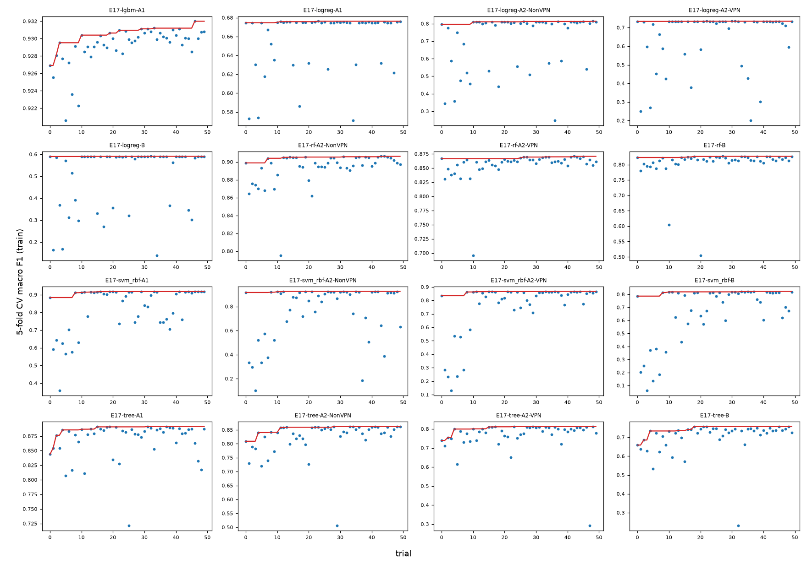

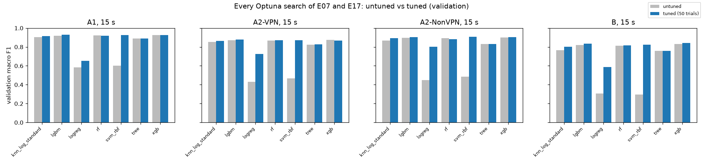

## 4.13 Final choice per task and the comparison set

The final configuration per task is the run with the highest validation macro F1 among all
model-selection runs (E02-E17, any timeout), decided on 28 Oct after E10. This replaces the rule
set before Phase 3, under which any gap below 0.03 was a tie broken in favour of the simpler
model. The cross-validation standard deviations of the headline models (0.0028-0.0058) are far
below 0.03,
and under the old rule KNN or the SVM would have been chosen at 0.0146-0.0286 below the best.
This is a deviation from the pre-set rule and is reported as one (Section 3.8). The models the old
rule would pick were also scored on the test set (E12), so the cost of either rule is visible
(Section 5.3). The only fallback is a saved model file above 50 MB; none of the four is.

| task | run | method type | timeout | val macro F1 | next best | next best F1 | model file MiB | skipped for file size |
|---|---|---|---|---|---|---|---|---|
| A1 | E17-lgbm-A1-15s | LightGBM | 15 | 0.9308 | E06-xgb-A1-15s | 0.9271 | 7.09 | none |
| A2-VPN | E08-lgbm_class_weight-A2-VPN-15s | LightGBM | 15 | 0.883 | E08-lgbm_oversample-A2-VPN-15s | 0.883 | 25.12 | none |
| A2-NonVPN | E08-lgbm_oversample-A2-NonVPN-15s | LightGBM | 15 | 0.9075 | E17-svm_rbf-A2-NonVPN-15s | 0.9058 | 4.32 | none |
| B | E07-xgb-B-15s | XGBoost | 15 | 0.8428 | E08-xgb_class_weight-B-15s | 0.8364 | 4.31 | none |

| task | run | method type | val macro F1 | below the best by | runs within 0.03 | in comparison set |
|---|---|---|---|---|---|---|
| A1 | E04-knn_log_standard-A1-15s | KNN | 0.9048 | 0.026 | 10 | no |
| A2-VPN | E04-knn_log_standard-A2-VPN-15s | KNN | 0.8544 | 0.0286 | 11 | no |
| A2-NonVPN | E07-knn_log_standard-A2-NonVPN-15s | KNN | 0.8929 | 0.0146 | 11 | yes |
| B | E17-svm_rbf-B-15s | SVM-RBF | 0.8242 | 0.0186 | 9 | yes |

The **comparison set** holds, per task, the best 15 s validation variant of each of the 7 method
types, 28 models in all. It was fixed in `configs/final/compare/` before the test set was opened.
In Phase 4 each was retrained on training + validation data and scored once on the test set, with
26 paired bootstrap tests on macro F1 (Holm correction), fixed before the test set was opened
(Section 3.3, E12; results in Section 5.3).

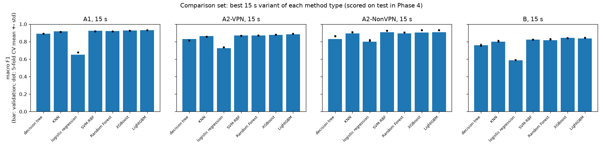

| task | method type | run | val macro F1 | variants compared |
|---|---|---|---|---|
| A1 | decision tree | E17-tree-A1-15s | 0.8905 | 2 |
| A1 | KNN | E07-knn_log_standard-A1-15s | 0.9163 | 4 |
| A1 | logistic regression | E17-logreg-A1-15s | 0.6517 | 2 |
| A1 | SVM-RBF | E17-svm_rbf-A1-15s | 0.9259 | 2 |
| A1 | Random Forest | E05-rf-A1-15s | 0.9203 | 2 |
| A1 | XGBoost | E06-xgb-A1-15s | 0.9271 | 3 |
| A1 | LightGBM | E17-lgbm-A1-15s | 0.9308 | 2 |
| A2-VPN | decision tree | E17-tree-A2-VPN-15s | 0.8292 | 2 |
| A2-VPN | KNN | E07-knn_log_standard-A2-VPN-15s | 0.8625 | 4 |
| A2-VPN | logistic regression | E17-logreg-A2-VPN-15s | 0.7263 | 2 |
| A2-VPN | SVM-RBF | E17-svm_rbf-A2-VPN-15s | 0.8707 | 2 |
| A2-VPN | Random Forest | E17-rf-A2-VPN-15s | 0.8704 | 2 |
| A2-VPN | XGBoost | E06-xgb-A2-VPN-15s | 0.8758 | 2 |
| A2-VPN | LightGBM | E08-lgbm_class_weight-A2-VPN-15s | 0.883 | 4 |
| A2-NonVPN | decision tree | E02-tree-A2-NonVPN-15s | 0.8294 | 2 |
| A2-NonVPN | KNN | E07-knn_log_standard-A2-NonVPN-15s | 0.8929 | 4 |
| A2-NonVPN | logistic regression | E17-logreg-A2-NonVPN-15s | 0.8002 | 2 |
| A2-NonVPN | SVM-RBF | E17-svm_rbf-A2-NonVPN-15s | 0.9058 | 2 |
| A2-NonVPN | Random Forest | E05-rf-A2-NonVPN-15s | 0.8941 | 2 |
| A2-NonVPN | XGBoost | E07-xgb-A2-NonVPN-15s | 0.9025 | 2 |
| A2-NonVPN | LightGBM | E08-lgbm_oversample-A2-NonVPN-15s | 0.9075 | 5 |
| B | decision tree | E02-tree-B-15s | 0.7585 | 2 |
| B | KNN | E07-knn_log_standard-B-15s | 0.8006 | 4 |
| B | logistic regression | E17-logreg-B-15s | 0.5862 | 2 |
| B | SVM-RBF | E17-svm_rbf-B-15s | 0.8242 | 2 |
| B | Random Forest | E17-rf-B-15s | 0.8167 | 2 |
| B | XGBoost | E07-xgb-B-15s | 0.8428 | 4 |
| B | LightGBM | E07-lgbm-B-15s | 0.8352 | 2 |

## 4.14 E09: feature-group ablation (analysis only)

**What.** The four headline models retrained with one feature group only, with one group
removed, and with the timing-only set (all but flowBytesPerSecond, the only size-based feature).
**Threshold.** (a) every group alone scores below all 23 features in all four tasks; (b) dropping
any one group costs at most 0.02 in at least 3 of 4 tasks; (c) the timing-only set is within 0.01
of all 23 features in at least 3 of 4 tasks. If any set scored at least 0.03 above all 23, the
work would stop and the user would be asked (it did not happen).

| task | feature set | features | val macro F1 | change vs all | CV macro F1 |
|---|---|---|---|---|---|
| A1 | all | 23 | 0.9308 | 0.0 | 0.9320 +- 0.0028 |
| A1 | only_fiat | 4 | 0.8078 | -0.1229 | 0.8111 +- 0.0059 |
| A1 | only_biat | 4 | 0.8243 | -0.1064 | 0.8136 +- 0.0100 |
| A1 | only_flowiat | 4 | 0.8507 | -0.08 | 0.8456 +- 0.0043 |
| A1 | only_active | 4 | 0.5489 | -0.3819 | 0.5618 +- 0.0124 |
| A1 | only_idle | 4 | 0.5505 | -0.3803 | 0.5614 +- 0.0107 |
| A1 | only_rates_duration | 3 | 0.8392 | -0.0915 | 0.8363 +- 0.0063 |
| A1 | no_fiat | 19 | 0.9256 | -0.0052 | 0.9187 +- 0.0050 |
| A1 | no_biat | 19 | 0.9152 | -0.0155 | 0.9161 +- 0.0050 |
| A1 | no_flowiat | 19 | 0.9322 | 0.0014 | 0.9222 +- 0.0019 |
| A1 | no_active | 19 | 0.9296 | -0.0011 | 0.9300 +- 0.0024 |
| A1 | no_idle | 19 | 0.9304 | -0.0004 | 0.9302 +- 0.0031 |
| A1 | no_rates_duration | 20 | 0.9185 | -0.0122 | 0.9133 +- 0.0054 |
| A1 | timing_only | 22 | 0.9159 | -0.0148 | 0.9140 +- 0.0031 |
| A2-VPN | all | 23 | 0.883 | 0.0 | 0.8893 +- 0.0044 |
| A2-VPN | only_fiat | 4 | 0.7593 | -0.1237 | 0.7326 +- 0.0146 |
| A2-VPN | only_biat | 4 | 0.7199 | -0.1631 | 0.6958 +- 0.0108 |
| A2-VPN | only_flowiat | 4 | 0.7861 | -0.0969 | 0.7690 +- 0.0107 |
| A2-VPN | only_active | 4 | 0.3252 | -0.5578 | 0.3222 +- 0.0193 |
| A2-VPN | only_idle | 4 | 0.3067 | -0.5763 | 0.3208 +- 0.0145 |
| A2-VPN | only_rates_duration | 3 | 0.779 | -0.104 | 0.7661 +- 0.0082 |
| A2-VPN | no_fiat | 19 | 0.8651 | -0.0179 | 0.8723 +- 0.0037 |
| A2-VPN | no_biat | 19 | 0.8724 | -0.0105 | 0.8760 +- 0.0037 |
| A2-VPN | no_flowiat | 19 | 0.8752 | -0.0078 | 0.8833 +- 0.0054 |
| A2-VPN | no_active | 19 | 0.886 | 0.003 | 0.8895 +- 0.0041 |
| A2-VPN | no_idle | 19 | 0.8826 | -0.0004 | 0.8893 +- 0.0054 |
| A2-VPN | no_rates_duration | 20 | 0.8435 | -0.0395 | 0.8449 +- 0.0083 |
| A2-VPN | timing_only | 22 | 0.849 | -0.034 | 0.8410 +- 0.0095 |
| A2-NonVPN | all | 23 | 0.9075 | 0.0 | 0.9310 +- 0.0058 |
| A2-NonVPN | only_fiat | 4 | 0.7535 | -0.154 | 0.7720 +- 0.0087 |
| A2-NonVPN | only_biat | 4 | 0.7271 | -0.1804 | 0.7407 +- 0.0140 |
| A2-NonVPN | only_flowiat | 4 | 0.8165 | -0.091 | 0.8288 +- 0.0095 |
| A2-NonVPN | only_active | 4 | 0.3355 | -0.572 | 0.3208 +- 0.0128 |
| A2-NonVPN | only_idle | 4 | 0.3038 | -0.6037 | 0.3225 +- 0.0177 |
| A2-NonVPN | only_rates_duration | 3 | 0.8471 | -0.0604 | 0.8396 +- 0.0110 |
| A2-NonVPN | no_fiat | 19 | 0.9024 | -0.0051 | 0.9260 +- 0.0087 |
| A2-NonVPN | no_biat | 19 | 0.8993 | -0.0082 | 0.9240 +- 0.0087 |
| A2-NonVPN | no_flowiat | 19 | 0.903 | -0.0045 | 0.9189 +- 0.0065 |
| A2-NonVPN | no_active | 19 | 0.9093 | 0.0018 | 0.9283 +- 0.0066 |
| A2-NonVPN | no_idle | 19 | 0.9039 | -0.0036 | 0.9300 +- 0.0045 |
| A2-NonVPN | no_rates_duration | 20 | 0.8774 | -0.0301 | 0.8980 +- 0.0037 |
| A2-NonVPN | timing_only | 22 | 0.8744 | -0.0331 | 0.9000 +- 0.0060 |
| B | all | 23 | 0.8428 | 0.0 | 0.8405 +- 0.0056 |
| B | only_fiat | 4 | 0.64 | -0.2028 | 0.6399 +- 0.0089 |
| B | only_biat | 4 | 0.6098 | -0.233 | 0.6147 +- 0.0121 |
| B | only_flowiat | 4 | 0.6716 | -0.1712 | 0.6926 +- 0.0102 |
| B | only_active | 4 | 0.2138 | -0.629 | 0.2262 +- 0.0072 |
| B | only_idle | 4 | 0.2083 | -0.6345 | 0.2118 +- 0.0092 |
| B | only_rates_duration | 3 | 0.7043 | -0.1385 | 0.6886 +- 0.0091 |
| B | no_fiat | 19 | 0.8244 | -0.0184 | 0.8266 +- 0.0072 |
| B | no_biat | 19 | 0.8163 | -0.0265 | 0.8189 +- 0.0067 |
| B | no_flowiat | 19 | 0.8262 | -0.0166 | 0.8284 +- 0.0052 |
| B | no_active | 19 | 0.8479 | 0.0051 | 0.8400 +- 0.0071 |
| B | no_idle | 19 | 0.8428 | 0.0 | 0.8405 +- 0.0058 |
| B | no_rates_duration | 20 | 0.7879 | -0.0549 | 0.7936 +- 0.0076 |
| B | timing_only | 22 | 0.7987 | -0.0441 | 0.7949 +- 0.0062 |

**Result.** No single group comes close to all 23 features (the best single group is
0.0604-0.1385 below). Removing rates + duration costs the most in A2-VPN, A2-NonVPN and B
(0.0395, 0.0301, 0.0549); in A1 removing the backward gaps costs more (0.0155 against 0.0122). Active or
idle features can be removed with almost no effect (at most +-0.0051). The timing-only set loses
0.0148-0.0441, so packet sizes carry information here. **Verdict.** (a) supported, (b) not supported, (c) not supported. Nothing changes in the final
configurations. [E09]

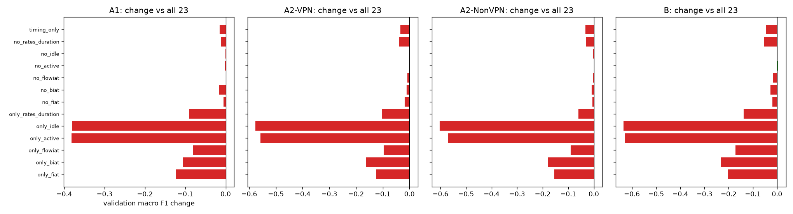

## 4.15 E13: learning curve (analysis only)

**What.** The headline models trained on 10%, 20%, 40%, 60% and 80% of the training rows
(stratified samples, 5 seeds each) and scored on the full validation set; 100% is the headline
run. **Threshold.** (a) 100% scores above 10% in all four tasks; (b) the gain from 80% to 100% is
below 0.01 in at least 3 of 4 tasks; (c) the spread over seeds is larger at 10% than at 80% in at
least 3 of 4 tasks.

| task | train fraction | runs | training rows | val macro F1 mean | val macro F1 std |
|---|---|---|---|---|---|
| A1 | 0.1 | 5 | 1,262 | 0.8724 | 0.0062 |
| A1 | 0.2 | 5 | 2,525 | 0.8952 | 0.0041 |
| A1 | 0.4 | 5 | 5,050 | 0.9106 | 0.0066 |
| A1 | 0.6 | 5 | 7,575 | 0.9213 | 0.0039 |
| A1 | 0.8 | 5 | 10,100 | 0.927 | 0.0029 |
| A1 | 1.0 | 1 | 12,626 | 0.9308 |  |
| A2-VPN | 0.1 | 5 | 656 | 0.7793 | 0.0052 |
| A2-VPN | 0.2 | 5 | 1,313 | 0.826 | 0.0101 |
| A2-VPN | 0.4 | 5 | 2,626 | 0.8582 | 0.0041 |
| A2-VPN | 0.6 | 5 | 3,939 | 0.8721 | 0.0053 |
| A2-VPN | 0.8 | 5 | 5,252 | 0.8804 | 0.0036 |
| A2-VPN | 1.0 | 1 | 6,566 | 0.883 |  |
| A2-NonVPN | 0.1 | 5 | 608 | 0.8176 | 0.0093 |
| A2-NonVPN | 0.2 | 5 | 1,217 | 0.8585 | 0.0118 |
| A2-NonVPN | 0.4 | 5 | 2,434 | 0.8806 | 0.0057 |
| A2-NonVPN | 0.6 | 5 | 3,651 | 0.8934 | 0.0045 |
| A2-NonVPN | 0.8 | 5 | 4,868 | 0.9005 | 0.0033 |
| A2-NonVPN | 1.0 | 1 | 6,085 | 0.9075 |  |
| B | 0.1 | 5 | 1,265 | 0.6969 | 0.0097 |
| B | 0.2 | 5 | 2,530 | 0.7468 | 0.0138 |
| B | 0.4 | 5 | 5,060 | 0.7975 | 0.0036 |
| B | 0.6 | 5 | 7,590 | 0.8156 | 0.0016 |
| B | 0.8 | 5 | 10,120 | 0.8297 | 0.0029 |
| B | 1.0 | 1 | 12,651 | 0.8428 |  |

**Result.** Every task gains with more data (10% to 100%: +0.0584 to +0.1459). A1 and both A2
tasks are near their plateau (80% to 100%: +0.0026 to +0.0070), but the 14-class task B still
gains +0.0131. **Verdict.** (a), (b) and (c) supported. [E13]

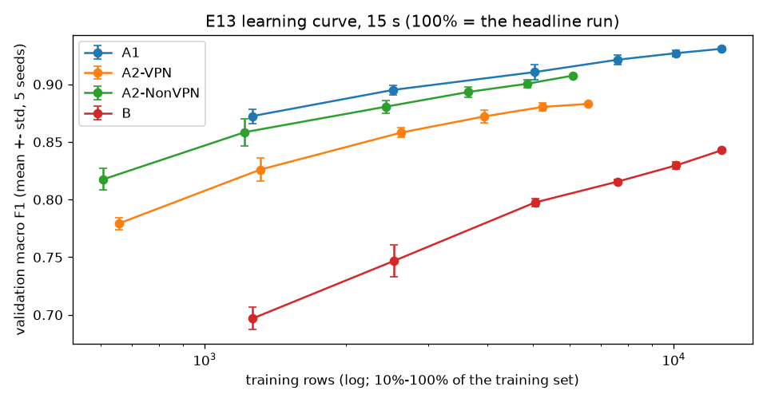

## 4.16 E14: split-seed stability (analysis only)

**What.** The headline models retrained on 10 new stratified splits of training + validation
(seeds 42-51, same sizes). The seed-42 test rows are never pooled or looked at. Seed 42 here is a
resplit, not the official split. **Threshold.** (a) the standard deviation is below 0.01 in at
least 3 of 4 tasks; (b) mean cross-validation minus mean validation is within 0.01 in at least 3
of 4 tasks; (c) the official validation score lies inside the range of the 10 resplits in all four
tasks.

| task | seeds | val macro F1 mean | val macro F1 std | val macro F1 min | val macro F1 max | val accuracy mean | val accuracy std | CV macro F1 mean | CV - val mean | official split (seed 42) val macro F1 |
|---|---|---|---|---|---|---|---|---|---|---|
| A1 | 10 | 0.9338 | 0.0042 | 0.9275 | 0.9397 | 0.9339 | 0.0042 | 0.9306 | -0.0032 | 0.9308 |
| A2-VPN | 10 | 0.8862 | 0.0114 | 0.8689 | 0.902 | 0.9037 | 0.0066 | 0.8805 | -0.0057 | 0.883 |
| A2-NonVPN | 10 | 0.9324 | 0.0071 | 0.9257 | 0.9468 | 0.9589 | 0.0044 | 0.9283 | -0.0041 | 0.9075 |
| B | 10 | 0.8476 | 0.0084 | 0.8344 | 0.8636 | 0.8819 | 0.0074 | 0.8358 | -0.0119 | 0.8428 |

**Result.** Scores move with the split by a standard deviation of 0.0042-0.0114. In A2-NonVPN
the official validation score (0.9075) is below all 10 resplits (0.9257-0.9468): its validation
rows are unusually hard, mostly for MAIL and P2P. This also explains the large cross-validation
minus validation gaps seen for A2-NonVPN in E04-E17. **Verdict.** (a) supported, (b) supported,
(c) not supported. [E14]

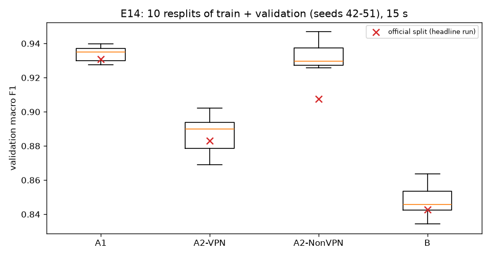

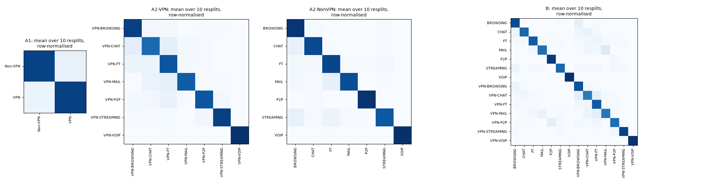

## 4.17 E11: session-aware split (not run)

The ARFF files hold only the 23 features and the label, with no flow IDs, addresses, ports,
timestamps or capture-file names, so flows cannot be grouped by recording session (E00). E11
therefore does not run. Exact duplicates were removed before the split (E00), and E14 and E16(b)
measure related effects. The missing session split is a limitation (Section 7). [E11]

## 4.18 E16: reproducing Isnan et al. (2026), then correcting it

**What.** Isnan et al. report 88.01% accuracy for a 300-tree Random Forest on the Kaggle copy of
the dataset, which is the eight A2 files from all four timeouts stacked (Section 2.9). E16 used
its own data version (kaggle-k1) and ran four parts:
- **(a)** their exact setup: duplicates dropped over the whole file, a stratified 80/20 split
  with seed 42, and their grid search with accuracy as the score;
- **(b)** the same method with each timeout kept apart;
- **(c)** our tuned task-B XGBoost under (b);
- **(d)**, added in a recheck: (a)'s forest trained on mixed-timeout rows cut to each
  per-timeout training size.

**Threshold.** (a) accuracy and weighted F1 within 0.01 of theirs; (b) the per-timeout mean is at
least 0.01 below (a); (c) our model's per-timeout mean is at least the forest's; (d) at equal
training size, mixing timeouts adds less than 0.01 over (b).

| run | split | train / test rows | grid pick | grid best CV accuracy | test accuracy | test weighted F1 | test macro F1 |
|---|---|---|---|---|---|---|---|
| E16-isnan-rf | isnan | 32,789 / 8,198 | {"max_depth": null, "min_samples_leaf": 1, "min_samples_split": 2, "n_estimators": 200} | 0.8742 | 0.8796 | 0.8792 | 0.8407 |
| E16-per_timeout-rf-120s | per_timeout_120s | 7,671 / 1,918 | {"max_depth": null, "min_samples_leaf": 1, "min_samples_split": 5, "n_estimators": 300} | 0.8178 | 0.8206 | 0.817 | 0.7724 |
| E16-per_timeout-rf-15s | per_timeout_15s | 14,459 / 3,615 | {"max_depth": 30, "min_samples_leaf": 1, "min_samples_split": 2, "n_estimators": 300} | 0.8578 | 0.8658 | 0.8652 | 0.8323 |
| E16-per_timeout-rf-30s | per_timeout_30s | 10,910 / 2,728 | {"max_depth": 30, "min_samples_leaf": 1, "min_samples_split": 2, "n_estimators": 300} | 0.8457 | 0.8537 | 0.8527 | 0.815 |
| E16-per_timeout-rf-60s | per_timeout_60s | 11,783 / 2,946 | {"max_depth": 30, "min_samples_leaf": 1, "min_samples_split": 2, "n_estimators": 300} | 0.8307 | 0.8316 | 0.8308 | 0.7873 |
| E16-per_timeout-xgb-120s | per_timeout_120s | 7,671 / 1,918 | fixed (configs/final/B.yaml) |  | 0.8384 | 0.8346 | 0.7881 |
| E16-per_timeout-xgb-15s | per_timeout_15s | 14,459 / 3,615 | fixed (configs/final/B.yaml) |  | 0.8924 | 0.8919 | 0.8637 |
| E16-per_timeout-xgb-30s | per_timeout_30s | 10,910 / 2,728 | fixed (configs/final/B.yaml) |  | 0.8728 | 0.872 | 0.8327 |
| E16-per_timeout-xgb-60s | per_timeout_60s | 11,783 / 2,946 | fixed (configs/final/B.yaml) |  | 0.8551 | 0.8544 | 0.8076 |

| training rows (timeouts mixed) | runs | test accuracy mean | std | min - max | 15s test rows | 30s test rows | 60s test rows | 120s test rows | (b) same rows, one timeout |
|---|---|---|---|---|---|---|---|---|---|
| 32,789 | 1 | 0.8796 |  |  | 0.8913 | 0.9038 | 0.8982 | 0.8222 |  |
| 14,459 | 5 | 0.8504 | 0.0021 | 0.8470 - 0.8529 | 0.8643 | 0.8798 | 0.8655 | 0.7887 | 15s: 0.8658 |
| 11,783 | 5 | 0.8435 | 0.0028 | 0.8401 - 0.8464 | 0.8592 | 0.8742 | 0.8558 | 0.7809 | 60s: 0.8316 |
| 10,910 | 5 | 0.8396 | 0.0024 | 0.8367 - 0.8430 | 0.8559 | 0.8708 | 0.8517 | 0.7755 | 30s: 0.8537 |
| 7,671 | 5 | 0.8243 | 0.0038 | 0.8202 - 0.8302 | 0.8402 | 0.8576 | 0.8372 | 0.7583 | 120s: 0.8206 |

**Result.**
- **(a)** Their result is reproduced: 0.8796 accuracy and 0.8792 weighted F1, against their
  0.8801 and 0.8797, on the same split. Their accuracy hides weaker small classes (macro F1
  0.8407).
- **(b)** With the timeouts kept apart, the same method scores 0.8206-0.8658 (mean 0.8430).
- **(d)** That drop is explained by training-set size, not by the mixing. Stacking the four files
  gives 2.3-4.3 times as many training rows. At equal size the mixed setup scores 0.8395 on
  average, slightly below (b).
- **(c)** Our tuned XGBoost beats their forest at every timeout (mean 0.8647; 0.8924 at 15 s).

The Kaggle rows use the A2 column layout and an 80/20 split, so these scores are not comparable
with our validation scores. **Verdict.** (a), (b), (c) and (d) supported. E16 feeds no model
selection. [E16]

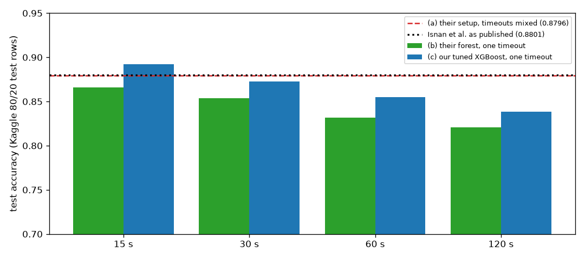

## 4.19 Storage after Phase 3

Every official run saves its model (compressed, level 3). Per experiment and model type:

| kind | runs | total_MB | per_run_max_MB | model_file_max_MB |
|---|---|---|---|---|
| E04 knn_log_robust | 4 | 4.678 | 1.577 | 1.435 |
| E04 knn_log_standard | 7 | 6.54 | 1.579 | 1.437 |
| E05 rf | 7 | 102.403 | 22.6 | 22.436 |
| E06 lgbm | 4 | 4.56 | 2.168 | 2.014 |
| E06 xgb | 4 | 2.522 | 1.226 | 1.064 |
| E07 knn_log_standard | 4 | 4.78 | 1.604 | 1.437 |
| E07 lgbm | 3 | 92.646 | 62.694 | 62.51 |
| E07 rf | 1 | 3.835 | 3.835 | 3.72 |
| E07 xgb | 4 | 9.238 | 4.508 | 4.315 |
| E08 lgbm | 5 | 67.775 | 27.135 | 27.033 |
| E08 xgb | 2 | 4.724 | 4.511 | 4.348 |
| E09 lgbm | 39 | 482.749 | 27.644 | 27.549 |
| E09 xgb | 13 | 61.881 | 5.261 | 5.092 |
| E10 xgb_two_step | 1 | 3.856 | 3.856 | 3.728 |
| E13 lgbm | 75 | 474.7 | 21.265 | 21.163 |
| E13 xgb | 25 | 73.528 | 4.188 | 4.025 |
| E14 lgbm | 30 | 372.146 | 25.859 | 25.759 |
| E14 xgb | 10 | 44.771 | 4.494 | 4.336 |
| E16 rf | 26 | 453.605 | 35.049 | 34.902 |
| E16 xgb | 4 | 17.765 | 4.829 | 4.697 |
| E17 lgbm | 1 | 7.215 | 7.215 | 7.092 |
| E17 logreg | 4 | 0.515 | 0.199 | 0.004 |
| E17 rf | 3 | 68.011 | 45.962 | 45.773 |
| E17 svm_rbf | 4 | 2.944 | 1.479 | 1.306 |
| E17 tree | 4 | 0.732 | 0.275 | 0.07 |

Whole store at this point: artifacts 2645.3 MiB, mlflow.db 35.8 MiB. This is far below the plan's 20 GB limit. The four headline
model files are 4.31-25.12 MiB, all below GitHub's 50 MB warning size.

## 4.20 E15: calibration of the headline models (on validation, before the test set)

**What.** The Expected Calibration Error (15 equal-width bins; confidence = the probability of the
predicted class) and a reliability diagram for each headline model, fitted on the training rows and
measured on the validation rows; then isotonic calibration (`CalibratedClassifierCV`, one base
model, mapping learned from 5-fold out-of-fold predictions on the training rows with shuffled folds,
seed 42). **Why.** `predict.py` and the demo report a confidence for every prediction, so it must
be trustworthy. **Rule and thresholds, fixed before running.** Calibration is adopted for a task if
the uncalibrated validation ECE is above 0.05 and isotonic calibration lowers it; it changes only
the reported confidence, never the predicted class. (a) uncalibrated ECE above 0.05 in at least 2
of 4 tasks; (b) isotonic ECE lower in all 4; (c) the predicted class unchanged on every row and
validation macro F1 equal to the source run. **Correction before the counted runs.** The first
pilot used `cv=5`, which means unshuffled folds; the training rows are stored in file order, so
each fold held out a block of the file and the out-of-fold predictions were far too poor (A1
out-of-fold accuracy 0.6701 unshuffled against 0.9321 shuffled). The folds were changed to the
project's shuffled folds before any counted E15 run; the pilot run is kept and superseded.

| task | run | headline | val accuracy | mean confidence, uncalibrated | mean confidence, isotonic | ECE uncalibrated | ECE isotonic | adopted | same predicted class (share of rows) | calibrated argmax would differ (share, unused) | val macro F1 = source run |
|---|---|---|---|---|---|---|---|---|---|---|---|
| A1 | E15-A1-15s | E17-lgbm-A1-15s | 0.9309 | 0.9861 | 0.9356 | 0.0552 | 0.014 | yes | 1.0 | 0.0007 | yes |
| A2-VPN | E15-A2-VPN-15s | E08-lgbm_class_weight-A2-VPN-15s | 0.8984 | 0.9692 | 0.9004 | 0.0714 | 0.0168 | yes | 1.0 | 0.0078 | yes |
| A2-NonVPN | E15-A2-NonVPN-15s | E08-lgbm_oversample-A2-NonVPN-15s | 0.9479 | 0.991 | 0.9469 | 0.0444 | 0.0152 | no | 1.0 | 0.0084 | yes |
| B | E15-B-15s | E07-xgb-B-15s | 0.8794 | 0.9144 | 0.8787 | 0.035 | 0.0099 | no | 1.0 | 0.0077 | yes |

**Result.** All four models are overconfident on validation. (a), (b) and (c) are supported:
calibration was adopted for A1 (ECE 0.0552 to 0.0140) and A2-VPN (0.0714 to 0.0168), and not for
A2-NonVPN (0.0444) or B (0.0350), whose uncalibrated ECE is not above 0.05. The test-set ECE,
measured once, is in Section 5.4.

## 4.21 E12: final results on the test set

**What.** Each of the 30 final models (the 28 comparison-set members, which include the 4 headline
models, and the 2 old-rule picks that are not members) was retrained on training + validation data
and scored once on the test rows. The models, the 26 paired tests, the 10,000-resample stratified
bootstrap and the calibration rule were all fixed before the test set was opened; a rehearsal of
the same runs on the validation rows (fitted on the training rows, in a separate run store) passed
every check first, and the official runs went in one batch from commit 87181d2, with no crash and
no rerun. **Why.** A score on rows that no choice has seen is the honest estimate of performance
on new flows from the same captures. **Hypotheses, fixed in Phase 3.** (a) every headline model
within 0.03 of its validation score; (b) the headline model above the old rule's pick in at least
3 of 4 tasks; (c) Spearman's rank correlation [22] >= 0.8 between the validation and test order of the 7 method types in
at least 3 of 4 tasks.

| task | role | method type | run | source run | val macro F1 | test macro F1 | 95% interval | test - val | test accuracy | accuracy 95% interval | test weighted F1 | test balanced accuracy | CV macro F1 (fit rows) | CV - test | calibration |
|---|---|---|---|---|---|---|---|---|---|---|---|---|---|---|---|
| A1 | headline | LightGBM | E12-final-A1 | E17-lgbm-A1-15s | 0.9308 | 0.9434 | 0.9348-0.9519 | 0.0126 | 0.9435 | 0.9350-0.9520 | 0.9435 | 0.9433 | 0.9322 | -0.0111 | isotonic |
| A2-VPN | headline | LightGBM | E12-final-A2-VPN | E08-lgbm_class_weight-A2-VPN-15s | 0.883 | 0.8652 | 0.8431-0.8866 | -0.0178 | 0.8955 | 0.8799-0.9112 | 0.896 | 0.8682 | 0.8827 | 0.0175 | isotonic |
| A2-NonVPN | headline | LightGBM | E12-final-A2-NonVPN | E08-lgbm_oversample-A2-NonVPN-15s | 0.9075 | 0.9403 | 0.9216-0.9573 | 0.0328 | 0.9609 | 0.9510-0.9709 | 0.9607 | 0.9343 | 0.9347 | -0.0055 | none |
| B | headline | XGBoost | E12-final-B | E07-xgb-B-15s | 0.8428 | 0.848 | 0.8305-0.8651 | 0.0052 | 0.8798 | 0.8684-0.8916 | 0.8797 | 0.8439 | 0.8473 | -0.0007 | none |

**Result.** (a) is not supported (A2-NonVPN is 0.0328 above its validation score; E14 had already
shown its validation rows to be unusually hard), (b) and (c) are supported. 14 of the 26 paired
differences are clear after Holm; two more sit on the Holm line and are borderline. All results
are in Section 5.

