# 5 Results

*Working draft. These markdown drafts are the master copy of the report; the full report (DOCX and
PDF) is assembled from them at each milestone. Every table here is copied unchanged from a
generated file: `reports/phase4_tables.md` (`scripts/results_tables.py --phase 4`, from the saved
test predictions of the E12 runs and from `reports/history.csv`) and, for Section 5.5,
`reports/phase3_tables.md`; a test (`tests/test_report_drafts.py`) checks that each table still
matches its source. Data version: v1. The test set was scored once, by the 30 E12 runs, all from
commit 87181d2; nothing was chosen, swapped or re-tuned after their scores were seen.*

This section reports the final models on the test rows: 15% of each task's 15 s file (A1 2,706
flows, A2-VPN 1,407, A2-NonVPN 1,305, B 2,712), held out by the seed-42 split and used by no
earlier experiment. Each model was retrained on training + validation data with the settings fixed
in `configs/final/` before the test set was opened (Section 3.3, Section 4.13). Every interval is
a 95% percentile interval from 10,000 stratified paired bootstrap resamples (seed 42), so it is
conditional on the test set's class counts.

## 5.1 Final test scores

| task | role | method type | run | source run | val macro F1 | test macro F1 | 95% interval | test - val | test accuracy | accuracy 95% interval | test weighted F1 | test balanced accuracy | CV macro F1 (fit rows) | CV - test | calibration |
|---|---|---|---|---|---|---|---|---|---|---|---|---|---|---|---|
| A1 | headline | LightGBM | E12-final-A1 | E17-lgbm-A1-15s | 0.9308 | 0.9434 | 0.9348-0.9519 | 0.0126 | 0.9435 | 0.9350-0.9520 | 0.9435 | 0.9433 | 0.9322 | -0.0111 | isotonic |
| A2-VPN | headline | LightGBM | E12-final-A2-VPN | E08-lgbm_class_weight-A2-VPN-15s | 0.883 | 0.8652 | 0.8431-0.8866 | -0.0178 | 0.8955 | 0.8799-0.9112 | 0.896 | 0.8682 | 0.8827 | 0.0175 | isotonic |
| A2-NonVPN | headline | LightGBM | E12-final-A2-NonVPN | E08-lgbm_oversample-A2-NonVPN-15s | 0.9075 | 0.9403 | 0.9216-0.9573 | 0.0328 | 0.9609 | 0.9510-0.9709 | 0.9607 | 0.9343 | 0.9347 | -0.0055 | none |
| B | headline | XGBoost | E12-final-B | E07-xgb-B-15s | 0.8428 | 0.848 | 0.8305-0.8651 | 0.0052 | 0.8798 | 0.8684-0.8916 | 0.8797 | 0.8439 | 0.8473 | -0.0007 | none |

- Test macro F1: A1 0.9434 (0.9348-0.9519), A2-VPN 0.8652 (0.8431-0.8866), A2-NonVPN 0.9403
  (0.9216-0.9573), B 0.8480 (0.8305-0.8651). The two A2 models are scored separately and never
  merged into one score.
- Against validation, three scores are higher and one lower: +0.0126 (A1), -0.0178 (A2-VPN),
  +0.0328 (A2-NonVPN), +0.0052 (B). E14 had already shown that the official A2-NonVPN validation
  rows are unusually hard: its validation macro F1 (0.9075) lies below all 10 resplits of training
  + validation (0.9257-0.9468), and the test score lies inside that range (Section 5.5).
- Weighted and macro F1 differ most where the classes are unequal in size: weighted minus macro
  F1 is 0.0001 (A1), 0.0308 (A2-VPN), 0.0204 (A2-NonVPN) and 0.0317 (B).
- Cross-validation on the fitting rows agrees with the test score to within 0.0175 (CV - test:
  -0.0111, 0.0175, -0.0055, -0.0007).

Hypotheses fixed before the test set was opened (E12, Section 4.21):

- (a) every headline model within 0.03 of its validation score: **not supported**, because
  A2-NonVPN is 0.0328 higher. The failure is reported as it is; nothing was changed because of it.
- (b) the headline model above the old tie rule's pick in at least 3 of 4 tasks: **supported**
  (4 of 4; the paired test finds the difference clear in A1 and A2-NonVPN).
- (c) the order of the 7 method types by test score agrees with their order by validation score
  (Spearman >= 0.8) in at least 3 of 4 tasks: **supported** (0.9643, 0.8214, 0.9286, 0.9643).

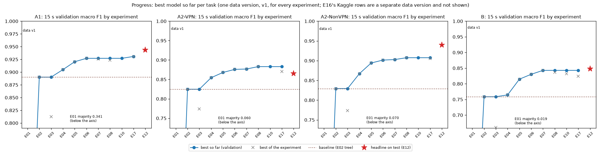

## 5.2 Per class

| class | test rows | precision | recall | F1 |
|---|---|---|---|---|
| Non-VPN | 1,303 | 0.9444 | 0.9378 | 0.9411 |
| VPN | 1,403 | 0.9426 | 0.9487 | 0.9456 |

| class | test rows | precision | recall | F1 |
|---|---|---|---|---|
| VPN-BROWSING | 375 | 0.9305 | 0.928 | 0.9292 |
| VPN-CHAT | 174 | 0.7663 | 0.8103 | 0.7877 |
| VPN-FT | 282 | 0.8672 | 0.8333 | 0.8499 |
| VPN-MAIL | 65 | 0.7188 | 0.7077 | 0.7132 |
| VPN-P2P | 100 | 0.8148 | 0.88 | 0.8462 |
| VPN-STREAMING | 71 | 0.9429 | 0.9296 | 0.9362 |
| VPN-VOIP | 340 | 1.0 | 0.9882 | 0.9941 |

| class | test rows | precision | recall | F1 |
|---|---|---|---|---|
| BROWSING | 375 | 0.9365 | 0.984 | 0.9597 |
| CHAT | 133 | 0.9219 | 0.8872 | 0.9042 |
| FT | 129 | 0.9504 | 0.8915 | 0.92 |
| MAIL | 36 | 0.9167 | 0.9167 | 0.9167 |
| P2P | 141 | 0.9929 | 0.9858 | 0.9893 |
| STREAMING | 68 | 0.9091 | 0.8824 | 0.8955 |
| VOIP | 423 | 1.0 | 0.9929 | 0.9964 |

| class | test rows | precision | recall | F1 |
|---|---|---|---|---|
| BROWSING | 375 | 0.8865 | 0.896 | 0.8912 |
| CHAT | 133 | 0.7698 | 0.8045 | 0.7868 |
| FT | 129 | 0.8992 | 0.8295 | 0.8629 |
| MAIL | 36 | 0.8182 | 0.75 | 0.7826 |
| P2P | 141 | 0.9214 | 0.9149 | 0.9181 |
| STREAMING | 67 | 0.8833 | 0.791 | 0.8346 |
| VOIP | 423 | 0.9929 | 0.9905 | 0.9917 |
| VPN-BROWSING | 375 | 0.827 | 0.8667 | 0.8464 |
| VPN-CHAT | 174 | 0.7607 | 0.7126 | 0.7359 |
| VPN-FT | 283 | 0.8027 | 0.8481 | 0.8247 |
| VPN-MAIL | 65 | 0.7 | 0.7538 | 0.7259 |
| VPN-P2P | 100 | 0.814 | 0.7 | 0.7527 |
| VPN-STREAMING | 71 | 0.8861 | 0.9859 | 0.9333 |
| VPN-VOIP | 340 | 1.0 | 0.9706 | 0.9851 |

Best and worst classes, calibration on the test rows and cost of the four headline models:

| task | run | calibration | test ECE (probabilities used) | test ECE uncalibrated | mean confidence | test accuracy | weighted - macro F1 gap | best class F1 | worst class F1 | best class recall | worst class recall | top-5 confusion pairs (true -> predicted: flows) | model file MiB | train time s | predict ms per 1,000 flows |
|---|---|---|---|---|---|---|---|---|---|---|---|---|---|---|---|
| A1 | E12-final-A1 | isotonic | 0.009 | 0.0442 | 0.9376 | 0.9435 | 0.0001 | VPN 0.9456 | Non-VPN 0.9411 | VPN 0.9487 | Non-VPN 0.9378 | Non-VPN -> VPN: 81; VPN -> Non-VPN: 72 | 7.63 | 4.31 | 192.9 |
| A2-VPN | E12-final-A2-VPN | isotonic | 0.0169 | 0.0709 | 0.889 | 0.8955 | 0.0308 | VPN-VOIP 0.9941 | VPN-MAIL 0.7132 | VPN-VOIP 0.9882 | VPN-MAIL 0.7077 | VPN-FT -> VPN-CHAT: 19; VPN-BROWSING -> VPN-CHAT: 16; VPN-CHAT -> VPN-FT: 15; VPN-CHAT -> VPN-BROWSING: 11; VPN-FT -> VPN-BROWSING: 10 | 28.14 | 14.79 | 1372.9 |
| A2-NonVPN | E12-final-A2-NonVPN | none | 0.0339 | 0.0339 | 0.9942 | 0.9609 | 0.0204 | VOIP 0.9964 | STREAMING 0.8955 | VOIP 0.9929 | STREAMING 0.8824 | CHAT -> BROWSING: 14; STREAMING -> BROWSING: 7; BROWSING -> CHAT: 4; FT -> BROWSING: 4; FT -> STREAMING: 4 | 4.92 | 6.24 | 325.6 |
| B | E12-final-B | none | 0.042 | 0.042 | 0.9213 | 0.8798 | 0.0317 | VOIP 0.9917 | VPN-MAIL 0.7259 | VOIP 0.9905 | VPN-P2P 0.7000 | BROWSING -> VPN-BROWSING: 28; VPN-BROWSING -> BROWSING: 17; VPN-CHAT -> VPN-FT: 16; VPN-BROWSING -> VPN-CHAT: 13; VPN-CHAT -> VPN-BROWSING: 13 | 4.6 | 10.56 | 58.8 |

The best class in each multi-class task is the voice class (VPN-VOIP 0.9941 in A2-VPN, VOIP 0.9964
in A2-NonVPN and 0.9917 in B); the weakest are
VPN-MAIL (0.7132 in A2-VPN, 0.7259 in B) and STREAMING in A2-NonVPN (0.8955), and VPN-P2P has B's
lowest recall (0.7000). In A1 both classes are close (VPN 0.9456, Non-VPN 0.9411).

The five largest confusions per task:

| task | run | rank | true | predicted | flows | share of true class |
|---|---|---|---|---|---|---|
| A1 | E12-final-A1 | 1 | Non-VPN | VPN | 81 | 0.0622 |
| A1 | E12-final-A1 | 2 | VPN | Non-VPN | 72 | 0.0513 |
| A2-VPN | E12-final-A2-VPN | 1 | VPN-FT | VPN-CHAT | 19 | 0.0674 |
| A2-VPN | E12-final-A2-VPN | 2 | VPN-BROWSING | VPN-CHAT | 16 | 0.0427 |
| A2-VPN | E12-final-A2-VPN | 3 | VPN-CHAT | VPN-FT | 15 | 0.0862 |
| A2-VPN | E12-final-A2-VPN | 4 | VPN-CHAT | VPN-BROWSING | 11 | 0.0632 |
| A2-VPN | E12-final-A2-VPN | 5 | VPN-FT | VPN-BROWSING | 10 | 0.0355 |
| A2-NonVPN | E12-final-A2-NonVPN | 1 | CHAT | BROWSING | 14 | 0.1053 |
| A2-NonVPN | E12-final-A2-NonVPN | 2 | STREAMING | BROWSING | 7 | 0.1029 |
| A2-NonVPN | E12-final-A2-NonVPN | 3 | BROWSING | CHAT | 4 | 0.0107 |
| A2-NonVPN | E12-final-A2-NonVPN | 4 | FT | BROWSING | 4 | 0.031 |
| A2-NonVPN | E12-final-A2-NonVPN | 5 | FT | STREAMING | 4 | 0.031 |
| B | E12-final-B | 1 | BROWSING | VPN-BROWSING | 28 | 0.0747 |
| B | E12-final-B | 2 | VPN-BROWSING | BROWSING | 17 | 0.0453 |
| B | E12-final-B | 3 | VPN-CHAT | VPN-FT | 16 | 0.092 |
| B | E12-final-B | 4 | VPN-BROWSING | VPN-CHAT | 13 | 0.0347 |
| B | E12-final-B | 5 | VPN-CHAT | VPN-BROWSING | 13 | 0.0747 |

In B the largest confusion is between a non-VPN class and its VPN counterpart: BROWSING predicted
as VPN-BROWSING (28 flows) and the reverse (17). Within the VPN classes, CHAT, FT and BROWSING are
mixed up with each other in both A2-VPN and B.

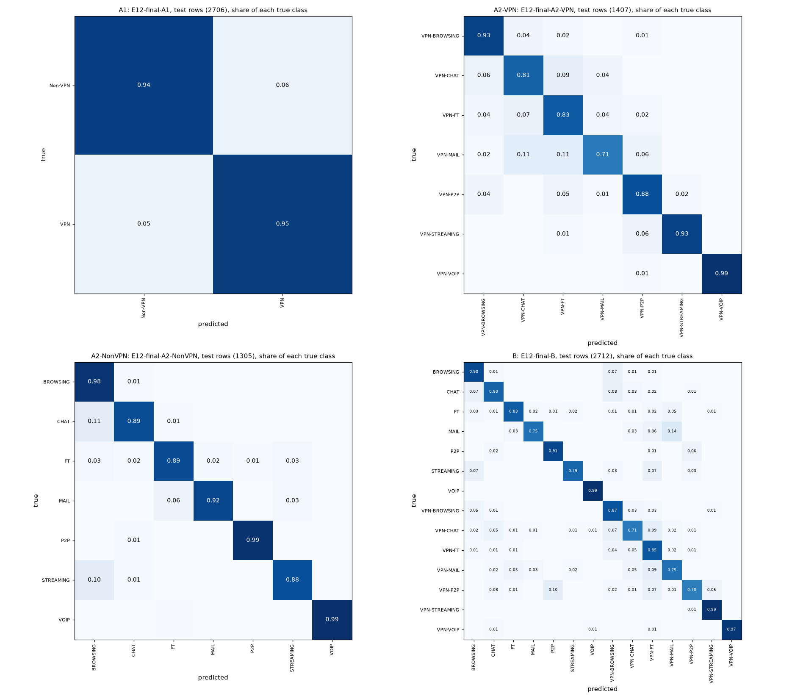

## 5.3 Comparison of the seven method types

Every model of the comparison set (the best validation variant of each method type, fixed before
the test set was opened) and the two old-rule picks that are not members, scored once on the same
test rows:

| task | role | method type | run | source run | val macro F1 | test macro F1 | 95% interval | test - val | test accuracy | accuracy 95% interval | test weighted F1 | test balanced accuracy | CV macro F1 (fit rows) | CV - test | calibration |
|---|---|---|---|---|---|---|---|---|---|---|---|---|---|---|---|
| A1 | headline | LightGBM | E12-final-A1 | E17-lgbm-A1-15s | 0.9308 | 0.9434 | 0.9348-0.9519 | 0.0126 | 0.9435 | 0.9350-0.9520 | 0.9435 | 0.9433 | 0.9322 | -0.0111 | isotonic |
| A1 | comparison | KNN | E12-compare-knn-A1 | E07-knn_log_standard-A1-15s | 0.9163 | 0.9208 | 0.9108-0.9308 | 0.0045 | 0.9209 | 0.9109-0.9309 | 0.9209 | 0.9209 | 0.9174 | -0.0034 | none |
| A1 | comparison | Random Forest | E12-compare-random_forest-A1 | E05-rf-A1-15s | 0.9203 | 0.9289 | 0.9192-0.9382 | 0.0085 | 0.929 | 0.9194-0.9383 | 0.929 | 0.9286 | 0.9199 | -0.009 | none |
| A1 | comparison | SVM-RBF | E12-compare-svm_rbf-A1 | E17-svm_rbf-A1-15s | 0.9259 | 0.9311 | 0.9215-0.9404 | 0.0052 | 0.9313 | 0.9217-0.9405 | 0.9312 | 0.9309 | 0.9222 | -0.0089 | none |
| A1 | comparison | XGBoost | E12-compare-xgboost-A1 | E06-xgb-A1-15s | 0.9271 | 0.9304 | 0.9207-0.9397 | 0.0033 | 0.9305 | 0.9209-0.9398 | 0.9305 | 0.9301 | 0.929 | -0.0014 | none |
| A1 | comparison | decision tree | E12-compare-decision_tree-A1 | E17-tree-A1-15s | 0.8905 | 0.8982 | 0.8866-0.9093 | 0.0077 | 0.8984 | 0.8869-0.9095 | 0.8983 | 0.8979 | 0.8983 | 0.0001 | none |
| A1 | comparison | logistic regression | E12-compare-logistic_regression-A1 | E17-logreg-A1-15s | 0.6517 | 0.6804 | 0.6628-0.6976 | 0.0287 | 0.6811 | 0.6633-0.6984 | 0.6809 | 0.6803 | 0.673 | -0.0074 | none |
| A1 | old_rule | KNN | E12-old_rule-A1 | E04-knn_log_standard-A1-15s | 0.9048 | 0.9112 | 0.9004-0.9216 | 0.0064 | 0.9113 | 0.9006-0.9217 | 0.9113 | 0.9111 | 0.9078 | -0.0034 | none |
| A2-VPN | headline | LightGBM | E12-final-A2-VPN | E08-lgbm_class_weight-A2-VPN-15s | 0.883 | 0.8652 | 0.8431-0.8866 | -0.0178 | 0.8955 | 0.8799-0.9112 | 0.896 | 0.8682 | 0.8827 | 0.0175 | isotonic |
| A2-VPN | comparison | KNN | E12-compare-knn-A2-VPN | E07-knn_log_standard-A2-VPN-15s | 0.8625 | 0.8431 | 0.8190-0.8655 | -0.0195 | 0.8735 | 0.8564-0.8898 | 0.8731 | 0.8441 | 0.8577 | 0.0146 | none |
| A2-VPN | comparison | Random Forest | E12-compare-random_forest-A2-VPN | E17-rf-A2-VPN-15s | 0.8704 | 0.8594 | 0.8379-0.8804 | -0.011 | 0.8827 | 0.8664-0.8984 | 0.8823 | 0.8646 | 0.8688 | 0.0093 | none |
| A2-VPN | comparison | SVM-RBF | E12-compare-svm_rbf-A2-VPN | E17-svm_rbf-A2-VPN-15s | 0.8707 | 0.867 | 0.8464-0.8875 | -0.0037 | 0.8863 | 0.8699-0.9019 | 0.8869 | 0.8732 | 0.8672 | 0.0002 | none |
| A2-VPN | comparison | XGBoost | E12-compare-xgboost-A2-VPN | E06-xgb-A2-VPN-15s | 0.8758 | 0.8577 | 0.8349-0.8796 | -0.0181 | 0.8891 | 0.8728-0.9048 | 0.8896 | 0.8606 | 0.882 | 0.0243 | none |
| A2-VPN | comparison | decision tree | E12-compare-decision_tree-A2-VPN | E17-tree-A2-VPN-15s | 0.8292 | 0.8308 | 0.8085-0.8534 | 0.0016 | 0.8557 | 0.8380-0.8735 | 0.8568 | 0.8383 | 0.8219 | -0.0089 | none |
| A2-VPN | comparison | logistic regression | E12-compare-logistic_regression-A2-VPN | E17-logreg-A2-VPN-15s | 0.7263 | 0.7179 | 0.6893-0.7446 | -0.0084 | 0.7633 | 0.7434-0.7832 | 0.7584 | 0.7093 | 0.7275 | 0.0096 | none |
| A2-VPN | old_rule | KNN | E12-old_rule-A2-VPN | E04-knn_log_standard-A2-VPN-15s | 0.8544 | 0.8442 | 0.8216-0.8667 | -0.0102 | 0.8685 | 0.8515-0.8856 | 0.8679 | 0.8538 | 0.8444 | 0.0003 | none |
| A2-NonVPN | headline | LightGBM | E12-final-A2-NonVPN | E08-lgbm_oversample-A2-NonVPN-15s | 0.9075 | 0.9403 | 0.9216-0.9573 | 0.0328 | 0.9609 | 0.9510-0.9709 | 0.9607 | 0.9343 | 0.9347 | -0.0055 | none |
| A2-NonVPN | comparison | KNN | E12-compare-knn-A2-NonVPN | E07-knn_log_standard-A2-NonVPN-15s | 0.8929 | 0.916 | 0.8960-0.9351 | 0.0231 | 0.9425 | 0.9303-0.9540 | 0.9423 | 0.9126 | 0.9091 | -0.007 | none |
| A2-NonVPN | comparison | Random Forest | E12-compare-random_forest-A2-NonVPN | E05-rf-A2-NonVPN-15s | 0.8941 | 0.9067 | 0.8848-0.9276 | 0.0127 | 0.9379 | 0.9249-0.9502 | 0.9373 | 0.897 | 0.908 | 0.0012 | none |
| A2-NonVPN | comparison | SVM-RBF | E12-compare-svm_rbf-A2-NonVPN | E17-svm_rbf-A2-NonVPN-15s | 0.9058 | 0.9244 | 0.9036-0.9438 | 0.0186 | 0.9525 | 0.9410-0.9632 | 0.9521 | 0.9202 | 0.923 | -0.0014 | none |
| A2-NonVPN | comparison | XGBoost | E12-compare-xgboost-A2-NonVPN | E07-xgb-A2-NonVPN-15s | 0.9025 | 0.9346 | 0.9151-0.9523 | 0.032 | 0.9579 | 0.9471-0.9678 | 0.9576 | 0.9268 | 0.9293 | -0.0053 | none |
| A2-NonVPN | comparison | decision tree | E12-compare-decision_tree-A2-NonVPN | E02-tree-A2-NonVPN-15s | 0.8294 | 0.8825 | 0.8596-0.9051 | 0.0532 | 0.9203 | 0.9057-0.9341 | 0.9204 | 0.8841 | 0.8686 | -0.0139 | none |
| A2-NonVPN | comparison | logistic regression | E12-compare-logistic_regression-A2-NonVPN | E17-logreg-A2-NonVPN-15s | 0.8002 | 0.8053 | 0.7724-0.8360 | 0.005 | 0.8828 | 0.8674-0.8981 | 0.8789 | 0.7814 | 0.7992 | -0.0061 | none |
| B | headline | XGBoost | E12-final-B | E07-xgb-B-15s | 0.8428 | 0.848 | 0.8305-0.8651 | 0.0052 | 0.8798 | 0.8684-0.8916 | 0.8797 | 0.8439 | 0.8473 | -0.0007 | none |
| B | comparison | KNN | E12-compare-knn-B | E07-knn_log_standard-B-15s | 0.8006 | 0.8253 | 0.8068-0.8432 | 0.0248 | 0.861 | 0.8488-0.8732 | 0.8607 | 0.825 | 0.811 | -0.0144 | none |
| B | comparison | LightGBM | E12-compare-lightgbm-B | E07-lgbm-B-15s | 0.8352 | 0.8567 | 0.8389-0.8735 | 0.0215 | 0.885 | 0.8732-0.8964 | 0.8846 | 0.8468 | 0.8501 | -0.0066 | none |
| B | comparison | Random Forest | E12-compare-random_forest-B | E17-rf-B-15s | 0.8167 | 0.8403 | 0.8222-0.8576 | 0.0236 | 0.8721 | 0.8603-0.8838 | 0.8713 | 0.8339 | 0.8359 | -0.0044 | none |
| B | comparison | SVM-RBF | E12-compare-svm_rbf-B | E17-svm_rbf-B-15s | 0.8242 | 0.8411 | 0.8224-0.8584 | 0.0169 | 0.8728 | 0.8610-0.8850 | 0.872 | 0.8342 | 0.8248 | -0.0163 | none |
| B | comparison | decision tree | E12-compare-decision_tree-B | E02-tree-B-15s | 0.7585 | 0.7886 | 0.7687-0.8081 | 0.03 | 0.8278 | 0.8145-0.8414 | 0.8279 | 0.7892 | 0.7574 | -0.0312 | none |
| B | comparison | logistic regression | E12-compare-logistic_regression-B | E17-logreg-B-15s | 0.5862 | 0.6089 | 0.5856-0.6313 | 0.0227 | 0.6574 | 0.6412-0.6737 | 0.6505 | 0.595 | 0.5885 | -0.0204 | none |

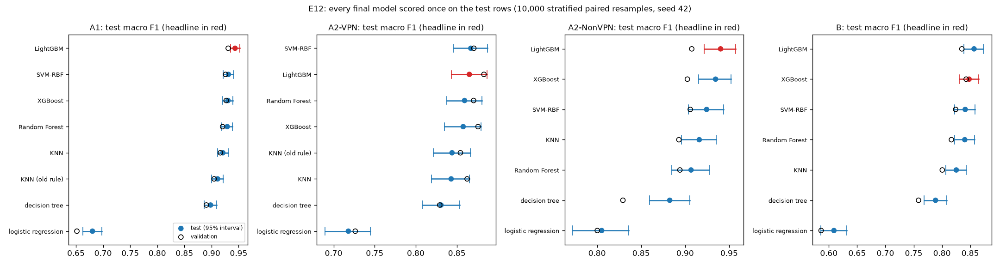

The 26 paired tests fixed before the test set was opened (headline model minus the other model on
the same resampled rows; Holm correction over all 26 at 0.05):

| task | headline | other | other role | other type | d (headline - other) | d 95% interval | p | Holm p | different (Holm, 0.05) |
|---|---|---|---|---|---|---|---|---|---|
| A1 | E12-final-A1 | E12-compare-knn-A1 | comparison | KNN | 0.0226 | 0.0140-0.0314 | 0.0002 | 0.0052 | yes |
| A1 | E12-final-A1 | E12-compare-random_forest-A1 | comparison | Random Forest | 0.0145 | 0.0071-0.0219 | 0.0004 | 0.0064 | yes |
| A1 | E12-final-A1 | E12-compare-svm_rbf-A1 | comparison | SVM-RBF | 0.0122 | 0.0038-0.0207 | 0.0042 | 0.0504 | no |
| A1 | E12-final-A1 | E12-compare-xgboost-A1 | comparison | XGBoost | 0.013 | 0.0056-0.0204 | 0.0004 | 0.0064 | yes |
| A1 | E12-final-A1 | E12-compare-decision_tree-A1 | comparison | decision tree | 0.0452 | 0.0352-0.0559 | 0.0002 | 0.0052 | yes |
| A1 | E12-final-A1 | E12-compare-logistic_regression-A1 | comparison | logistic regression | 0.263 | 0.2446-0.2817 | 0.0002 | 0.0052 | yes |
| A1 | E12-final-A1 | E12-old_rule-A1 | old_rule | KNN | 0.0322 | 0.0226-0.0422 | 0.0002 | 0.0052 | yes |
| A2-VPN | E12-final-A2-VPN | E12-compare-knn-A2-VPN | comparison | KNN | 0.0221 | 0.0052-0.0390 | 0.0132 | 0.1320 | no |
| A2-VPN | E12-final-A2-VPN | E12-compare-random_forest-A2-VPN | comparison | Random Forest | 0.0058 | -0.0117-0.0234 | 0.5123 | 1.0000 | no |
| A2-VPN | E12-final-A2-VPN | E12-compare-svm_rbf-A2-VPN | comparison | SVM-RBF | -0.0018 | -0.0224-0.0186 | 0.8525 | 1.0000 | no |
| A2-VPN | E12-final-A2-VPN | E12-compare-xgboost-A2-VPN | comparison | XGBoost | 0.0075 | -0.0062-0.0214 | 0.2918 | 1.0000 | no |
| A2-VPN | E12-final-A2-VPN | E12-compare-decision_tree-A2-VPN | comparison | decision tree | 0.0345 | 0.0115-0.0577 | 0.0042 | 0.0504 | no |
| A2-VPN | E12-final-A2-VPN | E12-compare-logistic_regression-A2-VPN | comparison | logistic regression | 0.1473 | 0.1173-0.1777 | 0.0002 | 0.0052 | yes |
| A2-VPN | E12-final-A2-VPN | E12-old_rule-A2-VPN | old_rule | KNN | 0.0211 | -0.0005-0.0426 | 0.0566 | 0.4752 | no |
| A2-NonVPN | E12-final-A2-NonVPN | E12-compare-knn-A2-NonVPN | comparison | KNN | 0.0242 | 0.0106-0.0387 | 0.0004 | 0.0064 | yes |
| A2-NonVPN | E12-final-A2-NonVPN | E12-compare-random_forest-A2-NonVPN | comparison | Random Forest | 0.0336 | 0.0181-0.0506 | 0.0002 | 0.0052 | yes |
| A2-NonVPN | E12-final-A2-NonVPN | E12-compare-svm_rbf-A2-NonVPN | comparison | SVM-RBF | 0.0158 | -0.0001-0.0327 | 0.0528 | 0.4752 | no |
| A2-NonVPN | E12-final-A2-NonVPN | E12-compare-xgboost-A2-NonVPN | comparison | XGBoost | 0.0057 | -0.0059-0.0181 | 0.3406 | 1.0000 | no |
| A2-NonVPN | E12-final-A2-NonVPN | E12-compare-decision_tree-A2-NonVPN | comparison | decision tree | 0.0578 | 0.0402-0.0763 | 0.0002 | 0.0052 | yes |
| A2-NonVPN | E12-final-A2-NonVPN | E12-compare-logistic_regression-A2-NonVPN | comparison | logistic regression | 0.135 | 0.1033-0.1687 | 0.0002 | 0.0052 | yes |
| B | E12-final-B | E12-compare-knn-B | comparison | KNN | 0.0227 | 0.0090-0.0364 | 0.0020 | 0.0260 | yes |
| B | E12-final-B | E12-compare-lightgbm-B | comparison | LightGBM | -0.0087 | -0.0197-0.0028 | 0.1368 | 0.9575 | no |
| B | E12-final-B | E12-compare-random_forest-B | comparison | Random Forest | 0.0077 | -0.0040-0.0196 | 0.1952 | 1.0000 | no |
| B | E12-final-B | E12-compare-svm_rbf-B | comparison | SVM-RBF | 0.0069 | -0.0093-0.0235 | 0.4078 | 1.0000 | no |
| B | E12-final-B | E12-compare-decision_tree-B | comparison | decision tree | 0.0594 | 0.0435-0.0762 | 0.0002 | 0.0052 | yes |
| B | E12-final-B | E12-compare-logistic_regression-B | comparison | logistic regression | 0.2391 | 0.2147-0.2648 | 0.0002 | 0.0052 | yes |

- 14 of the 26 differences are clear after Holm (A1 6 of 7, A2-VPN 1 of 7, A2-NonVPN 4 of 6, B 3
  of 6). The headline model is clearly better than logistic regression in every task and than the
  decision tree in A1, A2-NonVPN and B.
- It is not clearly different from the SVM in any task, nor from XGBoost or LightGBM except A1
  against XGBoost. Two comparison models scored slightly higher on the test rows, neither clearly:
  the A2-VPN SVM (0.8670 against 0.8652) and the B LightGBM (0.8567 against 0.8480).

Two of the 26 tests sit on the Holm line. The p-value of each test comes from the same 10,000
resamples, so it carries Monte Carlo error; the band below is 2 x the tail share plus or minus two
standard errors, times the test's Holm multiplier:

| task | other | smaller tail count | p | Holm p | Holm p band (+-2 SE) | different (Holm, 0.05) | settled by B resamples |
|---|---|---|---|---|---|---|---|
| A1 | E12-compare-knn-A1 | 0 | 0.0002 | 0.0052 | 0.0000-0.0156 | yes | yes |
| A1 | E12-compare-decision_tree-A1 | 0 | 0.0002 | 0.0052 | 0.0000-0.0150 | yes | yes |
| A1 | E12-compare-logistic_regression-A1 | 0 | 0.0002 | 0.0052 | 0.0000-0.0144 | yes | yes |
| A1 | E12-old_rule-A1 | 0 | 0.0002 | 0.0052 | 0.0000-0.0138 | yes | yes |
| A2-VPN | E12-compare-logistic_regression-A2-VPN | 0 | 0.0002 | 0.0052 | 0.0000-0.0132 | yes | yes |
| A2-NonVPN | E12-compare-random_forest-A2-NonVPN | 0 | 0.0002 | 0.0052 | 0.0000-0.0126 | yes | yes |
| A2-NonVPN | E12-compare-decision_tree-A2-NonVPN | 0 | 0.0002 | 0.0052 | 0.0000-0.0120 | yes | yes |
| A2-NonVPN | E12-compare-logistic_regression-A2-NonVPN | 0 | 0.0002 | 0.0052 | 0.0000-0.0114 | yes | yes |
| B | E12-compare-decision_tree-B | 0 | 0.0002 | 0.0052 | 0.0000-0.0108 | yes | yes |
| B | E12-compare-logistic_regression-B | 0 | 0.0002 | 0.0052 | 0.0000-0.0102 | yes | yes |
| A1 | E12-compare-random_forest-A1 | 1 | 0.0004 | 0.0064 | 0.0000-0.0154 | yes | yes |
| A1 | E12-compare-xgboost-A1 | 1 | 0.0004 | 0.0064 | 0.0000-0.0145 | yes | yes |
| A2-NonVPN | E12-compare-knn-A2-NonVPN | 1 | 0.0004 | 0.0064 | 0.0000-0.0135 | yes | yes |
| B | E12-compare-knn-B | 9 | 0.0020 | 0.0260 | 0.0096-0.0424 | yes | yes |
| A1 | E12-compare-svm_rbf-A1 | 20 | 0.0042 | 0.0504 | 0.0284-0.0724 | no | no |
| A2-VPN | E12-compare-decision_tree-A2-VPN | 20 | 0.0042 | 0.0504 | 0.0261-0.0663 | no | no |
| A2-VPN | E12-compare-knn-A2-VPN | 65 | 0.0132 | 0.1320 | 0.0996-0.1644 | no | yes |
| A2-NonVPN | E12-compare-svm_rbf-A2-NonVPN | 263 | 0.0528 | 0.4752 | 0.4174-0.5329 | no | yes |
| A2-VPN | E12-old_rule-A2-VPN | 282 | 0.0566 | 0.4752 | 0.3997-0.5058 | no | yes |
| B | E12-compare-lightgbm-B | 683 | 0.1368 | 0.9575 | 0.8868-1.0000 | no | yes |
| B | E12-compare-random_forest-B | 975 | 0.1952 | 1.0000 | 1.0000-1.0000 | no | yes |
| A2-VPN | E12-compare-xgboost-A2-VPN | 1,458 | 0.2918 | 1.0000 | 1.0000-1.0000 | no | yes |
| A2-NonVPN | E12-compare-xgboost-A2-NonVPN | 1,702 | 0.3406 | 1.0000 | 1.0000-1.0000 | no | yes |
| B | E12-compare-svm_rbf-B | 2,038 | 0.4078 | 1.0000 | 1.0000-1.0000 | no | yes |
| A2-VPN | E12-compare-random_forest-A2-VPN | 2,561 | 0.5123 | 1.0000 | 0.9898-1.0000 | no | yes |
| A2-VPN | E12-compare-svm_rbf-A2-VPN | 4,262 | 0.8525 | 1.0000 | 0.8327-0.8723 | no | yes |

A1 against the SVM and A2-VPN against the decision tree (Holm p 0.0504) have bands of about
0.03-0.07, so 10,000 resamples cannot settle whether they fall below 0.05. Under the rule fixed in
advance both count as not clear; they are reported as borderline. No verdict depends on them, and
the other 24 tests are settled either way. An independent recomputation from the saved predictions
(`scripts/check_e12_independent.py`) reproduced every interval, p-value and Holm p.

**The deviation from the pre-set tie rule, and what it cost.** The rule set before Phase 3 would
have chosen a simpler model whenever the gap was below 0.03 (Section 3.8). Its picks were scored
on the test set too: the headline model scored higher in all four tasks, by 0.0322 in A1 (against
the E04 KNN, clear), 0.0211 in A2-VPN (E04 KNN, not clear), 0.0242 in A2-NonVPN (E07 KNN, clear)
and 0.0069 in B (E17 SVM, not clear). Choosing by the highest validation score therefore did not
cost anything on the test rows, and in two tasks it gained a clear margin.

## 5.4 Calibration (E15)

| task | run | headline | val accuracy | mean confidence, uncalibrated | mean confidence, isotonic | ECE uncalibrated | ECE isotonic | adopted | same predicted class (share of rows) | calibrated argmax would differ (share, unused) | val macro F1 = source run |
|---|---|---|---|---|---|---|---|---|---|---|---|
| A1 | E15-A1-15s | E17-lgbm-A1-15s | 0.9309 | 0.9861 | 0.9356 | 0.0552 | 0.014 | yes | 1.0 | 0.0007 | yes |
| A2-VPN | E15-A2-VPN-15s | E08-lgbm_class_weight-A2-VPN-15s | 0.8984 | 0.9692 | 0.9004 | 0.0714 | 0.0168 | yes | 1.0 | 0.0078 | yes |
| A2-NonVPN | E15-A2-NonVPN-15s | E08-lgbm_oversample-A2-NonVPN-15s | 0.9479 | 0.991 | 0.9469 | 0.0444 | 0.0152 | no | 1.0 | 0.0084 | yes |
| B | E15-B-15s | E07-xgb-B-15s | 0.8794 | 0.9144 | 0.8787 | 0.035 | 0.0099 | no | 1.0 | 0.0077 | yes |

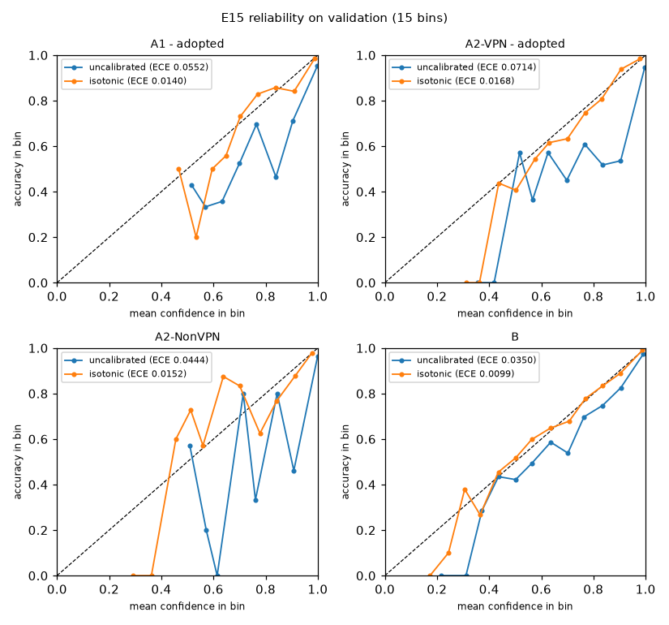

All four headline models were overconfident on validation (mean confidence above accuracy).
By the rule fixed before the test set (calibrate where the uncalibrated validation ECE is above
0.05 and isotonic calibration lowers it), calibration was adopted for A1 and A2-VPN. On the test
rows, measured once, it lowers the expected calibration error from 0.0442 to 0.0090 (A1) and from
0.0709 to 0.0169 (A2-VPN); the uncalibrated A2-NonVPN and B models have 0.0339 and 0.0420.
Calibration changes only the reported confidence; the predicted class, and so every test score
above, is the uncalibrated model's.

## 5.5 Stability and amount of training data (E14, E13)

Split-seed stability on validation, 10 resplits of training + validation (E14, Section 4.16):

| task | seeds | val macro F1 mean | val macro F1 std | val macro F1 min | val macro F1 max | val accuracy mean | val accuracy std | CV macro F1 mean | CV - val mean | official split (seed 42) val macro F1 |
|---|---|---|---|---|---|---|---|---|---|---|
| A1 | 10 | 0.9338 | 0.0042 | 0.9275 | 0.9397 | 0.9339 | 0.0042 | 0.9306 | -0.0032 | 0.9308 |
| A2-VPN | 10 | 0.8862 | 0.0114 | 0.8689 | 0.902 | 0.9037 | 0.0066 | 0.8805 | -0.0057 | 0.883 |
| A2-NonVPN | 10 | 0.9324 | 0.0071 | 0.9257 | 0.9468 | 0.9589 | 0.0044 | 0.9283 | -0.0041 | 0.9075 |
| B | 10 | 0.8476 | 0.0084 | 0.8344 | 0.8636 | 0.8819 | 0.0074 | 0.8358 | -0.0119 | 0.8428 |

The validation macro F1 of the headline models varies by 0.0042-0.0114 (standard deviation) across
resplits. The test scores are inside the resplit range for A2-NonVPN (0.9403 in 0.9257-0.9468) and
B (0.8480 in 0.8344-0.8636), above it for A1 (0.9434 against at most 0.9397) and below it for A2-VPN
(0.8652 against at least 0.8689). The resplit models are trained on the training share of each
resplit only, while the final models also use the validation rows, so the two are not the same
model; a single 15% test set can also land outside a 10-resplit range by chance.

Learning curve on validation (E13, Section 4.15):

| task | train fraction | runs | training rows | val macro F1 mean | val macro F1 std |
|---|---|---|---|---|---|
| A1 | 0.1 | 5 | 1,262 | 0.8724 | 0.0062 |
| A1 | 0.2 | 5 | 2,525 | 0.8952 | 0.0041 |
| A1 | 0.4 | 5 | 5,050 | 0.9106 | 0.0066 |
| A1 | 0.6 | 5 | 7,575 | 0.9213 | 0.0039 |
| A1 | 0.8 | 5 | 10,100 | 0.927 | 0.0029 |
| A1 | 1.0 | 1 | 12,626 | 0.9308 |  |
| A2-VPN | 0.1 | 5 | 656 | 0.7793 | 0.0052 |
| A2-VPN | 0.2 | 5 | 1,313 | 0.826 | 0.0101 |
| A2-VPN | 0.4 | 5 | 2,626 | 0.8582 | 0.0041 |
| A2-VPN | 0.6 | 5 | 3,939 | 0.8721 | 0.0053 |
| A2-VPN | 0.8 | 5 | 5,252 | 0.8804 | 0.0036 |
| A2-VPN | 1.0 | 1 | 6,566 | 0.883 |  |
| A2-NonVPN | 0.1 | 5 | 608 | 0.8176 | 0.0093 |
| A2-NonVPN | 0.2 | 5 | 1,217 | 0.8585 | 0.0118 |
| A2-NonVPN | 0.4 | 5 | 2,434 | 0.8806 | 0.0057 |
| A2-NonVPN | 0.6 | 5 | 3,651 | 0.8934 | 0.0045 |
| A2-NonVPN | 0.8 | 5 | 4,868 | 0.9005 | 0.0033 |
| A2-NonVPN | 1.0 | 1 | 6,085 | 0.9075 |  |
| B | 0.1 | 5 | 1,265 | 0.6969 | 0.0097 |
| B | 0.2 | 5 | 2,530 | 0.7468 | 0.0138 |
| B | 0.4 | 5 | 5,060 | 0.7975 | 0.0036 |
| B | 0.6 | 5 | 7,590 | 0.8156 | 0.0016 |
| B | 0.8 | 5 | 10,120 | 0.8297 | 0.0029 |
| B | 1.0 | 1 | 12,651 | 0.8428 |  |

Macro F1 still rises between 80% and 100% of the training rows in every task (A1 0.927 to 0.9308,
A2-VPN 0.8804 to 0.883, A2-NonVPN 0.9005 to 0.9075, B 0.8297 to 0.8428), most in B, the task with
the most classes. Retraining on training + validation for the final models adds 15 percentage
points of the file to the 70% used here.

## 5.6 What the models use (SHAP and E09)

SHAP values of the four final models on the test rows (`scripts/explain_final.py`, notebook
`05_explain`); no score is computed from them.

| rank | A1 | A2-VPN | A2-NonVPN | B |
|---|---|---|---|---|
| 1 | min_flowiat (2.224) | flowBytesPerSecond (1.062) | flowBytesPerSecond (1.409) | flowBytesPerSecond (0.989) |
| 2 | min_biat (2.192) | min_flowiat (0.776) | min_flowiat (1.326) | min_flowiat (0.828) |
| 3 | flowBytesPerSecond (1.905) | min_fiat (0.688) | min_fiat (0.756) | duration (0.687) |
| 4 | min_fiat (1.535) | min_biat (0.537) | flowPktsPerSecond (0.685) | min_fiat (0.589) |
| 5 | max_flowiat (1.320) | duration (0.448) | mean_flowiat (0.663) | min_biat (0.495) |

| task | group | features | mean |SHAP| (sum) | SHAP share | E09 drop this group (val change) | E09 this group alone (val change) |
|---|---|---|---|---|---|---|
| A1 | fiat | 4 | 2.9511 | 0.1654 | -0.0052 | -0.1229 |
| A1 | biat | 4 | 4.0202 | 0.2253 | -0.0155 | -0.1064 |
| A1 | flowiat | 4 | 5.2763 | 0.2957 | 0.0014 | -0.08 |
| A1 | active | 4 | 0.9953 | 0.0558 | -0.0011 | -0.3819 |
| A1 | idle | 4 | 0.7757 | 0.0435 | -0.0004 | -0.3803 |
| A1 | rates_duration | 3 | 3.8264 | 0.2144 | -0.0122 | -0.0915 |
| A2-VPN | fiat | 4 | 1.6589 | 0.2212 | -0.0179 | -0.1237 |
| A2-VPN | biat | 4 | 1.4386 | 0.1918 | -0.0105 | -0.1631 |
| A2-VPN | flowiat | 4 | 1.9133 | 0.2551 | -0.0078 | -0.0969 |
| A2-VPN | active | 4 | 0.2794 | 0.0373 | 0.003 | -0.5578 |
| A2-VPN | idle | 4 | 0.4264 | 0.0569 | -0.0004 | -0.5763 |
| A2-VPN | rates_duration | 3 | 1.7828 | 0.2377 | -0.0395 | -0.104 |
| A2-NonVPN | fiat | 4 | 2.3124 | 0.2197 | -0.0051 | -0.154 |
| A2-NonVPN | biat | 4 | 1.694 | 0.1609 | -0.0082 | -0.1804 |
| A2-NonVPN | flowiat | 4 | 2.8594 | 0.2716 | -0.0045 | -0.091 |
| A2-NonVPN | active | 4 | 0.593 | 0.0563 | 0.0018 | -0.572 |
| A2-NonVPN | idle | 4 | 0.3305 | 0.0314 | -0.0036 | -0.6037 |
| A2-NonVPN | rates_duration | 3 | 2.7372 | 0.26 | -0.0301 | -0.0604 |
| B | fiat | 4 | 1.5248 | 0.2032 | -0.0184 | -0.2028 |
| B | biat | 4 | 1.3158 | 0.1754 | -0.0265 | -0.233 |
| B | flowiat | 4 | 1.9626 | 0.2616 | -0.0166 | -0.1712 |
| B | active | 4 | 0.4103 | 0.0547 | 0.0051 | -0.629 |
| B | idle | 4 | 0.2732 | 0.0364 | 0.0 | -0.6345 |
| B | rates_duration | 3 | 2.0161 | 0.2687 | -0.0549 | -0.1385 |

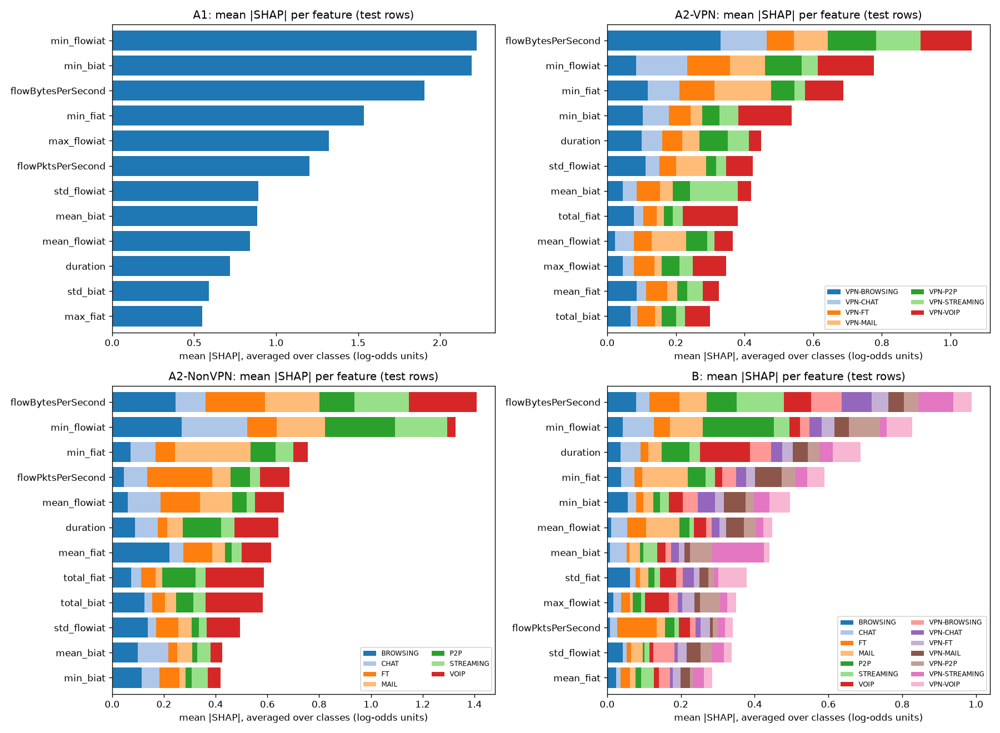

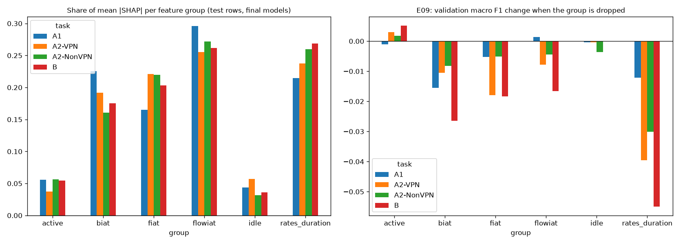

- The byte rate (flowBytesPerSecond) is the most used feature in A2-VPN, A2-NonVPN and B, and the
  smallest gaps between packets (min_flowiat, min_fiat, min_biat) are in the top 5 of every task.
- SHAP and the ablation (E09) agree that the active and idle groups matter least (3.1-5.7% of mean
  |SHAP|; dropping either changes validation macro F1 by -0.0036 to +0.0051). Rates + duration hold
  21.4-26.9% of mean |SHAP| (the largest group share in B), and dropping them costs the most in
  A2-VPN, A2-NonVPN and B (0.0395, 0.0301, 0.0549); in A1 dropping the backward gaps costs more
  (0.0155 against 0.0122).
- They differ on the flow gaps (flowiat): the largest SHAP share in A1, A2-VPN and A2-NonVPN
  (25.5-29.6%), yet dropping the group costs at most 0.0166, because the correlated forward and
  backward gaps carry much the same timing. SHAP shows what a model uses; the ablation shows what
  it cannot do without. Because the features are correlated, neither describes what causes the
  traffic patterns.

Worked examples (one flow each; picked by a rule fixed before looking at them):

| task | example | raw_row | true | predicted | confidence | rank | feature | value | SHAP |
|---|---|---|---|---|---|---|---|---|---|
| A1 | most confident correct | 797 | Non-VPN | Non-VPN | 1.0 | 1 | max_flowiat | 55123.0 | 4.2942 |
| A1 | most confident correct | 797 | Non-VPN | Non-VPN | 1.0 | 2 | min_flowiat | 55123.0 | 3.4935 |
| A1 | most confident correct | 797 | Non-VPN | Non-VPN | 1.0 | 3 | flowPktsPerSecond | 36.2825 | 3.1267 |
| A1 | least confident correct | 5,497 | VPN | VPN | 0.4519 | 1 | flowBytesPerSecond | 240.3304 | 2.6886 |
| A1 | least confident correct | 5,497 | VPN | VPN | 0.4519 | 2 | flowPktsPerSecond | 1.6321 | 1.3703 |
| A1 | least confident correct | 5,497 | VPN | VPN | 0.4519 | 3 | mean_active | 4695071.0 | 0.7458 |
| A1 | most confident error | 2,218 | Non-VPN | VPN | 0.9956 | 1 | flowBytesPerSecond | 130.9021 | 4.5879 |
| A1 | most confident error | 2,218 | Non-VPN | VPN | 0.9956 | 2 | min_fiat | 794487.0 | 2.3452 |
| A1 | most confident error | 2,218 | Non-VPN | VPN | 0.9956 | 3 | max_flowiat | 794487.0 | 1.9669 |
| A1 | weakest class, median confidence | 2,896 | Non-VPN | Non-VPN | 0.9946 | 1 | min_flowiat | 559.0 | 6.0851 |
| A1 | weakest class, median confidence | 2,896 | Non-VPN | Non-VPN | 0.9946 | 2 | max_flowiat | 969065.0 | 1.6854 |
| A1 | weakest class, median confidence | 2,896 | Non-VPN | Non-VPN | 0.9946 | 3 | min_biat | 959994.0 | 1.3987 |
| A2-VPN | most confident correct | 9,144 | VPN-VOIP | VPN-VOIP | 0.9994 | 1 | min_biat | 10038206.0 | 3.9411 |
| A2-VPN | most confident correct | 9,144 | VPN-VOIP | VPN-VOIP | 0.9994 | 2 | flowBytesPerSecond | 21.4332 | 3.4869 |
| A2-VPN | most confident correct | 9,144 | VPN-VOIP | VPN-VOIP | 0.9994 | 3 | min_flowiat | 38775.0 | 3.2343 |
| A2-VPN | least confident correct | 4,435 | VPN-FT | VPN-FT | 0.2259 | 1 | min_flowiat | 52.0 | 1.8895 |
| A2-VPN | least confident correct | 4,435 | VPN-FT | VPN-FT | 0.2259 | 2 | min_fiat | 52.0 | 1.016 |
| A2-VPN | least confident correct | 4,435 | VPN-FT | VPN-FT | 0.2259 | 3 | min_biat | 60.0 | 0.5417 |
| A2-VPN | most confident error | 1 | VPN-BROWSING | VPN-STREAMING | 0.9788 | 1 | flowBytesPerSecond | 1322206.4391 | 4.4567 |
| A2-VPN | most confident error | 1 | VPN-BROWSING | VPN-STREAMING | 0.9788 | 2 | mean_biat | 998.9129 | 3.3432 |
| A2-VPN | most confident error | 1 | VPN-BROWSING | VPN-STREAMING | 0.9788 | 3 | max_flowiat | 217299.0 | 2.3032 |
| A2-VPN | weakest class, median confidence | 5,962 | VPN-MAIL | VPN-MAIL | 0.877 | 1 | duration | 192.0 | 3.2163 |
| A2-VPN | weakest class, median confidence | 5,962 | VPN-MAIL | VPN-MAIL | 0.877 | 2 | min_flowiat | 192.0 | 3.0667 |
| A2-VPN | weakest class, median confidence | 5,962 | VPN-MAIL | VPN-MAIL | 0.877 | 3 | max_fiat | 192.0 | 1.4462 |
| A2-NonVPN | most confident correct | 1,570 | BROWSING | BROWSING | 1.0 | 1 | min_flowiat | 2.0 | 2.7472 |
| A2-NonVPN | most confident correct | 1,570 | BROWSING | BROWSING | 1.0 | 2 | std_flowiat | 2354206.5587 | 2.6679 |
| A2-NonVPN | most confident correct | 1,570 | BROWSING | BROWSING | 1.0 | 3 | mean_flowiat | 567400.6667 | 1.7755 |
| A2-NonVPN | least confident correct | 4,393 | FT | FT | 0.4821 | 1 | min_flowiat | 961.0 | 2.639 |
| A2-NonVPN | least confident correct | 4,393 | FT | FT | 0.4821 | 2 | std_flowiat | 139858.6502 | 1.0974 |
| A2-NonVPN | least confident correct | 4,393 | FT | FT | 0.4821 | 3 | max_flowiat | 198751.0 | 0.6833 |
| A2-NonVPN | most confident error | 4,356 | FT | MAIL | 1.0 | 1 | duration | 79.0 | 4.2734 |
| A2-NonVPN | most confident error | 4,356 | FT | MAIL | 1.0 | 2 | min_fiat | 79.0 | 4.1959 |
| A2-NonVPN | most confident error | 4,356 | FT | MAIL | 1.0 | 3 | mean_fiat | 79.0 | 2.9155 |
| A2-NonVPN | weakest class, median confidence | 5,721 | STREAMING | STREAMING | 1.0 | 1 | flowBytesPerSecond | 180014.1793 | 4.7998 |
| A2-NonVPN | weakest class, median confidence | 5,721 | STREAMING | STREAMING | 1.0 | 2 | min_flowiat | 0.0 | 1.7719 |
| A2-NonVPN | weakest class, median confidence | 5,721 | STREAMING | STREAMING | 1.0 | 3 | min_fiat | 5.0 | 1.6621 |
| B | most confident correct | 3,045 | VOIP | VOIP | 1.0 | 1 | duration | 14991066.0 | 3.8544 |
| B | most confident correct | 3,045 | VOIP | VOIP | 1.0 | 2 | std_biat | 3595.304 | 1.1211 |
| B | most confident correct | 3,045 | VOIP | VOIP | 1.0 | 3 | max_flowiat | 30384.0 | 0.8372 |
| B | least confident correct | 2,091 | MAIL | MAIL | 0.2948 | 1 | min_fiat | 96.0 | 1.3413 |
| B | least confident correct | 2,091 | MAIL | MAIL | 0.2948 | 2 | duration | 96.0 | 1.3326 |
| B | least confident correct | 2,091 | MAIL | MAIL | 0.2948 | 3 | mean_flowiat | 96.0 | 0.825 |
| B | most confident error | 7,408 | VPN-P2P | VPN-FT | 0.9986 | 1 | flowBytesPerSecond | 365.1224 | 2.4335 |
| B | most confident error | 7,408 | VPN-P2P | VPN-FT | 0.9986 | 2 | max_flowiat | 284836.0 | 0.5198 |
| B | most confident error | 7,408 | VPN-P2P | VPN-FT | 0.9986 | 3 | min_fiat | -1.0 | 0.4553 |
| B | weakest class, median confidence | 9,737 | VPN-MAIL | VPN-MAIL | 0.9845 | 1 | duration | 11544.0 | 1.7503 |
| B | weakest class, median confidence | 9,737 | VPN-MAIL | VPN-MAIL | 0.9845 | 2 | min_fiat | 27.0 | 1.2891 |
| B | weakest class, median confidence | 9,737 | VPN-MAIL | VPN-MAIL | 0.9845 | 3 | min_flowiat | 27.0 | 0.6031 |

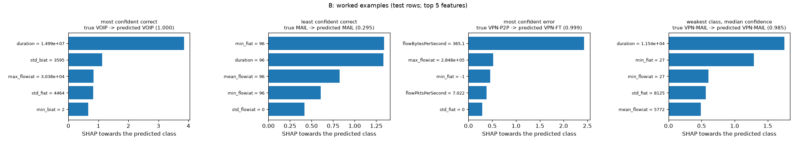

The most confident errors come from a byte rate typical of another class (for example a B VPN-P2P
flow at 365.1 bytes per second predicted as VPN-FT with confidence 0.9986), so a high confidence
alone does not show that a prediction is right.

## 5.7 Comparison with the paper

The paper's own protocol (10-fold cross-validation on the full file) is reproduced in Section 4.3:
on the published rows our C4.5 approximation matches all 16 A1 values of the paper's Figure 2
within 0.05 and 1-NN matches 15 of 16. The scores in this section come from a different protocol
(a held-out test set after deduplication, models chosen on validation) and are not compared with
the paper's figures value for value.

## 5.8 Cost and timeout

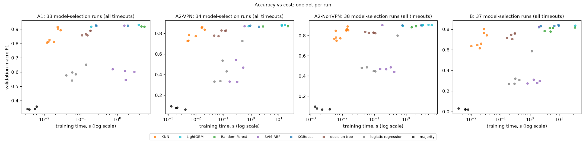

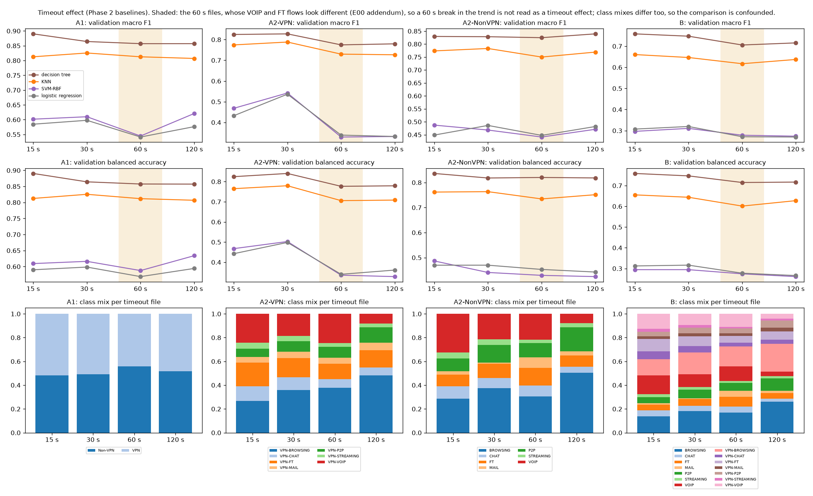

The best scores come from the boosted trees, Random Forest and the tuned SVM, which take longer to
train than KNN and the decision tree (figure above); prediction with the headline models costs
58.8-1,372.9 ms per 1,000 flows (B and A2-VPN).
The timeout comparison uses the Phase 2 baselines, the only models run at all four timeouts. The
class mix changes with the timeout and the 60 s files hold different VOIP and FT flows (Section
2), so the comparison is confounded and is not read as a timeout effect.

## 5.9 Every pre-stated hypothesis

Each experiment stated its hypotheses and numeric thresholds before it ran; the verdicts, read from
the generated threshold checks:

| experiment | supported | not supported |
|---|---|---|
| E01 | single check | none |
| E02 | a, b, c | d |
| E03 | a_knn, a_logreg, a_svm_rbf, b, c_logreg, c_svm_rbf, d | e |
| E04 | a, b | none |
| E05 | a, b | none |
| E06 | a, b | none |
| E07 | a, c | b |
| E08 | b, c | a |
| E09 | a | b, c |
| E10 | c | a, b |
| E12 | b, c | a |
| E13 | a, b, c | none |
| E14 | a, b | c |
| E15 | a, b, c | none |
| E16 | a, b, c, d | none |
| E17 | a, b, c | none |

## 5.10 Using a final model

`scripts/predict.py` checks a flow file against the model's feature list (names, order, numeric
and finite values) and writes, per flow, the predicted label, its confidence and the three
features that pushed the model most towards that label. A malformed file stops with an error and
exit code 2. The first 8 rows of its output for the task B sample file, from
`uv run python scripts/predict.py --task B --input app/samples/B_test_sample.csv --output
predictions.csv`:

| row | label | true_label | confidence | top_feature_1 | top_feature_2 | top_feature_3 |
|---|---|---|---|---|---|---|
| 1 | MAIL | MAIL | 0.9879 | flowBytesPerSecond (+3.048) | max_biat (+1.391) | min_flowiat (+1.088) |
| 2 | VOIP | VOIP | 0.9998 | duration (+3.221) | min_biat (+0.953) | flowBytesPerSecond (+0.756) |
| 3 | VOIP | VOIP | 0.9998 | duration (+3.220) | min_biat (+0.989) | flowBytesPerSecond (+0.760) |
| 4 | VOIP | VOIP | 1.0 | duration (+3.751) | std_biat (+1.102) | max_flowiat (+0.877) |
| 5 | VOIP | VOIP | 0.9995 | duration (+3.618) | mean_flowiat (+0.849) | max_flowiat (+0.743) |
| 6 | VOIP | VOIP | 1.0 | duration (+3.528) | std_biat (+1.169) | std_fiat (+0.747) |
| 7 | VPN-FT | VPN-CHAT | 0.7308 | flowPktsPerSecond (+0.375) | mean_fiat (+0.346) | flowBytesPerSecond (+0.306) |
| 8 | VPN-FT | VPN-FT | 0.7385 | max_flowiat (+0.977) | min_flowiat (+0.556) | min_fiat (+0.353) |

## 5.11 The demo

`app/demo.py` is a one-page Streamlit [23] app built only on `models/final/` and the code above
(`blindspy.predict` for the labels and confidences, `blindspy.explain` for the SHAP values); it
trains nothing. The user chooses a task, picks one of five sample files in `app/samples/` (20
test rows per task, written by `scripts/make_samples.py`, and one malformed file with a renamed
column) or uploads a CSV, and gets a table of predictions with their confidence. Clicking a row
shows the 10 features that pushed the model most towards its label, with each feature's value and
unit; `-1` is shown as "not measurable" (Section 2.5). A malformed file is rejected with the same
message as `scripts/predict.py`. The page is tested headless (`tests/test_demo.py`); the
screenshots come from `scripts/demo_screenshots.py`.

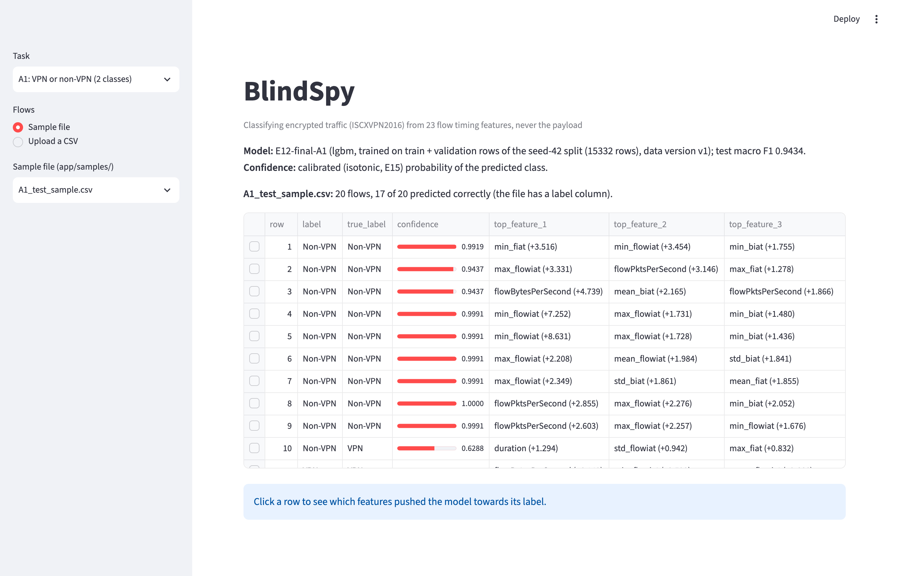

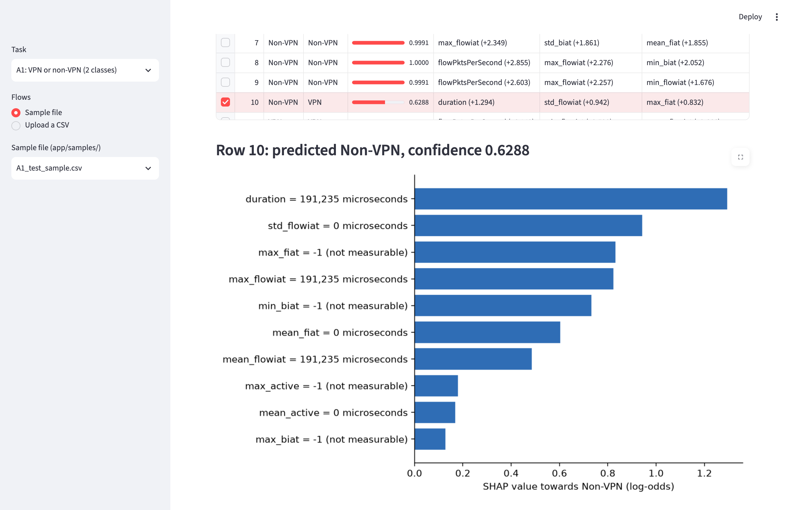

Row 10 is one of the three wrong predictions in the A1 sample (17 of 20 correct). It is a
two-packet flow (10.46 packets per second over 191,235 microseconds): its whole duration is one
gap, and its forward and backward gaps are not measurable (`-1`: fewer than two packets in each
direction). Its confidence, 0.6288, is the second lowest in the file; the lowest, 0.6267 (row 15),
is also a wrong prediction. Section 4.3 showed that near-empty flows like this often share their
features with flows of another label, so timing features alone cannot always separate them.
