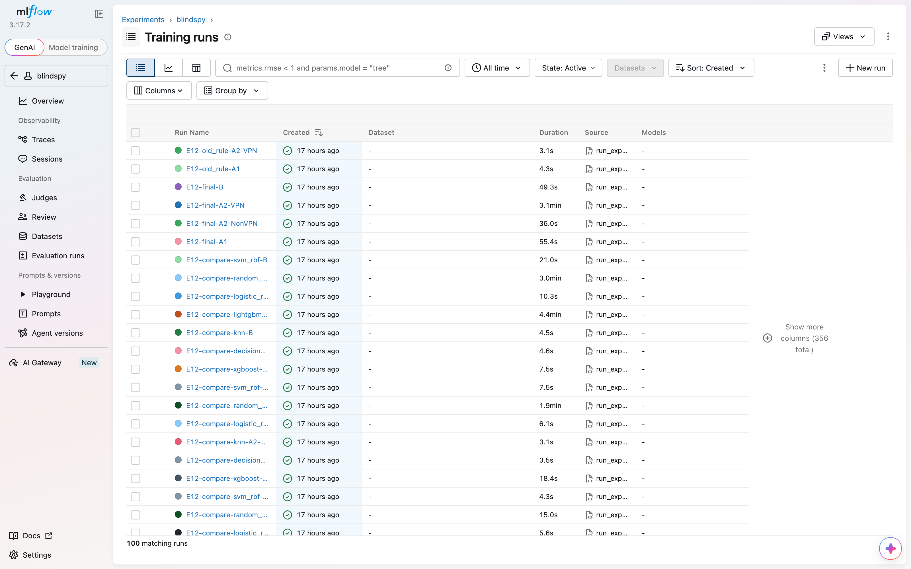
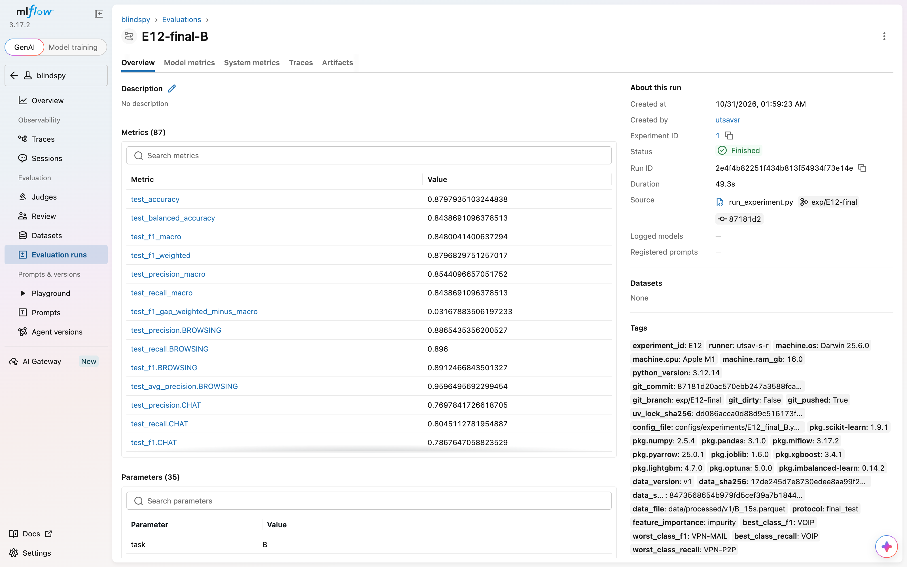

# Appendix

*Working draft. These markdown drafts are the master copy of the report; the full report (DOCX and
PDF) is assembled from them at each milestone. This appendix is built by `scripts/build_report.py`:
the tag table is read from git, and sections A.3-A.5 insert the repository files named there in
full, as they are at the commit the report is built from.*

## A.1 Repository and tags

The repository is https://github.com/Varun-U-Pratap/BlindSpy (branch `main` at hand-in). The
results come from tag `v1.0-final` (https://github.com/Varun-U-Pratap/BlindSpy/tree/v1.0-final);
the hand-in tag `v1.0.1-final` (https://github.com/Varun-U-Pratap/BlindSpy/tree/v1.0.1-final) is
placed on the last commit of the hand-in, which holds this report, the README for markers, the
demo and its video, and changes no result. Tags at the time this report was built:

{{git tags}}

Every official run records the commit it came from, and the tracking code refuses an official
run from uncommitted or unpushed code (Section 3.6), so each number in this report can be traced
to a configuration file, an MLflow run and a commit.

## A.2 MLflow screenshots

The official MLflow store holds all 2,013 runs (A.5). Below: the run list of the `blindspy`
experiment (newest first: the 30 E12 runs), and one final run, E12-final-B, with its test metrics
and the tags every run carries (runner, machine, commit, uncommitted-changes and pushed flags,
lock-file hash, package versions, data version and data hashes). The demo is shown in Section
5.11.

## A.3 Data changelog

The full `reports/DATA_CHANGELOG.md`:

{{include reports/DATA_CHANGELOG.md}}

## A.4 Experiment log

The full `reports/EXPERIMENT_LOG.md`, generated by `scripts/export_history.py` from the one file
per experiment in `reports/experiments/utsav-s-r/` (newest experiment first; failures, corrections
and rechecks included as they were written):

{{include reports/EXPERIMENT_LOG.md}}

## A.5 Every run

{{include reports/appendix_runs.md}}

The full history, every parameter, metric and tag of each of these runs, is in
`reports/history.csv` (2,013 rows, 463 columns); every text file saved with a run is in
`reports/run_artifacts_text.tar.gz`, listed in `reports/run_artifacts_index.csv`.
