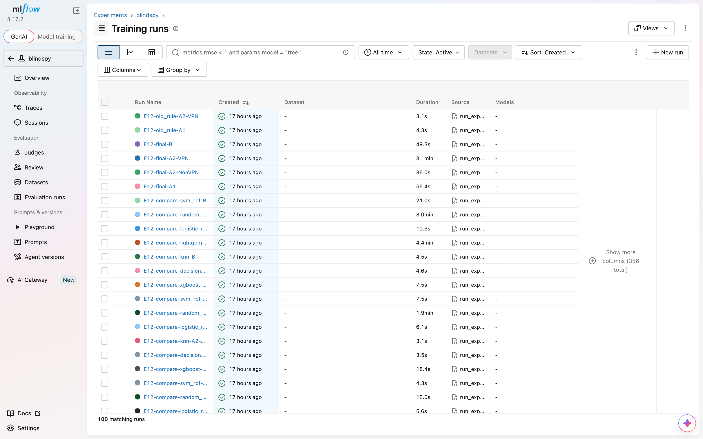
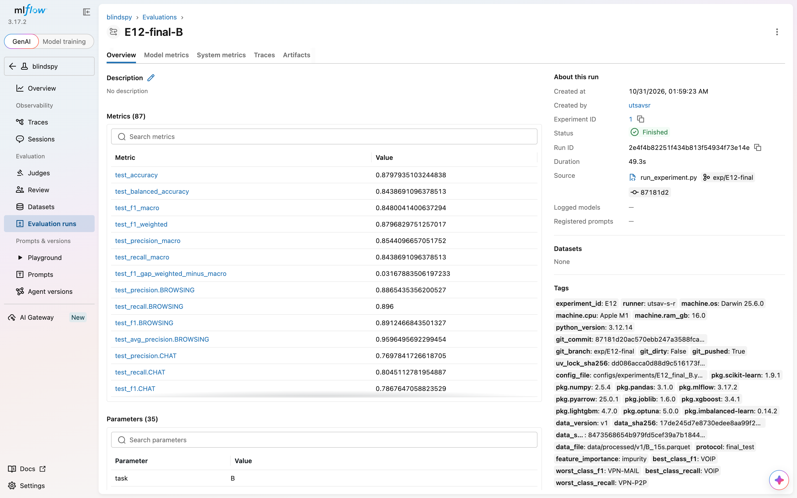

# Appendix

## A.1 Repository

The code, configurations, experiment notes and results are at
https://github.com/Varun-U-Pratap/BlindSpy.

## A.2 MLflow screenshots

The official MLflow store holds all 2,015 runs (A.5). Below, as captured on 31 Oct (before E18):
the run list of the `blindspy` experiment (newest first: the 30 E12 runs), and one final run, E12-final-B, with its test metrics
and the tags every run carries (runner, machine, code version, lock-file hash, package versions,
data version and data hashes). The demo is shown in Section 5.11.

## A.3 Data changelog

{{include reports/report/drafts_standalone/appendix_DATA_CHANGELOG.md}}

## A.4 Experiment log

The full experiment log, one entry per experiment (newest experiment first; failures, corrections
and rechecks included as they were written):

{{include reports/report/drafts_standalone/appendix_EXPERIMENT_LOG.md}}

## A.5 Every run

{{include reports/report/drafts_standalone/appendix_runs.md}}

Every parameter, metric and tag of each of these runs, and every text file saved with a run, are
kept with the project's files.
